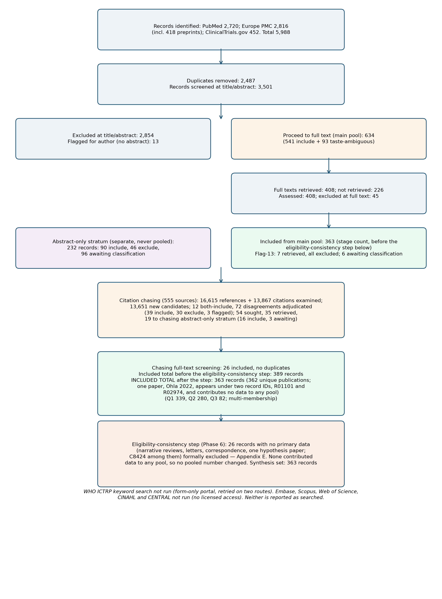
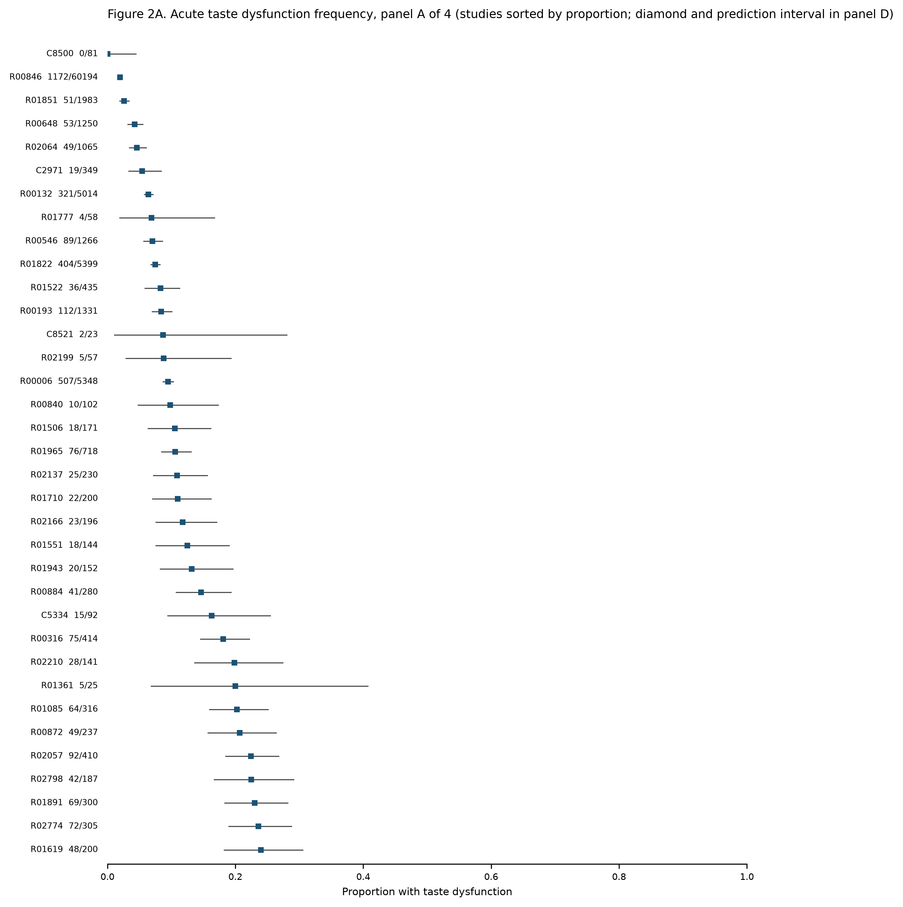
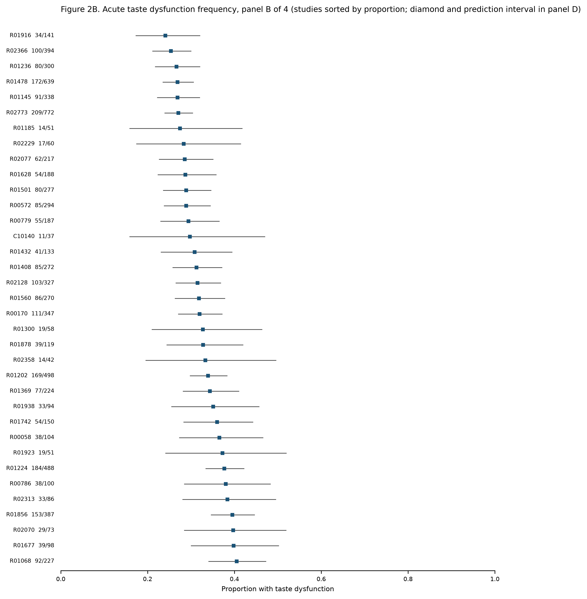
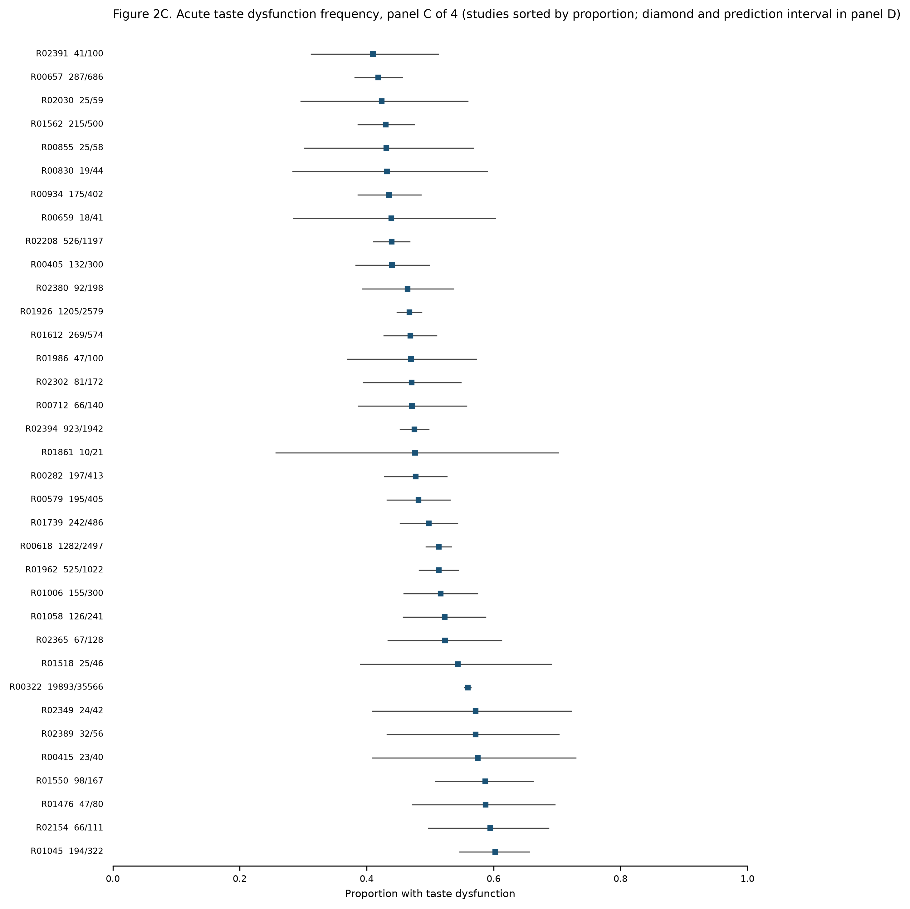
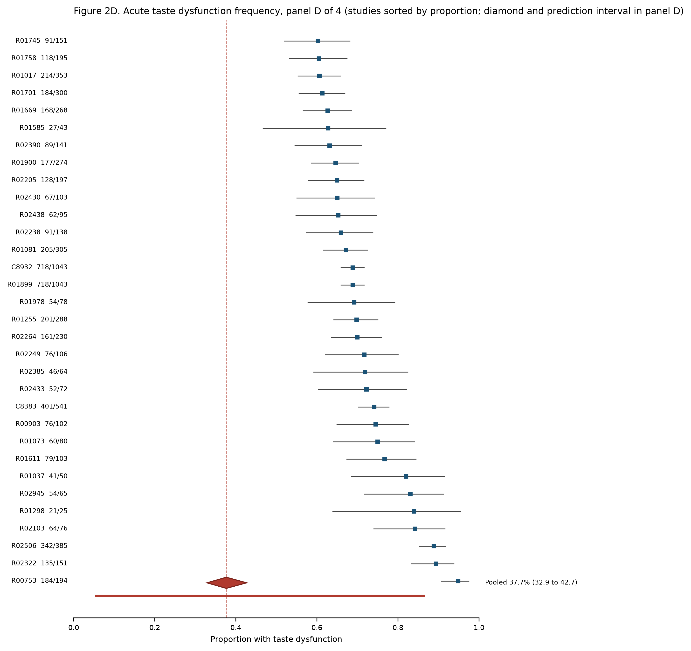
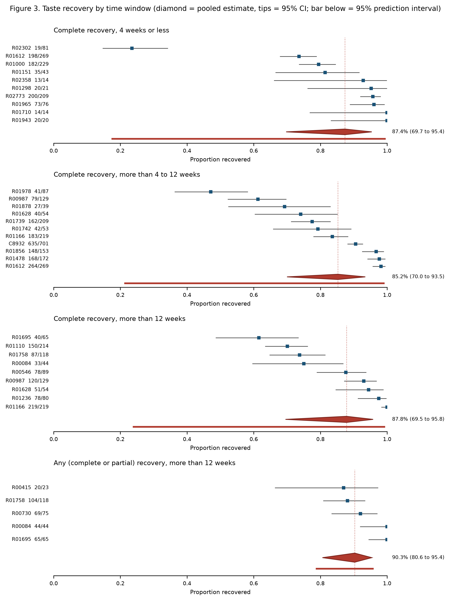
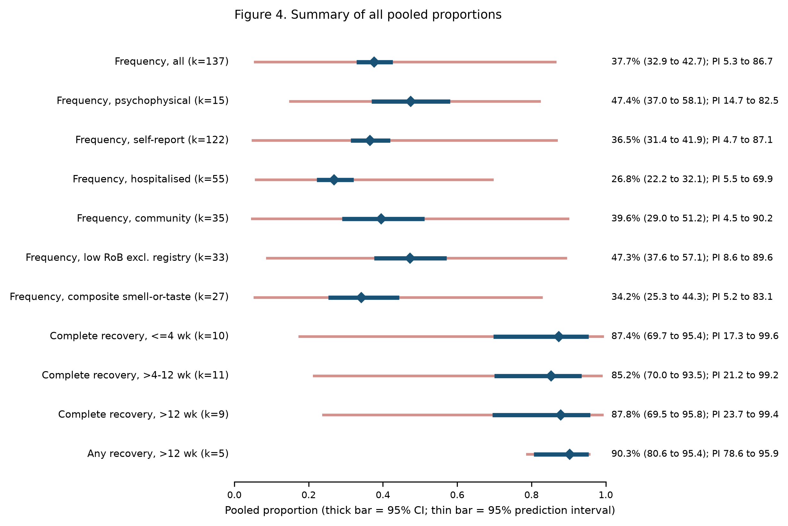

# Loss of taste in possible viral infection: etiologies, pathogenesis, and the evidence for treatments

## A Cochrane-level systematic review and meta-analysis where poolable

**Raphael Malikian, rtmalikian@gmail.com** — Palmdale, CA, USA. ORCID 0009-0008-4326-4205
Independent researcher. This review is written from a family medicine perspective: the questions are the ones a family physician faces when a patient reports that food has lost its taste during or after a viral illness, and asks what caused it, how long it will last, and whether anything can be done.

Version 1.0, 21 November 2026. This review follows Cochrane Handbook methods (version 6.5, 2024) and reports to PRISMA 2020 and PRISMA-S. It is a Cochrane-level review. It is not a Cochrane review and has not been submitted to Cochrane.

**Registration.** A protocol was locked on 20 November 2026, before screening, and a PROSPERO-ready form was prepared from it the same day. The review is not registered: no PROSPERO registration number exists, and none is claimed. The protocol, search log, screening files, extraction sheets, risk of bias files and analysis code are held with the review files and will be deposited with the manuscript.

**Funding.** None. **Conflicts of interest.** None. The author has no industry affiliation and received no support from any maker of a treatment assessed in this review.

---

## Abstract

**Background.** Loss or distortion of taste is a recognised accompaniment of viral infections - in the author's training and practice, of upper respiratory infections - and was reported very widely during the COVID-19 pandemic. Patients ask which infections do this, what is happening in the body, and whether treatment helps. Most early syntheses pooled smell and taste together and counted frequency only.

**Objectives.** For new-onset taste dysfunction attributed to a confirmed, probable or possible viral infection: (Q1) which viruses are associated, with what frequency, timing and recovery; (Q2) which pathogenesis mechanisms have been proposed, and how direct the evidence for each is; (Q3) what interventions have been studied, with what effects, doses, harms and special-population considerations.

**Search methods.** PubMed, Europe PMC (including its preprint index) and ClinicalTrials.gov were searched in full on 20 November 2026, with no date limit. The WHO ICTRP keyword search could not be run (form-only portal; logged as not run), and Embase, Scopus, Web of Science, CINAHL and Cochrane CENTRAL were not run (no licensed access); their ready strings are printed in an appendix, marked as not run. Citation chasing covered all studies included at that point and all competing reviews; studies chasing added were not then chased.

**Selection criteria.** Human studies of any design with a denominator, and case series of 10 or more, reporting taste separately or extractably from smell, in people with taste dysfunction attributed to a viral infection. Mechanistic human studies and an animal and in-vitro stratum informed Q2; any intervention started for the dysfunction informed Q3. Case reports of fewer than 10, narrative reviews, editorials and letters without original data were excluded from synthesis. Unretrieved records form an abstract-only stratum, never pooled and with no GRADE contribution.

**Data collection and analysis.** A team of large language model roles screened, extracted and assessed risk of bias in duplicate under the author's accountability, with every disagreement adjudicated by reading (title and abstract agreement 0.890, kappa 0.618). Proportions were pooled on the logit scale with random effects (REML, Hartung-Knapp), Q-based I squared and 95% prediction intervals. Certainty was rated with GRADE; risk of bias used RoB 2, ROBINS-I and JBI checklists.

**Main results.** The search retrieved 5,988 records; 3,501 were screened, and 363 were included after full-text assessment, citation chasing and a final eligibility-consistency step, representing 362 unique publications (one paper, Ohla 2022, appears under two record IDs, R01101 and R02974; neither contributed data to any pool). At the final step, 26 records with no primary data (narrative reviews, letters and one hypothesis paper; the class includes C8424) were formally excluded under the locked eligibility for primary studies and are listed in Appendix E; none had contributed data to any pool, so no pooled number changed. Every pooled study concerns SARS-CoV-2: in the searches run and the records retrieved and classified, no study of influenza or any other named virus mapped to any pool, so the quantitative answer to the general viral question is, in substance, a COVID-19 answer. Acute taste dysfunction (taste-specific, SARS-CoV-2) pooled at 37.7% (95% CI 32.9 to 42.7; 137 studies, 155,010 participants), with I squared 99.5% and a 95% prediction interval of 5.3 to 86.7%. By ascertainment: 47.4% (psychophysical testing, 15 studies) and 36.5% (self-report, 122 studies); by setting: 26.8% (hospitalised, 55) and 39.6% (community, 35); no interaction test was performed and no subgroup difference is established. Complete recovery pooled at 87.4% within 4 weeks, 85.2% at more than 4 to 12 weeks, and 87.8% beyond 12 weeks, each from a different study set, with near-scale-wide prediction intervals. Any recovery beyond 12 weeks pooled at 90.3% (5 studies). No study reported any recovery separably in the more-than-4-to-12-week window; that cell is empty. Any recovery within 4 weeks rests on a single study (63 of 81, 77.8%). For pathogenesis, all 214 studies carrying a mechanism code concern SARS-CoV-2, and 73.4% were graded speculative (proposed in discussion, not measured). Only 15 carried direct human evidence. The largest raw direct-human count belongs to the residual 'other mechanisms' category (5 studies, five unrelated tests). On coherence grounds the best-supported theories are systemic or local inflammation, olfactory-mediated misattribution, direct infection of taste tissue, and central gustatory pathway involvement; direct infection has one null direct study among three and no demonstration of infection of human taste buds in vivo, and the central theory rests on one genuinely direct imaging study. Six of the eleven pre-specified theories have no direct human evidence for their own mechanism. For treatments, only 23 studies tested an intervention and 8 had any comparator; 2 randomised trials reported a taste-outcome estimate, and a third (zinc) reported only a composite smell-and-taste outcome. Oral prednisolone may result in little to no difference in gustatory scores in the one low-risk-of-bias trial (low certainty). Photobiomodulation, tested in people with taste loss of at least 4 weeks, showed a large complete-restoration proportion in one 36-participant trial at some concerns of bias, which did not report adverse events. Zinc has no taste-specific effect estimate anywhere. Adverse events were reported in only 6 of the 23 treatment studies. GRADE certainty was very low for frequency, complete recovery at every window, time to recovery, the zinc composite outcome and all harms outcomes; low for any recovery beyond 12 weeks, prednisolone and photobiomodulation; and no evidence for several pre-specified cells.

**Limitations.** Five databases and the WHO ICTRP keyword search were not run; 245 reports were never retrieved in full text and 99 records remain awaiting classification; and all pooled evidence concerns SARS-CoV-2.

**Authors' conclusions.** On the evidence that can be pooled, this is a SARS-CoV-2 literature: taste dysfunction is common, usually recovering, and no more precise than the wide prediction intervals allow. The pathogenesis literature mostly proposes mechanisms rather than testing them. The treatment literature cannot support a recommendation for or against any intervention, and none has the comparative evidence a follow-on meta-analysis would need. Useful next studies are an adequately powered photobiomodulation trial with taste-specific outcomes, standardised recovery outcomes, and any eligible study of a non-SARS-CoV-2 virus.

## Plain language summary

When people catch a virus, some find that food loses its taste, or tastes strange. This happened to very large numbers of people during the COVID-19 pandemic. This review searched three large databases and a trials register for studies that measured taste loss on its own (separate from smell), and asked: how often does it happen, how long does it last, what might cause it inside the body, and do any treatments work? Five other databases could not be searched, so 'every study it could find' means every study those searches found.

The review included 363 records. Of them, 360 were about COVID-19, 3 were about an unspecified possible virus, and none was about flu or any other named virus, so everything that follows is about COVID-19. Twenty-six records that turned out to be summary articles, letters or an idea paper with no original data of their own were removed from the list at a final check, because the review's rules only allow studies with their own data; they are listed in the review's appendix of excluded studies, and none of them contributed to any result. One paper also appears twice in the list under two record numbers; it too contributed no results.

About 38 in every 100 people with COVID-19 in these studies had taste problems early in the illness, but in a new setting the true figure could plausibly be anywhere from about 5 in 100 to about 87 in 100. Studies that tested taste with standard taste tests reported a higher average rate (about 47 in 100) than studies that simply asked people (about 37 in 100); the review did not run the test that would show whether that gap is real, so the two figures are reported side by side, not as a proven difference. Most people's taste came back fully: at each check point studied, from within a few weeks to beyond three months, roughly 85 to 88 in every 100 had recovered completely. Those check points come from different groups of studies, not from following the same people over time, and the certainty in them is very low: in a new group, the recovered share could be much lower or higher.

Scientists have proposed many explanations, from the virus infecting taste buds directly, to inflammation, to people mistaking loss of smell (which carries much of what we call flavour) for loss of taste. This review found that most papers proposed an explanation without testing it. The explanations with the most direct testing behind them are the smell one, inflammation, and the virus infecting taste tissue directly: in several studies, people who said they had lost taste scored normally on taste tests, and a few studies measured inflammation markers or examined tissue. One brain-imaging study also directly tested the idea that the brain's own taste pathways are involved. All of this explanation evidence is about COVID-19 only. Six of the eleven explanations the review looked for have no direct test in people at all.

For treatments, the cupboard is nearly bare. Only 23 studies tested any treatment. Only two proper randomised trials reported a result for taste itself; a third randomised trial, of zinc, measured smell and taste together. A steroid tablet (prednisolone) did not improve taste scores in the best-run trial, though the certainty in that result is low. A light treatment applied to the tongue (photobiomodulation), tested in people whose taste loss had lasted at least 4 weeks, produced a large recovery figure in one small trial of 36 people, but one small trial is not enough to rely on, and that trial did not report side effects. Zinc, often suggested, has never been tested in a way that measures taste on its own. Side effects of treatments were reported in only 6 of the 23 treatment studies, so this review cannot say which treatments are safe, only that safety was mostly not reported.

This review makes no recommendation for or against any treatment. What it can say is how often taste loss happens, that it usually gets better on its own, and where the gaps are that future studies need to fill.

## Summary of findings

Population: people with new-onset taste dysfunction attributed to a confirmed, probable or possible viral infection. All evidence in every row is SARS-CoV-2; no other virus contributed data to any row. The downgrade reasoning for each row is given in the GRADE footnotes following the tables and summarised in the Results; the full certainty assessments are held with the review files. Abstract-only records contribute to no row.

### Table 1. Frequency and recovery (Q1, taste-specific)

| Outcome | Studies (k) | Participants | Effect | Certainty (GRADE) |
|---|---|---|---|---|
| Acute taste dysfunction frequency | 137 | 155,010 (crude 38,607 events, 24.9%) | Pooled 37.7% (95% CI 32.9 to 42.7); I squared 99.5%; tau squared 1.44; Q 29,068.7 (df 136); 95% prediction interval 5.3 to 86.7% | Very low |
| Frequency, psychophysical testing subgroup | 15 | 2,355 (crude 1,123 events, 47.7%) | Pooled 47.4% (37.0 to 58.1); I squared 93.8%; tau squared 0.55; Q 227.2 (df 14); prediction interval 14.7 to 82.5% | Very low (parent body rating; not separately assessed) |
| Frequency, self-report subgroup | 122 | 152,655 (crude 37,484 events, 24.6%) | Pooled 36.5% (31.4 to 41.9); I squared 99.6%; tau squared 1.53; Q 28,788.9 (df 121); prediction interval 4.7 to 87.1% | Very low (parent body rating; not separately assessed) |
| Frequency, hospitalised subgroup | 55 | 25,150 (crude 4,324 events, 17.2%) | Pooled 26.8% (22.2 to 32.1); I squared 98.3%; tau squared 0.83; Q 3,228.5 (df 54); prediction interval 5.5 to 69.9% | Very low (parent body rating; not separately assessed) |
| Frequency, community subgroup | 35 | 18,742 (crude 6,120 events, 32.7%) | Pooled 39.6% (29.0 to 51.2); I squared 99.0%; tau squared 1.63; Q 3,331.1 (df 34); prediction interval 4.5 to 90.2% | Very low (parent body rating; not separately assessed) |
| Frequency, low risk of bias sensitivity | 34 | 72,123 (crude 6,564 events, 9.1%) | Pooled 44.4% (33.8 to 55.6); I squared 99.7%; tau squared 1.61; Q 13,050.9 (df 33); prediction interval 5.5 to 91.7% | Very low (parent body rating; not separately assessed) |
| Frequency, low risk of bias sensitivity, excluding the 60,194-participant registry | 33 | 11,929 (crude 5,392 events, 45.2%) | Pooled 47.3% (37.6 to 57.1); I squared 98.0%; tau squared 1.19; Q 1,565.6 (df 32); prediction interval 8.6 to 89.6% | Very low (parent body rating; not separately assessed) |
| Complete taste recovery, 4 weeks or less | 10 | 976 (774 events; crude 79.3%) | Pooled 87.4% (69.7 to 95.4); I squared 93.5%; tau squared 2.06; Q 137.6 (df 9); prediction interval 17.3 to 99.6% | Very low |
| Complete taste recovery, more than 4 to 12 weeks | 11 | 2,085 (1,789 events; crude 85.8%) | Pooled 85.2% (70.0 to 93.5); I squared 95.0%; tau squared 1.67; Q 200.3 (df 10); prediction interval 21.2 to 99.2% | Very low |
| Complete taste recovery, more than 12 weeks | 9 | 1,012 (856 events; crude 84.6%) | Pooled 87.8% (69.5 to 95.8); I squared 88.1%; tau squared 1.52; Q 67.4 (df 8); prediction interval 23.7 to 99.4% | Very low |
| Any (complete or partial) taste recovery, more than 12 weeks | 5 | 325 (302 events; crude 92.9%) | Pooled 90.3% (80.6 to 95.4); I squared 44.1%; tau squared 0.0013 (a boundary estimate from five studies; the prediction interval rests on 3 degrees of freedom and is itself fragile); Q 7.2 (df 4) | Low |
| Any taste recovery, more than 4 to 12 weeks | 0 | None | No evidence. No study reported this outcome separably. The cell is empty and was not filled | Not rated |
| Any taste recovery, 4 weeks or less | 1 (not pooled) | 81 | 63 of 81 (77.8%) at day 20, as printed (single study, R02302, high risk of bias; rated very low on that basis) | Very low |
| Time to recovery | 118 records with a duration field; narrative only | Not pooled | No pooled estimate. Taste-specific medians as printed include 9, 12 and 14 days; forms are incompatible (means and medians among recoverers, Kaplan-Meier estimates, duration bands, composite smell-and-taste durations) | Very low |

### Table 2. Treatments (Q3) and harms

| Intervention and outcome | Studies | Participants | Effect (as printed) | Certainty (GRADE) |
|---|---|---|---|---|
| Prednisolone 40 mg per day for 10 days plus olfactory training, versus placebo plus olfactory training: gustatory function at 12 weeks | 1 randomised trial | 115 randomised | Taste Strip Test median 11 (IQR 9 to 13) versus 11 (9.3 to 13); difference 0.00 (95% CI -1.00 to 1.00), p = 0.50. Taste visual analogue difference 0.1 (-1.00 to 1.3), p = 0.80. No recovery proportion reported | Low |
| Prednisolone: complete or any taste recovery | 1 randomised trial | 115 | Not reported in the trial | No evidence |
| Photobiomodulation, single-session diode laser to the tongue, versus placebo light: complete taste restoration at 1 month | 1 randomised trial | 36 (18 versus 18) | Laser 17 of 18 (94.4%) complete restoration, p less than 0.001 versus placebo; the placebo complete-restoration count is not printed (placebo partial restoration 7 of 18, 38.9%, is printed). Dose as settled: 940 nm, 1 W, 4 J per cm squared, 6 minutes (the abstract conclusion states 810 nm; discrepancy as printed) | Low |
| Zinc sulfate 220 mg twice daily versus no zinc: taste-specific effect | 1 randomised trial | 105 | No taste-specific estimate exists. The printed durations of 7 versus 18 days are smell recovery only | No evidence |
| Zinc: composite gustatory and/or olfactory recovery duration | 1 randomised trial | 105 | Median duration significantly shorter with zinc, p less than 0.001; no composite medians, effect size or interval printed | Very low |
| Cerebrolysin plus training versus training only: any outcome | 1 randomised trial, no results posted (R03352, NCT06208540) | 160 enrolled | No effect estimate and no harms data | No evidence |
| All other interventions (steroid combinations and bundles, stellate ganglion block, olfactory or gustatory training, multi-component protocols, coffee, turmeric, pregabalin, others) | 19 of the 23 treatment studies | Various | No randomised or otherwise poolable effect estimate for any; evidence is uncontrolled pre-post, single-arm, single-case or exposure-descriptive only, and was never pooled with the trials | Not rated as effect evidence |
| Any adverse event (across the 23 treatment studies) | 6 of 23 report any adverse event content; 17 of 23 do not report harms | See text | In the prednisolone trial, mild side effects in 9 of 58 (15.5%) versus 5 of 57 (8.8%) on placebo. In one observational multi-drug study, 55 of 483 medication users (11.4%) reported adverse events | Very low |
| Serious adverse events | Reported in 2 of 23 studies | 115; 483 medication users | Prednisolone trial: no serious adverse events. Observational study: 4 subjects (0.8%) had cardiac arrhythmia; no other severe adverse events reported | Very low |
| Discontinuation due to adverse events | Reported in 1 of 23 studies | 115 | 3 participants stopped treatment because of side effects: 2 on placebo, 1 on prednisolone | Very low |

**GRADE footnotes (downgrades applied).** (a) Risk of bias (-1): the majority of studies are moderate or worse on the adjudicated assessments; taste and recovery are predominantly self-reported without validated instruments; for time to recovery, durations are often retrospective recall conditioned on having recovered. (b) Inconsistency (-2 for the pooled proportions; -1 for time to recovery): I squared 88.1 to 99.7% across the proportion pools, and prediction intervals spanning most of the scale; subgroups do not resolve it. Any recovery beyond 12 weeks is the exception (I squared 44.1%, prediction interval 78.6 to 95.9%; no inconsistency downgrade). (c) Indirectness (-1; -2 for time to recovery): all evidence is SARS-CoV-2 against a question about viral infections generally; the frequency body additionally rests mostly on self-reported "taste" liable to olfactory misattribution (only 15 of 137 studies psychophysical); recovery windows pool non-uniform assessment timepoints; time-to-recovery estimands shift across studies and much duration data is composite. (d) Imprecision (-1): recovery pools are small (k 5 to 11; N 325 to 2,085) with intervals 15 to 26 percentage points wide; the tau squared estimates for the complete-recovery pools rest on 9 to 11 studies each and are themselves imprecise, so their prediction intervals carry the same fragility noted for the five-study pool in Table 1; time to recovery has no pooled estimate. (e) Prednisolone: indirectness (-1; cohort sampled on persistent olfactory disorders, gustatory function a secondary outcome, no recovery proportion reported, drug tested as an add-on to olfactory training in both arms) and imprecision (-1; single trial). (f) Photobiomodulation: risk of bias (-1; RoB 2 some concerns for the randomisation process, and the internal wavelength discrepancy) and imprecision (-2; single trial, 36 participants, the headline proportion rests on 17 events in one arm and no comparative interval can be constructed). (g) Zinc composite: risk of bias (-2; RoB 2 high overall), indirectness (-1; a smell-and/or-taste composite in a cohort selected for olfactory dysfunction) and imprecision (-1). (h) Harms: the body starts at low for a cross-intervention observational body and was downgraded for risk of bias and reporting bias (-1; adverse-event content absent in 17 of 23 studies, including three of the four randomised records, and ascertainment unsystematic where present), indirectness (-1; the only multi-user rates concern self-chosen acute-phase drug exposures, not assigned taste treatments) and imprecision (-1; the only comparative safety denominator is 115 randomised participants). Publication bias was not formally assessable for any row and was not downgraded; the harms non-reporting is charged under reporting bias, with publication bias subsumed and not double-counted. No body was upgraded; the large photobiomodulation effect was not upgraded because large-effect upgrading does not apply to a single small randomised trial with risk-of-bias concerns.

Doses in Table 2 are the studied doses as printed in the trials. They are reported descriptively and are not recommended doses.

## Background

### The complaint, as it presents in family medicine

A patient who cannot taste properly rarely uses the words in this review's title. They say food tastes of nothing, or tastes wrong, or that they have stopped enjoying meals. The complaint arrives during a respiratory illness or in the weeks after one, and it arrives with three questions attached: is this the virus, how long will it last, and is there anything you can give me. A family physician answering those questions in 2019 had a thin evidence base: in the author's training and practice, taste disturbance was a recognised accompaniment of upper respiratory infections and a listed effect of many drugs, but it was seldom measured on its own. From 2020 the position inverted. SARS-CoV-2 produced taste complaints on a scale that filled the literature within months, and the problem for the clinician became sorting, not scarcity.

Sorting matters because the word taste covers at least three different things in this literature. True gustation is the detection of sweet, salty, sour, bitter and umami by taste buds on the tongue and elsewhere in the mouth. Flavour is wider: it combines gustation with retronasal smell, texture, temperature and trigeminal sensation, and most of what a patient calls taste at the table is flavour. A study that asks "have you lost your sense of taste" measures a report that mixes the two. A study that puts taste strips or solutions on the tongue measures gustation itself. This review was built around that distinction: a record entered the quantitative synthesis only if taste was reported separately, or could be extracted separately, from smell. Records in which taste was named but only smell was measured were carried through screening under a taste-ambiguous flag and resolved at full text, not quietly counted.

### Etiologies in scope

The locked question covers taste dysfunction attributed to a confirmed, probable or possible viral infection: laboratory-confirmed, clinically diagnosed, or a self-reported viral illness where no non-viral cause is established. Taste dysfunction wholly explained by chemotherapy, radiotherapy, head and neck surgery or trauma, a neurodegenerative disease, or a named drug cause, with no separable viral subgroup, was excluded. In the event, the included evidence answered a narrower question than the one posed. Of the 363 included records, 360 concern SARS-CoV-2 (including variant-qualified records), 3 concern an unspecified possible viral infection, and none concerns influenza or any other named virus alone. That statement is bounded by the searches run and the records retrieved and classified, as the Methods set out. It is a finding, not a framing device, and it governs every conclusion in this review: this review contains no quantitative evidence base for taste loss in influenza to summarise.

### How taste could be lost: the theories the review tested for

The protocol fixed an eleven-item taxonomy of proposed mechanisms before screening, so that the pathogenesis synthesis would test a list rather than assemble one from whatever the retrieved papers happened to mention. The theories were: T1, direct infection or injury of taste bud or taste receptor cells, including viral-entry-factor expression in taste epithelium; T2, injury to sustentacular or supporting cells or the lingual epithelium without direct receptor-cell infection; T3, cranial nerve involvement (VII, IX, X); T4, olfactory-mediated misattribution, in which retronasal flavour loss is reported as taste loss; T5, systemic or local inflammation and cytokine effects on taste bud turnover; T6, salivary gland infection or dysfunction altering the delivery of tastants; T7, micronutrient or zinc pathway disruption; T8, vascular, microthrombotic or hypoxic injury; T9, central gustatory pathway involvement; T10, autoimmune or post-viral immune-mediated injury; and T11, other specified mechanisms. Each included study's mechanism content was coded against this list, with a directness grade: direct-human, indirect-human, animal, in-vitro, speculative (proposed in discussion, not measured), or mixed as stated. The distinction between a mechanism that was measured and a mechanism that was mentioned is the spine of the pathogenesis results. Three cautions belong with the list itself. T4 is not a tissue mechanism: it is a claim about measurement and attribution, about what a symptom report means, and it competes with the tissue theories only at that level. T2's label is imported from the olfactory literature, where 'sustentacular' names a supporting cell of the olfactory epithelium; the source papers use the analogy themselves, and the label is retained as they use it, not as settled taste anatomy. And the taxonomy is partly shaped by the virus that dominates the evidence: T1 is defined around viral-entry-factor expression of the ACE2/TMPRSS2 type, an entry route influenza and most other respiratory viruses do not use, so plausibility rankings built on entry-factor biology cannot be carried across viruses with different receptors and tissue tropism.

### What earlier reviews did, and how this one differs

Taste and smell in COVID-19 were reviewed early and often. The 179 records captured at screening whose titles identify them as reviews, meta-analyses, guidelines or consensus documents were logged as competing reviews; the most directly comparable are the 2020 syntheses of chemosensory dysfunction in COVID-19, including meta-analyses of olfactory and gustatory dysfunction (record R02155), of smell and taste disorders (R02160), of chemosensory dysfunction prevalence (R02195), and of smell and taste dysfunction in Mayo Clinic Proceedings (R02254), a systematic review and meta-analysis of self-reported smell or taste alteration in 3,563 patients (R02303), and narrative and systematic reviews of anosmia and dysgeusia (R02327, R02006). Those reviews share four features that this review was designed to move past. First, they pool smell and taste as a composite, or report them side by side without requiring taste to be separable; this review pools taste-specific data only and keeps the composite in a separate, labelled stratum. Second, they are frequency reviews; none synthesises recovery by time window, pathogenesis by directness of evidence, and treatments with harms in one framework. Third, they are early-pandemic reviews, built before the treatment trials, the psychophysical-testing cohorts and the long follow-up studies existed. Fourth, none applies GRADE per critical outcome with a summary of findings that includes empty cells. Three later captured syntheses are closer to this review and are differentiated separately. The 2023 systematic review and meta-analysis of taste loss as a distinct symptom of COVID-19 (R00428) is the only earlier synthesis to isolate taste as this review does, but it is a frequency synthesis: it does not address recovery by window, pathogenesis or treatments, and its record in the captured set carries both a retraction-and-replacement (R00427) and an expression of concern (R00535). The 2022 BMJ meta-analysis of prognosis and persistence (R00924) models recovery of smell and taste dysfunction jointly, as a composite, where this review pools taste-specific recovery by window. The 2025 systematic review of photobiomodulation for persistent olfactory and gustatory dysfunction (R00152) is a single-intervention review of a composite outcome; this review's treatment synthesis covers all interventions on taste-specific outcomes, and reaches a different structural conclusion about the same trial (see Discussion). The remaining captured reviews and guidelines were not differentiated individually by name; instead every captured record is accounted for in a tiered differentiation log deposited with the review (Tier 1: the records differentiated by name here; Tier 2: 47 records from the chemosensory-synthesis literature pooling composite outcomes; Tier 3: 110 guidelines, consensus documents, narrative reviews and adjacent-question syntheses, background only; 3 records logged as not relevant, their titles showing a different clinical question; and 7 records that are single-patient case reports rather than syntheses), each with its disposition and the reason read from its title and type as captured at screening, as declared in the Methods (Difference 11). Narrative pathogenesis pieces in the captured set, such as the long-COVID pathogenesis discussion retained from the flagged records (R01505), propose mechanisms without primary data; this review codes such proposals as speculative wherever they appear, including in its own included set. Where this review's frequency estimate can be compared with the earlier composite reviews, the comparison is made on scope in the Discussion; their pooled numbers are not re-quoted here, because the outcomes they pooled are not the outcome this review pooled.

### Why an LLM team review

A Cochrane review is team work: an information specialist, two screeners working apart, adjudicators, two extractors, risk of bias assessors, a statistician, a GRADE assessor and editors. This review has one human author. It used a team of large language model (LLM) roles in place of that team, with the separations the human team would have: screeners who did not see each other's calls, extractors whose sheets were compared field by field and settled by a third reading, risk of bias passes that disagreed in the open and were adjudicated by reading, and an accountable human author who set the question, made the flagged decisions, and signs the result. The 2025 RAISE statement from Cochrane, the Campbell Collaboration, JBI and the Collaboration for Environmental Evidence sets the terms for this: state the tool, the purpose and the checks. This review reports the team's agreement numbers as results, in the Methods and in the team disclosure, so that a reader can judge the substitute team on its numbers rather than on its description.

## Objectives

To assess, in people with new-onset taste dysfunction attributed to a confirmed, probable or possible viral infection:

- Q1: which viral infections are associated with the dysfunction, and the reported frequency, timing, duration and recovery of the dysfunction;
- Q2: which pathogenesis mechanisms are proposed for it, and the directness and quality of the evidence for each mechanism; and
- Q3: the effects of interventions studied for it, on recovery and on taste scores, together with the studied doses and courses, harms, and special-population considerations;

and to report how a team of LLM roles performed the team tasks of a Cochrane-level review under human accountability.

## Methods

### Differences between protocol and review

This section opens the Methods as a conscious structural choice: every departure from the locked protocol is declared before the methods that embody it are described, so that no departure is discoverable only by comparing the two documents.

Thirteen differences are declared. First, the protocol named a PROSPERO-ready form to be prepared before screening; it was prepared and the protocol locked on 20 November 2026, but no PROSPERO registration number had been issued when the analysis was run, and none is claimed anywhere in this review. Second, WHO ICTRP was named as a source; its keyword search could not be run automatically (the portal's search is a form-only interface; three attempts by two routes are logged), and it is reported as not run, with a ready string in the search log for a manual author run. Third, after full-text retrieval, the author approved a dated amendment (20 November 2026) under which records that could not be retrieved in full text could contribute abstract-stated information only, as a separate abstract-only stratum: never pooled, risk of bias not assessable, no contribution to primary GRADE ratings. The amendment, its safeguards, and the author's blanket permission for legitimate-route downloading are recorded in the protocol and the team log. Fourth, the protocol required interaction tests for any subgroup claim; the analysis files report subgroup pooled estimates but no interaction test, so this review presents subgroup estimates descriptively and claims no established subgroup difference. Fifth, the protocol named the Hartung-Knapp adjustment and prediction intervals; both are reported, and the I squared statistic is the Q-based definition, (Q minus degrees of freedom) divided by Q, named here because a tau-squared-based I squared would differ materially in one pool (any recovery beyond 12 weeks: Q-based 44.1%, tau-squared-based about 0.4%). Sixth, at a final eligibility-consistency step taken after the first full draft and its pre-submission peer review, 26 records whose settled designs are narrative reviews, letters, correspondence or a hypothesis paper with no primary data (C8424, a narrative review verified at extraction settlement, among them) were formally excluded from the included set, because the locked eligibility admits primary studies only - the same standard applied at full-text screening, where commentaries, editorials and letters with no original data were excluded, and in the resolution of the author-flagged records. The 26 are listed in Appendix E with the reason 'no original primary data - narrative review / secondary source; used for citation chasing and Background differentiation only'. None of the 26 contributed data to any pool, the treatment table or any GRADE rating, so no pooled number, rating or verdict changed; the counts restated are the included total (363 records, 362 unique publications), the question memberships and the pathogenesis coding counts, each identified where it appears. The earlier draft's handling of this class (one record flagged and excluded from synthesis counts, the other 25 retained in the denominator) is superseded by this step and recorded in the team log. The boundary case is R02464, a correspondence that reports preliminary primary results of an ongoing multicentre study: primary data exists in it (a composite outcome only), so it is retained; a record enters the excluded class only where no primary data exists at all. Seventh, nine of the 26 records excluded under the sixth difference carried pathogenesis theory codes (26 code assignments among them: six narrative or bibliographic reviews, one hypothesis paper and two letters). Their exclusion restates the pathogenesis counts from 223 coded studies and 409 assignments to 214 studies and 383 assignments (speculative 157 of 214, 73.4%); every direct-human count in Table 3 is unchanged and no theory verdict changes. The counts in the Q2 Results are the restated counts. Eighth, the directness grading uses a sixth grade, mixed as stated (13 studies, 36 assignments, after the eligibility-consistency exclusion), for studies whose papers state more than one evidence type without a separable split; the protocol named five grades. The mixed grade is reported as its own column and never silently allocated. Ninth, the subgroup and sensitivity analyses reported are not the protocol's pre-specified sets. The protocol named subgroups by virus, confirmation method, duration at enrolment, age and treatment class; the analysis set's coded variables supported ascertainment and setting subgroups, which are what is reported. Virus was constant in the event (all SARS-CoV-2), and the confirmation, duration, age, variant or era, and treatment-class subgroups were not run; neither were three locked sensitivity analyses (excluding preprints, excluding taste-ambiguous records reclassified as olfaction-only, and excluding case series and uncontrolled designs), the recovery-by-ascertainment subgroup (ascertainment was not carried as a separable variable in the recovery analysis set), nor exclusion sensitivities for the R01110 timepoint choice, the retained overlapping cohorts, or the derived-numerator studies. The high-risk-of-bias sensitivity and the registry-exclusion variant were run and are reported. Three features whose exclusion sensitivities were not run are nonetheless retained, for stated reasons: the R01110 record enters its pool under the pre-stated latest-timepoint rule and its non-monotonic values are flagged in the Results; the overlapping cohorts are handled one record per cohort per pool, so no linked report of the same cohort contributes twice to any pool (same-centre cohorts with overlapping periods that are not linked reports are retained as separate studies, and any partial participant overlap between them is unquantified in the source files); and each derived numerator is the unique integer consistent with the printed percentage and denominator, flagged in the pool logs. The unrun preprint-exclusion sensitivity would have removed 22 records (6.1% of the 363 included), counted from the preprint DOI, journal and source fields as recorded; the size of the unrun sensitivity is stated here even though it was not run. Tenth, five of the 23 Q3 treatment records are case reports or series below the protocol's size threshold for synthesis (n = 1, 1, 2, 5 and 6). They are retained as descriptive case evidence only: they contribute no pooled or comparative data, and every "of 23" fraction in the treatment synthesis is reported with that composition stated. The retention is not Q3-only in effect: 12 retained case reports or series below the size threshold (among them R02393, a single case with primary data), and one familial cluster report of 7 (R02135), carry Q2 theory codes and are counted in the pathogenesis tallies as the primary-data records they are; they are not part of the no-primary-data class excluded under the sixth difference. Eleventh, the 179 captured competing reviews are accounted for in tiers rather than differentiated one by one. Twelve captured records are differentiated by name in the Background (Tier 1: the seven 2020 syntheses, the 2023 taste-specific review with its retraction-and-replacement and its expression of concern, the 2022 prognosis meta-analysis and the 2025 photobiomodulation review). Every other captured record is logged individually in a differentiation log deposited with the review (Tier 2: 47 records from the chemosensory-synthesis literature pooling composite outcomes; Tier 3: 110 guidelines, consensus documents, narrative reviews and adjacent-question syntheses, background only; 3 records logged as not relevant, their titles showing a different clinical question; 7 records that are single-patient case reports rather than syntheses), each with its disposition and the reason read from its title and type as captured at screening. The protocol's standard - differentiate all of them, or log each as not relevant with a reason - is discharged by that log for every record not differentiated by name. Twelfth, the risk of bias assessment instruction set allocated the tools more narrowly than the protocol's naming of them: ROBINS-I was applied to treatment studies, and non-randomised cohorts outside the treatment question were assessed with JBI cohort checklists. The allocation is described in the risk of bias Methods and is declared here because the protocol named the tools without it. Thirteenth, the protocol committed to a follow-on meta-analysis of the most promising treatment. This review's treatment finding is that no intervention has more than one comparative study with a taste outcome, so no single-treatment meta-analysis is justified on this evidence; the follow-on's form follows that finding and is under author consideration. No framing commitment is made in this review, and no citation of the follow-on appears in it.

### Eligibility criteria

**Population.** Humans, any age, any setting, with new-onset ageusia, hypogeusia or dysgeusia (including parageusia and phantogeusia when reported as taste dysfunction) attributed to, or temporally following, a confirmed, probable or possible viral infection. Taste had to be reported separately or extractably distinct from smell or flavour; records in which taste was used but only olfaction was measured entered screening under the taste-ambiguous flag and were resolved at full text. Distortion reported by a paper as a taste phenomenon (parageusia, phantogeusia) was extracted as gustatory; distortion reported as a smell phenomenon (parosmia, phantosmia) was not, because the two present in identical patient language and only the paper's own attribution separates them.

**Questions and exposures.** For Q1 and Q2, any viral etiology or mechanistic investigation, including human tissue work and, for Q2 only and in a separate stratum, animal and in-vitro work explicitly about viral taste pathogenesis. For Q3, any intervention (drug, supplement, training or rehabilitation, device or neuromodulation, procedure, or no-treatment, placebo or usual-care comparator) started for the taste dysfunction.

**Outcomes.** Critical: the proportion with complete taste recovery at a stated time point; the proportion with any (complete or partial) recovery; time to recovery; and, for Q3, any adverse event, serious adverse events, and discontinuation due to adverse events. Important: change in validated gustatory test score; validated patient-reported taste score; quality of life; the proportion with persistent dysfunction at the longest follow-up, with a stratum at 12 weeks or more; and smell-taste discordance.

**Study designs.** Randomised and quasi-randomised trials (primary for Q3); prospective and retrospective cohort, case-control, and cross-sectional studies with a denominator; case series of 10 or more participants (descriptive only); mechanistic human studies (Q2). Case reports of fewer than 10, narrative reviews, editorials and letters without original data were excluded from synthesis and retained for citation chasing. Conference abstracts with extractable data were included and flagged.

**Exclusions.** At screening, records with neither title nor abstract information on taste or on virus (the rule that generated the 13 author-flagged records, none of which had a retrievable abstract). At full text: taste dysfunction wholly explained by chemotherapy, radiotherapy, head or neck surgery or trauma, neurodegenerative disease, or a named non-viral drug cause, with no separable viral subgroup; congenital taste disorders; animal or in-vitro studies not about viral pathogenesis; duplicates. No date limit was applied. English-language full texts formed the primary synthesis; non-English records were logged as awaiting classification, never silently dropped.

### Search methods

Searches ran on 20 November 2026. PubMed returned 2,720 records for the locked string (Appendix A). Europe PMC returned 2,816, including 418 preprint records from its preprint index, which served as the medRxiv and bioRxiv route. ClinicalTrials.gov returned 452. Total retrieved: 5,988. Europe PMC was searched in title and abstract fields only; an unrestricted full-text test returned 27,975 hits dominated by incidental mentions, and the field restriction is part of the locked strategy, reported here under PRISMA-S. WHO ICTRP was attempted three times and logged as not run, for the reason given above. Embase, Scopus, Web of Science, CINAHL and Cochrane CENTRAL were not run, because no licensed access was available in the environment used; their strings are printed in Appendix B, marked as not run. Deduplication was by DOI, then PMID, then NCT number, then normalised title. A medRxiv API date-range check was also run and is logged in the search log. The search strategies were built by the review team and were not externally peer reviewed (no PRESS review). Citation chasing (backward references and forward citations, through Europe PMC) was performed on all 363 main-pool inclusions (the main-pool count as it stood before the eligibility-consistency step), all 179 competing reviews and guidelines, and the 13 author-flagged records retained for chasing: 555 sources in all.

### Selection of studies, and the LLM team

The review team was a set of LLM roles (Muse Spark, Meta, November 2026) working to the protocol's role definitions: information specialist and coordinator, Screener A, Screener B, four screening adjudicators, Screeners C and D at full text, full-text adjudicators, Extractor A, Extractor B, settlement readers, a risk of bias assessor pair with adjudicators, a statistician with an independent hand-checker, a GRADE assessor, and a methods editor. Screening used two independently written eligibility rule sets, run apart over all 3,501 deduplicated records. The screeners agreed on 89.0% of records (Cohen kappa 0.618); the 384 disagreements were adjudicated by reading, giving 128 includes, 93 taste-ambiguous includes, 150 excludes, and 13 records flagged for the human author because none had a retrievable abstract and eligibility could not be settled from the title. The author's decision on those 13 is recorded in the team log: all 13 were retrieved where legitimately possible and read in full; 7 were retrieved and all 7 were excluded (six with no original data, one an infodemiological analysis of search-engine trends with no taste outcome measured in people); 6 could not be retrieved and, having no published abstract, sit as awaiting classification. Full-text screening of the 408 retrieved main-pool reports used a second pair of screeners (agreement 0.868, kappa 0.347, a prevalence effect in a set that was 87% includable); all 54 disagreements were adjudicated by reading, and five both-include records were excluded on coordinator verification against the locked eligibility (case reports and series below the size threshold, and two pieces with no original data). Citation-chasing candidates were screened the same way: 13,651 unique new candidates, 12 both-include, 72 disagreements adjudicated by reading (39 include, 30 exclude, 3 flagged and later settled at full text), and full-text screening of the 35 retrieved reports, in which the adjudicator also re-read the 5 both-exclude reports as a verification step and overturned 2.

An incident in the screening phase is part of this review's record. Screener B's first two implementations failed to operationalise the locked taste-separability rule (kappa about 0.07 in both) and were rejected and discarded before adjudication; the run of record is the third implementation. A second incident in citation chasing, a file-writing bug that crashed the final output step after collection and screening had completed, was fixed in the script and the outputs regenerated from the intact candidates file, with no re-run of collection. Both incidents, and every correction described in this review, are logged in the team disclosure.

### Data extraction

Extraction used a form piloted before full extraction (30 fields covering Q1 frequency and recovery, the Q2 theory taxonomy with directness, and the Q3 intervention, dose and course, comparator, adverse events and special populations). The pilot (12 studies, two independent passes) found a 54.2% textual discrepancy rate concentrated in free-text fields, with structured treatment fields differing in 1 of 12 studies and adverse events in 0 of 12; both extractors independently flagged the same eight form ambiguities, which were resolved as eight dated conventions (R1 to R8) in form version 1.1 before full extraction. Full extraction ran in two fully independent passes over all 389 included records (11,670 cells; the included set as it stood before the Phase 6 eligibility-consistency exclusion). The passes differed textually in 5,405 cells (46.3%). Every differing cell was settled by a third reading of the full text: 1,197 differing cells (22.1% of differing cells; 10.3% of all cells) were substantive disagreements, and 4,208 were wording-only differences. Agreed cells were carried unchanged, with four documented exceptions where a form convention corrected a value both passes had left wrong or blank. No study could not be settled, and no cell was guessed.

### Risk of bias

Risk of bias was assessed in duplicate under rules specified before assessment: RoB 2 for randomised trials, ROBINS-I for non-randomised treatment studies, and JBI checklists matched to the settled design for other observational studies, with a pre-stated mapping from checklist proportions to overall bands (for JBI checklists: at least 80% of applicable items answered Yes = low; 50 to 79% = moderate, labelled some concerns in places; below 50% = high; ROBINS-I overall is its most severe domain), under an assessment instruction set specified before assessment began which assigns ROBINS-I to treatment studies and JBI cohort checklists to non-randomised cohorts, and a defined not-assessable list (including case reports and series below 10, registry records without results, and records with no primary data). The two passes agreed on the overall band in 75.3% of studies (kappa 0.603). The 96 overall disagreements and 3 substantive tool disagreements were adjudicated by reading, never by a mechanical rule: adjudication sided with Pass 1 in 40 cases and Pass 2 in 56. The adjudicators documented errors in both passes, including four arithmetic errors, factual misreadings of papers, and three tool-scope errors, each corrected against the files. Abstract-only records were not assessed: not assessable by design.

### Synthesis and GRADE

Proportions were pooled on the logit scale by random-effects meta-analysis, with tau squared estimated by restricted maximum likelihood, Hartung-Knapp confidence intervals, I squared (Q-based: (Q minus degrees of freedom) divided by Q), and 95% prediction intervals constructed as the pooled estimate plus or minus t on k minus 2 degrees of freedom times the square root of (tau squared plus the Hartung-Knapp variance). A continuity correction of 0.5 was applied only to studies with zero or complete events, which are undefined on the logit scale without it; the hand-check's sensitivity applying the correction to all studies did not change any conclusion. Where a paper printed only a rounded percentage with its denominator, a numerator was derived only when exactly one integer was consistent with the printed percentage; derivations are flagged in the pool logs. The protocol's comparative plan (risk ratios for recovery and mean or standardised mean differences for scores, where two or more studies map to one intervention and outcome) was never triggered: no intervention-outcome pair has more than one comparative study, so no comparative pooling exists in this review. Recovery pooling used one row per study, outcome and time window (4 weeks or less; more than 4 to 12 weeks; more than 12 weeks), taking the latest time point within the window. Composite smell-or-taste outcomes were pooled only as a separate, labelled stratum. Studies that did not map to a fixed outcome definition and window were synthesised narratively and never forced into a pool. Linked reports of one cohort were handled one record per cohort per pool. The statistician hand-check was broader than a sample check: an independent from-scratch implementation reproduced the primary pool and one recovery pool in full (the primary pool agreeing to about 10 to the minus 11), rebuilt the entire recovery analysis set exactly (36 of 36 rows), reproduced all 11 other pooled estimates and the crude totals of all 13 pools exactly, and verified 8 of 8 traced pool rows against the settled extraction sheet or full text; every item agreed. GRADE was applied per critical outcome, under the prognosis and prevalence convention for the Q1 proportion bodies (observational evidence starts high and is downgraded), with randomised treatment bodies starting high and non-randomised bodies low. Expected pressure points were named in the protocol before results were known: dominance of self-reported taste outcomes, confounding by spontaneous recovery in uncontrolled treatment designs, imprecision for non-COVID viruses and for most treatments, and publication bias where trial registration is absent.

## Results

### Study flow

The searches returned 5,988 records: PubMed 2,720, Europe PMC 2,816 (including 418 preprints) and ClinicalTrials.gov 452 (Figure 1). Deduplication removed 2,487, leaving 3,501 records screened at title and abstract. Screening excluded 2,854; 634 records (541 includes and 93 taste-ambiguous) proceeded to full-text retrieval, and 13 were flagged for the author and resolved as described in the Methods. Of the 634, 408 full texts were retrieved and assessed (64.4%); 226 were not retrieved by any legitimate route (181 with no open-access route found, 45 closed or paywalled). Forty-five reports were excluded at full text, leaving 363 included studies from the main pool (a stage count before citation chasing and before the eligibility-consistency step; the final total after that step is also 363, by coincidence). The 226 not-retrieved records entered the abstract-only stratum together with the 6 unretrieved flagged records: 232 records, of which 90 were abstract-only includes, 46 excluded on their abstracts, and 96 awaiting classification. Citation chasing examined 16,615 references and 13,867 citations from 555 sources and produced 13,651 unique new candidates; after screening, adjudication and full-text assessment it added 26 included studies and a further 19-record abstract-only group (16 includes, 3 awaiting classification). The included total after full-text assessment and citation chasing was 389 records. A final eligibility-consistency step, taken after the first full draft and described as Difference 6 in the Methods, then formally excluded 26 records whose settled designs are narrative reviews, letters, correspondence or a hypothesis paper with no primary data, because the locked eligibility admits primary studies only, leaving 363 included records representing 362 unique publications: one paper (Ohla 2022) appears under two record IDs (R01101 and R02974), a duplication found at analysis and disclosed here; neither record contributed data to any pool. Nine of the 26 carried pathogenesis theory codes, and the Q2 counts in this Results section are the restated counts after their removal; none of the 26 contributed data to any pool or to the treatment table, and no pooled number, GRADE rating or verdict changed at this step, as verified pool by pool in the team log. Study-level characteristics of the 363 included records are tabulated in Appendix D, and the 87 reports excluded at full text or at the eligibility-consistency step, with their recorded reasons, in Appendix E.

The abstract-only stratum was mapped, not synthesised. Of its 90 main-pool includes, 73 map to Q1 alone, 10 to Q1 with Q2, 3 to Q1 with Q3, 3 to Q3 alone and 1 to Q2 alone; the 16 chasing includes are shown with their stratum in Figure 1. The mapping locates the unretrieved evidence by question; no comparison of the stratum's findings with the full-text synthesis is made, because abstracts cannot carry one. The 99 records across the strata that remain awaiting classification were examined for language of publication from their titles, journals and abstracts as recorded in the review files: 64 are English-language, 2 are Chinese-language (both published in Chinese journals, with bracketed translated titles in the records), and for 33 the language cannot be determined from the files (30 records with no abstract in the files and English-language titles, and the 3 citation-chasing records, for which no abstract is held); no language was guessed for any record.

**Figure 1.** Study flow diagram (PRISMA 2020), including the abstract-only stratum and citation chasing. Sources not searched (WHO ICTRP; Embase, Scopus, Web of Science, CINAHL, CENTRAL) are noted on the diagram and in Appendices A and B.

### Description of studies

The 363 included records were published from 2020 to 2026 (2020: 73; 2021: 99; 2022: 96; 2023: 44; 2024: 22; 2025: 14; 2026: 15) in 160 journals and preprint sources. Twenty-two of the 363 (6.1%) are preprints, identified from their preprint DOI, journal or source as recorded, and one is a conference abstract (R02897, the conference-abstract report of the cohort also reported in full in R01739). Question membership (a study can serve more than one question) was Q1 339, Q2 280 and Q3 82 on the provisional mapping; the analysis sets below are smaller, because a study enters a pool only when its data map to that pool's fixed definition. The virus was SARS-CoV-2 in 360 studies (including variant-qualified records) and an unspecified possible viral infection in 3; no included study examined influenza or another named virus alone. Risk of bias tools used were JBI analytical cross-sectional (153 studies), JBI cohort (131), JBI case-control (30), JBI case series (8), ROBINS-I (11), RoB 2 (4), with 26 records not assessable under the pre-stated list. Final adjudicated bands across the 363 were: low 62, moderate 214 (including moderate-with-some-concerns labels), high, serious or critical 61, and not assessable 26. Per-study risk of bias judgements with domain-level rationales are in the adjudicated risk of bias file deposited with the review. Funding and conflict-of-interest statements were extracted for every study and are reproduced in the deposited extraction file; in 103 records the extracted statement records funding as not reported or not stated in the paper. The descriptive tallies in this section (publication years, journals, virus, tools and bands) are computed from the included-studies and adjudicated files deposited with the review. One included cohort (R00129) studied women infected during pregnancy (13 cases, with 10 post-pandemic controls); its outcome is a composite smell-and-taste measure, so it contributes no taste-specific data to Q1, and its Q2 mechanism codes rest on that composite outcome under a mixed-as-stated grade, so the review contains no pregnancy-specific taste evidence for any question.

### Q1: frequency of acute taste dysfunction

One hundred and thirty-seven studies, with 155,010 participants, reported a taste-specific frequency of acute taste dysfunction in SARS-CoV-2 infection that mapped to the pool definition (Figure 2, panels A to D; Figure 4). The pooled proportion was 37.7% (95% CI 32.9 to 42.7), against a crude proportion of 24.9% (38,607 of 155,010). Heterogeneity was extreme: I squared 99.5%, tau squared 1.44 on the logit scale (Cochran Q 29,068.7, df 136), and a 95% prediction interval of 5.3 to 86.7%. Individual study proportions ran from 0.0% to 94.8% (median 39.8%; interquartile range 24.0 to 58.8%). The pooled mean is therefore an average across very different settings, not a common frequency, and the prediction interval and the subgroup estimates are the honest summary of this pool. The pooled estimate exceeds the crude proportion because, at this tau squared, random-effects weights are near-equal across studies: the pooled value is a mean of study-level proportions, while the crude 24.9% is participant-weighted and dominated by the largest cohorts.

By ascertainment, the 15 studies using psychophysical gustatory testing pooled at 47.4% (37.0 to 58.1; I squared 93.8%; tau squared 0.55; Q 227.2, df 14; prediction interval 14.7 to 82.5%), and the 122 self-report studies at 36.5% (31.4 to 41.9; I squared 99.6%; tau squared 1.53; Q 28,788.9, df 121; prediction interval 4.7 to 87.1%). Subgrouping does not reduce heterogeneity: the self-report subgroup's I squared exceeds the whole pool's. By population, hospitalised cohorts pooled at 26.8% (22.2 to 32.1; 55 studies; crude 17.2%, 4,324 of 25,150; I squared 98.3%; tau squared 0.83; Q 3,228.5, df 54; prediction interval 5.5 to 69.9%) and community cohorts at 39.6% (29.0 to 51.2; 35 studies; crude 32.7%, 6,120 of 18,742; I squared 99.0%; tau squared 1.63; Q 3,331.1, df 34; prediction interval 4.5 to 90.2%). The two setting subgroups cover 90 of the 137 studies; the remaining 47 (mixed sampling frames 36, healthcare workers 8, other 3) sit in neither. These subgroup estimates are presented descriptively: no interaction test is reported in the analysis files, the intervals overlap, and no subgroup difference is claimed as established. In sensitivity analyses, the 34 low-risk-of-bias studies pooled at 44.4% (33.8 to 55.6; tau squared 1.61; Q 13,050.9, df 33), against a crude proportion of 9.1% (6,564 of 72,123) — the widest crude-to-pooled gap in the review. That set contains a single 60,194-participant national registry (R00846, voluntarily reported symptoms; its own recorded frequency was 1.9%, 1,172 of 60,194) that alone contributes 39% of the entire pool's participants; excluding it, the overall pool was 38.3% (33.6 to 43.2; 136 studies) and the low-risk-of-bias pool was 47.3% (37.6 to 57.1; 33 studies; crude 45.2%, 5,392 of 11,929; tau squared 1.19; Q 1,565.6, df 32). The separate composite stratum, in which smell-or-taste dysfunction was reported jointly in 27 studies, pooled at 34.2% (25.3 to 44.3; I squared 99.4%; tau squared 1.15; Q 4,273.9, df 26; prediction interval 5.2 to 83.1%). It is reported for completeness and was never merged with the taste-specific pool.

**Figure 2, panel A.** Acute taste dysfunction frequency, studies 1 to 35 of 137, sorted by proportion. Labels give record identifier and events/total. The summary diamond and prediction interval are in panel D.

**Figure 2, panel B.** Acute taste dysfunction frequency, studies 36 to 70 of 137.

**Figure 2, panel C.** Acute taste dysfunction frequency, studies 71 to 105 of 137.

**Figure 2, panel D.** Acute taste dysfunction frequency, studies 106 to 137 of 137, with the pooled diamond (centre 37.7%; tips 95% CI 32.9 to 42.7) and the red bar beneath it showing the 95% prediction interval (5.3 to 86.7).

### Q1: recovery and time to recovery

Complete recovery of taste, in taste-specific data, pooled at 87.4% (69.7 to 95.4) within 4 weeks (10 studies, 976 participants; crude 79.3%, 774 events; Q 137.6, df 9), 85.2% (70.0 to 93.5) at more than 4 to 12 weeks (11 studies, 2,085 participants; crude 85.8%, 1,789 events; Q 200.3, df 10), and 87.8% (69.5 to 95.8) beyond 12 weeks (9 studies, 1,012 participants; crude 84.6%, 856 events; Q 67.4, df 8) (Figure 3). The three windows rest on different sets of studies, so the three similar means must not be read as a within-cohort trajectory, and each window's prediction interval (17.3 to 99.6%, 21.2 to 99.2%, and 23.7 to 99.4% respectively) is near-scale-wide: a new comparable cohort could show almost any complete-recovery proportion. Any (complete or partial) recovery beyond 12 weeks pooled at 90.3% (80.6 to 95.4; 5 studies, 325 participants; crude 92.9%, 302 events; I squared 44.1%; Q 7.2, df 4; prediction interval 78.6 to 95.9%), the only pool in the review whose prediction interval stays within one interpretation — with the caution that its tau squared is a boundary estimate (0.0013) from five studies and its prediction interval rests on 3 degrees of freedom, so the narrow interval is itself fragile. One of the nine studies in the beyond-12-weeks complete-recovery pool is non-monotonic as printed (R01110: 186 of 214 recovered at day 90 but 150 of 214 at a mean of 9.5 months); the latest-timepoint rule places the lower, later value in that pool. Any recovery within 4 weeks rests on a single study (63 of 81, 77.8%, at day 20). Any recovery at more than 4 to 12 weeks has no separable evidence at all: no study reported it, and the summary of findings shows the cell as empty rather than filling it from the neighbouring windows. Two cautions attach to these pools beside the estimates themselves. First, recovery was not subgrouped by ascertainment - ascertainment was not carried as a separable variable in the recovery analysis set (Difference 9) - so the recovery pools inherit the measurement caveat of the frequency pools: whether recovery differs between psychophysically tested and self-reported taste is not answered here. Second, the complete-recovery pools rest on 9 to 11 studies each, so their tau squared estimates (2.06, 1.67 and 1.52) and prediction intervals are themselves imprecise, the same fragility the five-study any-recovery pool carries explicitly.

Time to recovery could not be pooled without forcing unlike quantities together, and was not pooled. One hundred and eighteen records carry a duration field, in incompatible forms: medians and means computed among recoverers only, Kaplan-Meier estimates without crude events, duration bands expressed over whole infected cohorts, and composite smell-and-taste durations. The taste-specific medians as printed include 9 days, 12 days and 14 days, with a long tail in cohorts assembled from people with persistent symptoms. The defensible statement is a ranged narrative at very low certainty, not an estimate.

Three pre-specified Important outcomes have no separable estimate and are accounted for here rather than dropped silently. Quality of life: no included study reported a taste-separable quality-of-life outcome in the extracted record. Persistent dysfunction at 12 weeks or more: captured as printed in 189 records, in forms too non-uniform in definition and timepoint to pool or tabulate as an outcome; the recovery pools above are this review's quantitative statement on persistence, read in reverse. Smell-taste discordance: addressed narratively in the pathogenesis synthesis (theory T4), where the objective-testing studies quantify it inside their own cohorts; no cross-study discordance proportion was extractable.

**Figure 3.** Taste recovery by time window. Each red diamond is the pooled estimate for its window (centre) with 95% CI tips; the red bar beneath is the 95% prediction interval. The three complete-recovery windows rest on different study sets and are not a within-cohort trajectory.

**Figure 4.** All pooled proportions in the review: diamonds are pooled estimates, thick bars are 95% CIs, thin bars are 95% prediction intervals.

### Q2: pathogenesis

Two hundred and fourteen of the 363 included studies (59.0%) carried at least one code from the pre-specified theory taxonomy, with 383 code assignments in total (Table 3). Of the 214, 100 (46.7%) carry two or more codes. The directness grades of those 214 studies were: speculative 157 (73.4%), indirect-human 22 (10.3%), direct-human 15 (7.0%), mixed as stated 13 (6.1%), animal 5 (2.3%) and in-vitro 2 (0.9%). In other words, almost three quarters of the pathogenesis literature in this review proposes a mechanism in discussion without measuring it, and only 37 studies (17.3%) carry a human grade of any kind. Every one of the 214 studies concerns SARS-CoV-2; the only experimentation on another virus in the whole Q2 set is one in-vitro study that also used HCoV-OC43. Taste itself was measured with a validated gustatory test in only 31 of the 214 studies (14.5%), and in only 3 of the 15 direct-human studies. These counts are stated after the eligibility-consistency exclusion of nine code-carrying records with no primary data (Difference 7); the counts as first computed, including those records, were 223 studies and 409 assignments.

### Table 3. Pathogenesis theories: studies tagged and directness of evidence

| Theory | Studies tagged | Direct-human | Indirect-human | Animal or in-vitro | Speculative | Mixed as stated |
|---|---|---|---|---|---|---|
| T1 Direct infection or injury of taste bud or receptor cells | 117 | 3 | 13 | 5 | 86 | 10 |
| T2 Sustentacular or supporting-cell or lingual epithelium injury | 17 | 0 | 1 | 1 | 14 | 1 |
| T3 Cranial nerve involvement (VII, IX, X) | 35 | 1 | 0 | 3 | 29 | 2 |
| T4 Olfactory-mediated misattribution | 61 | 3 | 4 | 0 | 48 | 6 |
| T5 Systemic or local inflammation and cytokine effects | 56 | 4 | 7 | 2 | 38 | 5 |
| T6 Salivary gland infection or dysfunction | 24 | 1 | 3 | 0 | 18 | 2 |
| T7 Micronutrient or zinc pathway disruption | 7 | 0 | 0 | 0 | 5 | 2 |
| T8 Vascular, microthrombotic or hypoxic injury | 10 | 1 | 1 | 0 | 8 | 0 |
| T9 Central gustatory pathway involvement | 28 | 2 | 1 | 0 | 22 | 3 |
| T10 Autoimmune or post-viral immune-mediated injury | 2 | 0 | 0 | 0 | 2 | 0 |
| T11 Other specified mechanisms | 26 | 5 | 1 | 0 | 15 | 5 |

Directness is a study-level grade propagated to each of a study's codes, so the per-theory direct counts must be read with the findings, as the text does: T8's single direct-human tag, for example, is a brain-imaging study whose finding addresses its T9 co-code and contains no vascular measurement. Because 46.7% of coded studies carry two or more codes under a single grade, every per-theory direct-human count in this table is an upper bound, and direct counts must not be summed across theories. Eight of the 26 T11 records carry no specification of their 'other' mechanism in the settled field, so for nearly a third of the residual category the mechanism cannot be named.

Ranked by raw direct-human counts, the order is T11 (5 studies), T5 (4), then T1 and T4 (3 each). That ranking misleads, and the reading the synthesis supports is the coherence-adjusted one given here. T11's count is addressed first, below, because its five studies test five unrelated things. T5 (inflammation) has four direct-human studies, all associational: salivary epithelial transcriptomics in bitter taste dysfunction (R00044), inflammatory markers associated with chemosensory dysfunction and its recovery (R00084), virus-specific T-cell responses (R01294), and kynurenine-pathway metabolites (R00066). Three of the four (R00084, R01294, R00066) were measured against composite smell-and-taste or dysosmia/dysgeusia outcomes rather than taste-specific outcomes, so T5's taste-specific directness is weaker than its count suggests; and the taste-bud-turnover half of the theory's label is not measured in any included human study. T4 (olfactory-mediated misattribution) is supported by two purpose-built objective-testing studies and one survey: taste-strip testing was normal in all tested patients complaining of taste loss in one case series (R02414), and in a prospective cohort taste strips were normal in 86.7 to 96.7% of participants per taste quality among the 30 participants tested (C11888); the third study (C4367) is a prospective survey in which 60% of respondents could still differentiate the basic tastes at first survey, rising to 88.9% at follow-up — self-differentiation, not a psychophysical test. A minority of complainers do have genuine gustatory deficits (23.5% objectively hypogeusic in R00232, a study graded mixed as stated). T1 (direct infection of taste tissue) has three direct-human studies, one of which is null: entry-factor expression in nasal and pharyngeal samples showed no significant association with dysgeusia in adjusted models (R00058), while nasopharyngeal ACE2 expression was associated with ageusia in a genetic-association study (R00840), and a threshold study (R01523) serves T1, T3 and T6 at once. None of the three demonstrates infection of human taste buds in vivo: they sample nasal and pharyngeal tissue, genetic association, and taste thresholds. T1's most taste-bud-specific support is in-vitro (infection of cultured human fungiform taste papilla cells, R00710) and animal expression work. The threshold study also shows that tested gustatory loss is not uniform across the five basic tastes (R01523: thresholds raised for sweet, sour and bitter, lowered for salty), and R00044's population is specifically bitter taste dysfunction.

Six theories rest on indirect or inference-type support only, with no direct human evidence addressed to their own mechanism: T2 (sustained by analogy with the olfactory sustentacular model, plus one indirect-human study of oral mucosal epithelial inflammation and damage, R02077, and one mouse expression dataset in which ACE2 was enriched in non-gustatory papillae and not in taste buds, R02218), T3 (its direct tag is the shared threshold study; its specific support is in-vitro neuronal infection, R01260 and R00710, and the animal expression dataset R02218), T6 (its direct tag is the same shared study, with no salivary measurement; the closest evidence is salivary biomarker work, R01361), T7 (no direct, indirect, animal or in-vitro evidence at all; it enters this literature by importation from general taste physiology), T8 (one indirect D-dimer association, R01957 — means 0.54 ± 0.32 versus 0.49 ± 0.51 mg/L FEU, a trivial and widely overlapping difference in a non-specific marker — and hypothesis lists), and T10 (two speculative mentions and nothing else: no included study measures an autoantibody or any autoimmune marker in relation to taste). T9 has one genuinely direct imaging study (diffusion MRI of taste-related brain regions over four years, R00185) and a second direct-human study, of decreased vividness of taste mental imagery (R01073, patient-reported), among 22 speculative tags that mostly reason from the co-occurrence of smell and taste loss. T11, the residual category, has the largest direct-human count (5) and must not be read as the best-supported mechanism: its five direct studies test five unrelated things (synapse-assembly gene expression, kynurenine metabolites, salivary antibody titres, adaptive immune responses, and trigeminal electrophysiology — the last being the set's one chemesthesis finding, prolonged masseter inhibitory reflex latencies, C4631). That finding is a trigeminal (chemesthesis) measure, not a gustatory one: the taxonomy has no chemesthesis category, so it sits in the residual category, is separated out here, and should not be read as evidence about gustatory mechanisms; chemesthesis outcomes were not otherwise separated in the eligibility criteria or synthesised as an outcome. Two of T11's five direct studies (R00044, R00066) are the same studies counted as direct evidence for T5.

### Q3: treatments

Eighty-two included records carried a Q3 mapping on the provisional classification, but only 23 studies actually tested an intervention and form the treatment synthesis (Table 2). All 23 concern SARS-CoV-2. Eight had any comparator group; 15 were uncontrolled pre-post, single-arm, single-case or exposure-descriptive. Four studies were randomised in design (photobiomodulation, zinc, prednisolone, cerebrolysin), and one of the four (cerebrolysin, R03352, 160 enrolled) has posted no results, so two interventions have a randomised taste-outcome estimate (prednisolone, photobiomodulation); the zinc trial's only randomised estimate is for a composite smell-and-taste outcome. Five of the 23 records are case reports or series below the protocol's size threshold for synthesis, retained as descriptive evidence only (Difference 10 in the Methods); they contribute no pooled or comparative data.

Prednisolone has the best-conducted trial in the set and a null result. In the COCOS trial (C9634; double-blind, placebo-controlled; RoB 2 low on all domains), oral prednisolone 40 mg per day for 10 days, added to olfactory training in both arms, showed no effect on gustatory function at 12 weeks (Taste Strip Test difference 0.00, 95% CI -1.00 to 1.00). The cohort was sampled on persistent olfactory disorders and gustatory function was a secondary outcome, and no recovery proportion was reported. Every positive steroid-associated finding in the set comes from uncontrolled pre-post series or from a non-randomised bundle in which steroids are one component among several, and spontaneous recovery, at the rates in the Q1 pools, is a complete competing explanation for each of them.

Photobiomodulation has the only positive randomised taste-specific signal. In one trial (R00627; 36 participants, 18 per arm; RoB 2 some concerns, for the randomisation process), in people with persistent taste loss of at least 4 weeks, a single session of diode laser to the tongue produced complete taste restoration at one month in 17 of 18 (94.4%) treated participants; the placebo arm's complete-restoration count is not printed (its partial-restoration count is printed: 7 of 18, 38.9%), adverse events were not reported, follow-up was one month, and the paper's abstract conclusion states a different wavelength (810 nm) from its methods (940 nm). The only other photobiomodulation study is an uncontrolled series of 10. Zinc has the most studies and no taste-specific estimate: its one trial (R01955; RoB 2 high) reports only a composite smell-and-or-taste recovery duration, and an observational exposure study (R00323) associates oral zinc with lower odds of total composite recovery (OR 0.24, 95% CI 0.1 to 0.5), in the opposite direction. Stellate ganglion block (three uncontrolled reports; the largest, a series of 195, reports improvement in 145 of 195, 74.4%), training protocols (no randomised test of training itself; the one prospective pre-post cohort showed a non-significant objective taste-score change), multi-component bundles, coffee (one non-randomised comparison whose printed improvement figures, about 98% versus about 1.3% in every subgroup, are implausible and whose per-arm numbers are not reported), turmeric (two cases) and pregabalin (one case, in an 87-year-old) complete the set. Treatment data in children exist only as one adolescent case series (R00782, ages 12 to 17) with no taste-specific outcome; the cerebrolysin trial's eligibility ran from age 10 to 70 (R03352), but it has posted no results, so it contributes eligibility, not data. Pregnancy was an exclusion in both trials that reported exclusions (C9634, R00627). The only older-adult treatment report is the single pregabalin case at age 87 (R01519). Diabetes treated with drugs was an exclusion in the prednisolone trial, while the coffee study dosed by underlying-disease groups including diabetes (R02883). Immunocompromised patients appear only as exclusions (autoimmune disease excluded in R00232 and R02693); polypharmacy appears only as an interaction caution in the turmeric report (R01378); and no study reports treatment data for chronic kidney or liver disease or for pre-existing chemosensory disorders, or a dose adjustment for any special population. A large treatment-use survey (R00334; 4,877 analysed) found that perceived efficacy of steroids and smell training was rated more than slight only by respondents under 40; it carries no effect estimate and is evidence about treatment use and perceived efficacy only.

### Harms

Adverse-event content is present in 6 of the 23 treatment studies and absent in 17, including three of the four randomised records (the photobiomodulation and zinc trials reported none; the cerebrolysin trial has posted no results). Only the prednisolone trial reports harms comparatively. It reports, as separate categories in the paper, 3 named adverse events in the prednisolone group (sleeplessness with psychological disorders requiring deblinding; restlessness with treatment stopped; stomach irritation requiring omeprazole) and mild side effects in 9 of 58 (15.5%) versus 5 of 57 (8.8%) on placebo, no serious adverse events, and 3 discontinuations due to side effects (2 placebo, 1 prednisolone), which is also the only discontinuation data in the entire review. One observational multi-drug study reports adverse events in 55 of 483 medication users (11.4%) — highest with chloroquine/hydroxychloroquine (22.4%), azithromycin (14.3%) and oral zinc (13.9%) — with 4 subjects (0.8%) reporting cardiac arrhythmia in the context of self-chosen acute-phase drugs, most of which were not given for taste dysfunction. The remaining content is transient expected effects of stellate ganglion block in 6 patients, one note of somnolence on a prior drug (clonazepam) in the pregabalin case, and two unquantified assurances of tolerability. A zero event count in this body is evidence about reporting, not about safety.

### Certainty of the evidence

GRADE ratings are in Tables 1 and 2, with per-row downgrade reasoning in the footnotes beneath them. In brief, by outcome: frequency and complete recovery were downgraded for risk of bias, very serious inconsistency and indirectness, with imprecision added for the recovery pools; any recovery beyond 12 weeks for indirectness and imprecision only; time to recovery for risk of bias, inconsistency, indirectness (two levels) and imprecision; prednisolone for indirectness and imprecision; photobiomodulation for risk of bias and very serious imprecision; the zinc composite for risk of bias (two levels), indirectness and imprecision; and harms for reporting bias, indirectness and imprecision from a low starting point. The pattern is consistent: the frequency and recovery bodies are very low certainty, dominated by inconsistency that subgrouping does not resolve and by the indirectness of SARS-CoV-2-only evidence against a general viral question; the two rateable treatment effects are low certainty, each resting on a single trial; and several pre-specified cells (any recovery at more than 4 to 12 weeks, taste-specific zinc effects, cerebrolysin, prednisolone recovery proportions) have no evidence at all. No body was upgraded.

## Discussion

### Summary of main results

This review included 363 records (362 unique publications) after a final eligibility-consistency step excluded 26 records with no primary data; the numbers actually synthesised per question are smaller — 137 studies in the frequency pool, 214 with a pathogenesis code, 23 treatment studies — because a record enters a synthesis only when its data map to it. Its first result is about scope: every pooled number in it is a SARS-CoV-2 number (137 of 137 studies in the frequency pool; 23 of 23 treatment studies), because no included study of influenza or any other named virus, in the searches run and the records retrieved and classified, mapped to any pool, against a locked question that asked about viral infections in general. Acute taste dysfunction pooled at 37.7% (95% CI 32.9 to 42.7), with a prediction interval of 5.3 to 86.7% that forbids treating 37.7% as the frequency in any particular clinic or wave. Complete recovery pooled at 87.4%, 85.2% and 87.8% across the three time windows, each from a different study set and each at very low certainty, and any recovery beyond 12 weeks pooled at 90.3% (80.6 to 95.4), the one estimate in the review rated low rather than very low. The pathogenesis synthesis found 214 studies carrying a mechanism code, of which 73.4% were graded speculative, with the coherence-adjusted best support in the inflammation, misattribution, direct-infection and central-pathway theories (the raw direct-human count is led by the residual 'other mechanisms' category) and direct evidence absent, for their own mechanisms, in six of the eleven theories. The treatment synthesis found 23 intervention studies, 2 randomised trials with a taste-outcome estimate and a third reporting only a composite outcome, one null result in the best-conducted trial (prednisolone, difference 0.00, 95% CI -1.00 to 1.00), one large positive result in a single 36-participant trial (photobiomodulation, 17 of 18 complete restoration), no taste-specific estimate for zinc at all, and adverse events reported in 6 of 23 studies. No intervention has more than one comparative study with a taste outcome, which is why this review names no most promising treatment in the sense its protocol anticipated: there is nothing for a follow-on meta-analysis to pool. A ranking by the pre-stated criteria was performed and is reported so that the finding can be checked: photobiomodulation first (the only positive randomised taste-specific signal), prednisolone second (the best-conducted trial, null), zinc third (the most studied, with no taste-specific estimate). The ranking does not change the conclusion.

### Overall completeness and applicability

The evidence is complete in one direction and empty in three. For SARS-CoV-2 frequency and natural history, the base is large (155,010 participants in the frequency pool alone) and the limiting factor is heterogeneity and measurement, not volume. For every other virus, the base is empty at the level of poolable data: the search was built to find influenza and other-virus studies (influenza is named in both run strings; capture of other named viruses depends on generic virus terms appearing in title or abstract, a real limit on the net), screened 3,501 records to find them, and found 3 studies of unspecified possible viral infection, which likewise mapped to no pool, and no study of a named non-COVID virus at all. Clinicians should not carry the COVID-19 frequencies across to influenza; this review provides no warrant for that, in either direction. For pathogenesis, the base is wide (214 studies) and shallow (15 direct-human). For treatments, the base is narrow (23 studies) and, harms apart, rests on three trials. Applicability is further limited by ascertainment: 122 of the 137 frequency studies used self-report, which the T4 studies show can fold flavour loss into a taste report — although the net direction at population level is not simple, since the psychophysical subgroup's point estimate sits above the self-report subgroup's (47.4% versus 36.5%, descriptive only), the opposite of what a simple misattribution story predicts — and by setting, since hospitalised cohorts (26.8%) and community cohorts (39.6%) describe different patient mixes. The pooled estimates derive overwhelmingly from adult cohorts; no age-stratified or paediatric-separable estimate was produced (the protocol's age subgroup was not run: Difference 9), and the figures should not be read as applying to children. Beyond the paediatric bound, applicability to special populations is limited in stated ways: there is no pregnancy-specific taste evidence for any question (the one pregnancy cohort contributed composite data only); treatment data in older adults rest on a single case at age 87; and no treatment data exist for chronic kidney or liver disease, for immunocompromised patients as an included population, or for pre-existing chemosensory disorders. The abstract-only stratum (106 includes: 90 from the main pool and 16 from citation chasing) was mapped by question from abstracts alone and was kept out of every pool and rating, as the protocol amendment required; its role is to locate the unretrieved evidence, not to add estimates, and no claim is made that its findings match the full-text synthesis.

### Quality of the evidence

The certainty profile is set out in the summary of findings and is mostly very low. Three features drive it. The first is inconsistency that resists explanation: the frequency pool's I squared of 99.5% and prediction interval of 5.3 to 86.7% survive subgrouping by ascertainment, setting and risk of bias, which means the studies are not estimating one quantity. The second is measurement: taste by self-report is a different outcome from taste by psychophysical testing, the two subgroup estimates sit about 11 percentage points apart (47.4% versus 36.5%; descriptive only, with no interaction test), and the recovery windows pool assessments taken at non-uniform time points within each window. The third is the structure of the treatment evidence: single trials, uncontrolled designs in which the natural history documented in Q1 (roughly 85 to 88% complete recovery by every window) fully explains the direction of every uncontrolled improvement, and harms reporting absent in 74% of treatment studies. Against those, the review's own processes were built to be auditable: dual screening with kappa 0.618, adjudication by reading at every stage, dual extraction with a 10.3% substantive discrepancy rate settled by third readings, dual risk of bias with kappa 0.603 and adjudication that documented errors in both passes, and an independent statistician hand-check that reproduced every pooled estimate and every crude total.

### Potential biases in the review process

Five limitations are specific to how this review was done. First, the searches did not cover Embase, Scopus, Web of Science, CINAHL or CENTRAL, and the WHO ICTRP keyword search could not be run; the ready strings are printed so the gap is checkable, but a gap it remains, and it matters most for the treatment question, where trial records cluster in registries. Second, 226 main-pool reports and 19 chasing reports could not be retrieved in full text; the abstract-only compromise keeps them visible but cannot give them risk of bias assessments or pooled weight, and 99 records across the strata remain awaiting classification, including 6 of the 13 author-flagged records, none of which has a published abstract. Third, the screening and extraction were performed by LLM roles implementing written rule sets, disclosed as such in the team log; the rejected Screener B implementations (kappa about 0.07) show what that method looks like when it fails, and the safeguard was structural, rejection before adjudication and adjudication by reading thereafter, rather than trust in any single pass. Fourth, 26 records that entered the included set strained the eligibility rules: narrative reviews, letters, correspondence and a hypothesis paper with no primary data, counted exactly from the settled design fields. In the first full draft they were handled by flagging - one (C8424) excluded from synthesis counts, the rest retained in the denominator - and nine of them sat inside the Q2 coding. At the eligibility-consistency step taken after pre-submission peer review, all 26 were formally excluded on the same standard applied at full-text screening and are listed in Appendix E; none had contributed data to any pool, so the step changed descriptive counts only, and the restated counts are identified where they appear. Fifth, one paper (Ohla 2022) is represented by two records (R01101, R02974) in the included set; the duplication was found at analysis, neither record contributes data anywhere, and counts are therefore reported as 363 records representing 362 unique publications. The one-version rule also had a cost in the other direction: the retained Pieruzzini record (R02711) has no taste-separable numerator and sits in the composite list, while its excluded preprint (R02729) prints taste-specific counts, so the taste pool forgoes a study the rule, applied the other way, would have admitted. One pooled numerator (R00415, 20 of 23) rests on a uniquely determined derivation from a rounded printed percentage because the paper's tables were unreadable in the retrieved text; it is flagged in the hand-check for re-confirmation if a cleaner full text is obtained.

### Agreements and disagreements with other reviews

On scope, this review agrees with the 2020 composite syntheses that chemosensory dysfunction in COVID-19 was common, and it disagrees with any reading of them as estimates of gustatory loss: their outcomes pooled smell and taste together, and when this review separates the two, its composite stratum (34.2%, 27 studies) sits close to its taste-specific pool (37.7%) while its psychophysical subgroup's point estimate (47.4%) sits above both - a descriptive comparison of point estimates only, with no interaction test performed and no subgroup difference established - which is the opposite of what a simple misattribution story would predict for tested taste. The honest conclusion is that ascertainment changes the answer in both directions depending on the instrument and the population, and that cross-review comparison of headline percentages, without matching outcome definitions, is not informative. Where this review extends the earlier ones is in the parts they did not attempt: recovery by window with an explicitly empty cell, a pathogenesis taxonomy graded by directness, and a treatment synthesis that reports harms reporting itself as a result. On treatments, one earlier synthesis overlaps: the 2025 photobiomodulation review (R00152) covers the same single positive trial on a composite olfactory-and-gustatory outcome. This review agrees that the trial's result is positive as printed, and differs in structure rather than arithmetic: on taste-specific outcomes, with harms reporting counted as a result, one 36-participant trial with no adverse-event reporting cannot carry a treatment conclusion, which is why this review names no most promising treatment. No other earlier synthesis addresses treatments at this scope.

## Authors' conclusions

### Implications for practice

This review makes no recommendation for or against any treatment for viral taste dysfunction, and nothing in it should be read as one. What it supports, at the certainty stated, is narrower. A family physician can tell a patient with COVID-19 that taste problems were reported by roughly a third to two-fifths of patients in the study populations (pooled 37.7%, 95% CI 32.9 to 42.7), that the range across settings is very wide (prediction interval 5.3 to 86.7%), and that in the follow-up studies most participants had recovered completely at whichever check point their study used, from within 4 weeks to beyond 12 weeks (pooled complete recovery 85.2 to 87.8% across the three windows, each from a different set of studies, very low certainty), with about 90% reporting at least partial recovery beyond 12 weeks (90.3%, low certainty). The physician can also say, accurately, that no treatment has been shown to speed that recovery — indeed, no trial has reported a taste recovery outcome for any intervention except photobiomodulation's restoration count: the best-conducted trial (prednisolone) measured gustatory scores rather than recovery and may result in little to no difference in them, the one positive trial is small and single, zinc has never been evaluated on a taste-specific outcome, and the safety of every intervention in this set is essentially uncharacterised outside one prednisolone trial (adverse events reported in 6 of 23 studies). Whether any individual patient should try any of these interventions is a decision this evidence base cannot settle, and the review does not pretend otherwise. For non-COVID viral illness, the review offers no numbers at all, and borrowing the COVID-19 figures for influenza would go beyond the evidence.

### Implications for research

The research implications follow from the empty and thin cells. First, photobiomodulation is the only intervention with a positive randomised taste-specific signal, and it needs an adequately powered, pre-registered trial with a fully reported comparator arm, taste-specific primary outcomes, follow-up beyond one month, and complete harms reporting, before its 17-of-18 result can be taken at face value. Second, natural-history research should standardise recovery outcomes: the absence of any separable any-recovery estimate in the more-than-4-to-12-week window, and the incompatibility of the duration measures across 118 records, are reporting failures that better outcome definitions would fix at no extra recruitment cost. Third, pathogenesis research should measure mechanisms rather than propose them: 73.4% of the coded literature is speculative, and the six theories with no direct human evidence (T2, T3, T6, T7, T8, T10) are testable with existing methods, salivary measurement, nerve-function testing and biomarker panels among them. Fourth, taste should be measured psychophysically in at least a validation subsample of any large frequency study, so that self-report can be calibrated against tested gustation. Fifth, any eligible study of taste dysfunction in influenza or another named virus would, by itself, widen the evidence base beyond a single virus. Sixth, frequency studies should report variant and era strata: SARS-CoV-2 is pooled here as one entity and no variant-stratified estimate was run, although variant is a plausible source of the heterogeneity that the reported subgroups do not explain. Finally, a follow-on treatment-evidence project arising from this review is planned; its form follows the finding reported here, that no intervention yet has the comparative evidence a meta-analysis requires, and it will be framed accordingly when the author settles its scope. Its citation of this review will use this review's verified deposit citation once live; no placeholder citation appears in this manuscript.

## Acknowledgements

The author thanks the family member whose question prompted this review, and the patients whose reports fill the studies it synthesises. No other person contributed to the review.

## Declarations

**Funding.** None. This work received no grant, sponsor or industry support.

**Conflicts of interest.** None. The author is an independent researcher, with no industry affiliation relevant to any intervention assessed, and no financial interest in any product named.

**Correspondence.** Raphael Malikian, rtmalikian@gmail.com, Palmdale, CA, USA. ORCID 0009-0008-4326-4205.

**Data availability.** The protocol, search log, screening and adjudication files, extraction sheets (both passes and the settled file), risk of bias files, analysis datasets and code, and the LLM team log have been assembled with the manuscript as a deposit package (with a README listing contents and checksums), deposited in the review's public repository (https://github.com/rtmalikian/viral-taste-loss-systematic-review). The manuscript is deposited on Zenodo: Malikian R. Loss of taste in possible viral infection: etiologies, pathogenesis, and the evidence for treatments. Zenodo, 2026. DOI 10.5281/zenodo.24418147 (https://doi.org/10.5281/zenodo.24418147).

**AI assistance.** This review was conducted by a team of large language model roles (Muse Spark, Meta) working under the accountable human author, in accordance with the RAISE 2025 statement on responsible use of AI in evidence synthesis: the tools, their purposes and the human checks are stated in the Methods, and the team's agreement statistics, discrepancy rates, adjudication outcomes and incidents are reported as results in the team disclosure below. The author set the question and the protocol, made every flagged decision recorded in the team log, and takes full responsibility for the content.

**Pre-submission peer review.** The draft received structured multi-agent pre-submission peer review under the author's Multi-Agent Peer Review System (Gates 0 to 6), with a panel of seven reviewers including a sceptic, before any external step; the panel's feedback was then implemented in revision-and-re-review loops, which closed with no Blocker or Major item open. The gate report and the loop report are held with the review files. The human author reviewed every comment and is accountable for the final text.

### LLM team disclosure

Roles and separations are described in the Methods. The numbers of record are: searches 5,988 retrieved (PubMed 2,720; Europe PMC 2,816 including 418 preprints; ClinicalTrials.gov 452); deduplication removed 2,487; title and abstract screening over 3,501 records, agreement 0.890, kappa 0.618, 384 disagreements adjudicated by reading (128 include, 93 taste-ambiguous, 150 exclude, 13 flagged for the author); full-text screening over 408 retrieved reports, agreement 0.868, kappa 0.347, 54 disagreements adjudicated (32 include, 22 exclude), 5 coordinator verification exclusions; citation chasing over 555 sources, 13,651 candidates, 72 disagreements adjudicated (39 include, 30 exclude, 3 flagged); citation-chasing full-text screening over 35 retrieved reports, agreement 0.7143, kappa 0.3636, 15 adjudication reads (the 10 disagreements plus all 5 both-exclude records as verification reads), overturning both screeners on 2 records (C3251, C4367), giving 26 final chasing inclusions; abstract-only decisions over 232 main-pool records (90 include, 46 exclude, 96 awaiting classification) and 19 chasing records (16 include, 3 awaiting classification); extraction in two independent passes over the 389 records then included (before the Phase 6 eligibility-consistency exclusion) and 11,670 cells, 5,405 textual differences (46.3%), of which 1,197 substantive (10.3% of all cells) and 4,208 wording-only, all settled by third readings; pilot extraction 12 studies, 195 differing cells, 31 substantive; risk of bias in duplicate over 389 records, overall-band agreement 75.3%, kappa 0.603, 99 records adjudicated (siding Pass 1 in 40, Pass 2 in 56, agreed band in 3 tool-only cases), with four arithmetic errors and three tool-scope errors documented across the two passes, final bands low 62, moderate 214, high, serious or critical 61, not assessable 52 (across the 389 records as extracted; after the Phase 6 eligibility-consistency exclusion of 26 not-assessable records, the retained bands are low 62, moderate 214, high, serious or critical 61, not assessable 26); statistician hand-check in full agreement on every item tested. Corrections and incidents kept visible: two discarded Screener B implementations; the citation-chasing output bug and its repair; a shared scratch-file collision between two extractor agents, detected and re-extracted; a batch-11 assembly fault in which 27 extraction rows were caught short of their Q3 fields and repaired with blanks; the duplicate-cohort pair R00573/R00714 and the duplicate paper R01101 = R02974 (the same Ohla 2022 paper under two record IDs), disclosed in the Results; one extractor field flagged as possibly non-independent and discharged on re-reading; four agreed extraction cells corrected under form conventions; 14 settled-sheet numeric errors itemised in the pool build logs (9 in the frequency pool log, 5 in the recovery pool log) found by the pool builders and corrected from full texts with both values logged; and the flagging of C8424 and the 25 further no-primary-data records, all 26 formally excluded at the eligibility-consistency step described in the Methods (Difference 6), after which no pooled number changed.

## References

### Methods, guidance and prior synthesis

- Higgins JPT, Thomas J, Chandler J, Cumpston M, Li T, Page MJ, Welch VA, editors. Cochrane Handbook for Systematic Reviews of Interventions, version 6.5 (updated August 2024). Cochrane, 2024. Available from www.cochrane.org/handbook. (The online Handbook carries no DOI; the citation follows Cochrane's own how-to-cite form.)
- Page MJ, McKenzie JE, Bossuyt PM, et al. The PRISMA 2020 statement: an updated guideline for reporting systematic reviews. BMJ 2021;372:n71. doi:10.1136/bmj.n71.
- Rethlefsen ML, Kirtley S, Waffenschmidt S, et al.; PRISMA-S Group. PRISMA-S: an extension to the PRISMA statement for reporting literature searches in systematic reviews. Systematic Reviews 2021;10:39. doi:10.1186/s13643-020-01542-z.
- Flemyng E, Noel-Storr A, Macura B, et al. Position statement on artificial intelligence (AI) use in evidence synthesis across Cochrane, the Campbell Collaboration, JBI and the Collaboration for Environmental Evidence 2025 (the joint position statement supporting the RAISE recommendations). Cochrane Database of Systematic Reviews 2025:ED000178. doi:10.1002/14651858.ED000178.
- Sterne JAC, Savović J, Page MJ, et al. RoB 2: a revised tool for assessing risk of bias in randomised trials. BMJ 2019;366:l4898. doi:10.1136/bmj.l4898.
- Sterne JAC, Hernán MA, Reeves BC, et al. ROBINS-I: a tool for assessing risk of bias in non-randomised studies of interventions. BMJ 2016;355:i4919. doi:10.1136/bmj.i4919.
- Aromataris E, Munn Z, editors. JBI Manual for Evidence Synthesis. JBI, 2020. doi:10.46658/JBIMES-20-01.
- Guyatt GH, Oxman AD, Vist GE, et al.; GRADE Working Group. GRADE: an emerging consensus on rating quality of evidence and strength of recommendations. BMJ 2008;336(7650):924-926. doi:10.1136/bmj.39489.470347.AD.
- Prior syntheses and comparator records cited in the Background and Discussion, by screening record identifier (full captured set of 179 in the competing-reviews file deposited with the review): R02006. Smell and taste alterations in COVID-19 patients: a systematic review. 2020. doi:10.1590/1806-9282.66.11.1602. PMID 33295417. R02155. Olfactory and gustatory dysfunction in COVID-19 patients: a meta-analysis study. 2020. doi:10.14814/phy2.14578. PMID 32975884. R02160. Systematic review and meta-analysis of smell and taste disorders in COVID-19. 2020. doi:10.1177/2473974X20957975. PMID 32964177. R02195. Prevalence of chemosensory dysfunction in COVID-19 patients: a systematic review and meta-analysis reveals significant ethnic differences. 2020. doi:10.1021/acschemneuro.0c00460. PMID 32870641. R02254. Smell and taste dysfunction in patients with COVID-19: a systematic review and meta-analysis. 2020. doi:10.1016/j.mayocp.2020.05.030. PMID 32753137. R02303. Self-reported alteration of sense of smell or taste in patients with COVID-19: a systematic review and meta-analysis on 3563 patients. 2020. doi:10.4193/Rhin20.185. PMID 32626853. R02327. Anosmia and dysgeusia in COVID-19: a systematic review. 2020. doi:10.12688/wellcomeopenres.15917.1. PMID 32587902. R00428. Taste loss as a distinct symptom of COVID-19: a systematic review and meta-analysis. Chemical Senses, 2023. doi:10.1093/chemse/bjad043. PMID 38100383. R00427. Retraction and replacement of R00428. 2023. doi:10.1093/chemse/bjad044. PMID 38100384. R00535. Expression of concern: R00428. 2023. doi:10.1093/chemse/bjad019. PMID 37503716. R00924. Prognosis and persistence of smell and taste dysfunction in patients with covid-19: meta-analysis with parametric cure modelling of recovery curves. BMJ, 2022. doi:10.1136/bmj.o1939. PMID 35944915. R00152. Photobiomodulation in the management of persistent olfactory and gustatory dysfunction post-COVID-19: a systematic review. 2025. doi:10.1007/s10103-025-04534-4. PMID 40522371. R01505 (retained from the author-flagged records, not the competing-reviews capture). Taste dysfunction and long COVID-19. Frontiers in Cellular and Infection Microbiology 2021;11:716563. doi:10.3389/fcimb.2021.716563. PMID 34336725.

### Included studies

The 363 included studies are listed in full in Appendix C, by record identifier, with first author and year, title, journal, DOI and PMID as recorded in the review files.

## Appendix A: search strings as run, 20 November 2026

**PubMed (MEDLINE via NCBI E-utilities).** Hit count 2,720, retrieved 2,720. ("Taste Disorders"[Mesh] OR ageusia[tiab] OR dysgeusia[tiab] OR hypogeusia[tiab] OR "taste loss"[tiab] OR "loss of taste"[tiab] OR "gustatory dysfunction"[tiab] OR "taste dysfunction"[tiab] OR "taste disorder"[tiab] OR "taste disorders"[tiab]) AND ("Virus Diseases"[Mesh] OR viral[tiab] OR virus[tiab] OR COVID-19[tiab] OR SARS-CoV-2[tiab] OR influenza[tiab] OR "common cold"[tiab] OR coronavirus[tiab] OR "upper respiratory"[tiab])

**Europe PMC (REST API, title and abstract fields).** Hit count 2,816, retrieved 2,816, including 418 preprint records. (TITLE_ABS:ageusia OR TITLE_ABS:dysgeusia OR TITLE_ABS:hypogeusia OR TITLE_ABS:"taste loss" OR TITLE_ABS:"loss of taste" OR TITLE_ABS:"gustatory dysfunction" OR TITLE_ABS:"taste dysfunction" OR TITLE_ABS:"taste disorder" OR TITLE_ABS:"taste disorders") AND (TITLE_ABS:viral OR TITLE_ABS:virus OR TITLE_ABS:"COVID-19" OR TITLE_ABS:"SARS-CoV-2" OR TITLE_ABS:influenza OR TITLE_ABS:coronavirus OR TITLE_ABS:"common cold" OR TITLE_ABS:"upper respiratory")

**ClinicalTrials.gov (API version 2).** Hit count 452, retrieved 452. query.term = ageusia OR dysgeusia OR hypogeusia OR "taste loss" OR "loss of taste" (all-fields term search).

**Attempted and not run.** WHO ICTRP: three attempts on 20 November 2026; the portal's keyword search is a form-only interface with no accessible query URL or API, and a direct record URL confirmed the portal serves individual records only. Status: keyword search not run. Ready string for a manual author run: Condition = ageusia OR dysgeusia OR hypogeusia OR "taste loss"; no other limits.

## Appendix B: search strings prepared but not run

None of the sources in this appendix was searched, because no licensed access was available. Each string is marked: string prepared, run pending access. The review must not state or imply that they were searched.

**Embase (ready string; the PubMed syntax above translates directly).** ('taste disorder'/exp OR ageusia:ti,ab OR dysgeusia:ti,ab OR hypogeusia:ti,ab OR 'taste loss':ti,ab OR 'loss of taste':ti,ab OR 'gustatory dysfunction':ti,ab) AND ('virus disease'/exp OR viral:ti,ab OR virus:ti,ab OR 'covid 19':ti,ab OR 'sars-cov-2':ti,ab OR influenza:ti,ab OR coronavirus:ti,ab OR 'common cold':ti,ab). String prepared, run pending access.

**Scopus.** TITLE-ABS-KEY(ageusia OR dysgeusia OR hypogeusia OR "taste loss" OR "loss of taste" OR "gustatory dysfunction" OR "taste dysfunction" OR "taste disorder" OR "taste disorders") AND TITLE-ABS-KEY(viral OR virus OR "COVID-19" OR "SARS-CoV-2" OR influenza OR coronavirus OR "common cold" OR "upper respiratory"). String prepared, run pending access.

**Web of Science.** TS=(ageusia OR dysgeusia OR hypogeusia OR "taste loss" OR "loss of taste" OR "gustatory dysfunction" OR "taste dysfunction" OR "taste disorder*") AND TS=(viral OR virus OR "COVID-19" OR "SARS-CoV-2" OR influenza OR coronavirus OR "common cold" OR "upper respiratory"). String prepared, run pending access.

**CINAHL.** (MH "Taste Disorders") OR TI(ageusia OR dysgeusia OR hypogeusia OR "taste loss" OR "loss of taste" OR "gustatory dysfunction" OR "taste dysfunction") OR AB(ageusia OR dysgeusia OR hypogeusia OR "taste loss" OR "loss of taste" OR "gustatory dysfunction" OR "taste dysfunction"), combined with AND TI/AB(viral OR virus OR "COVID-19" OR "SARS-CoV-2" OR influenza OR coronavirus OR "common cold" OR "upper respiratory"). String prepared, run pending access.

**Cochrane CENTRAL.** MeSH descriptor [Taste Disorders] explode all trees, OR (ageusia OR dysgeusia OR hypogeusia OR "taste loss" OR "loss of taste" OR "gustatory dysfunction" OR "taste dysfunction"):ti,ab,kw, combined with AND (viral OR virus OR "COVID-19" OR "SARS-CoV-2" OR influenza OR coronavirus OR "common cold" OR "upper respiratory"):ti,ab,kw. String prepared, run pending access.

## Appendix C: included studies (363 records)

Identifiers are as recorded in the review files. Twenty-six records listed here in the previous draft were removed at the eligibility-consistency step (Difference 6) and appear in Appendix E. Some entries (preprints and trial-registry records) carry no PMID or no DOI in the source records, and three registry records (R03352, R03416, R03494) carry neither a journal nor an identifier. R01101 and R02974 are the same paper (Ohla 2022) under two record IDs; both are listed because both are records of this review, and neither contributed data to any synthesis.

- R00004 — Koyama 2026. Post-Vaccination Chemosensory Dysfunction: Changes Following SARS-CoV-2 Vaccination in a Global Study. Laryngoscope investigative otolaryngology. DOI 10.1002/lio2.70589. PMID 42898918.
- R00006 — Sevillano Giraldez 2026. Association Between COVID-19 Vaccine Doses and Neurosensory Symptoms Among COVID-19-Positive Patients: A Retrospective Cross-Sectional Study. Cureus. DOI 10.7759/cureus.116226. PMID 42877857.
- R00012 — de Moraes Marchiori 2026. Comparisons between anosmia and ageusia with neurological symptoms and cardiorespiratory fitness among post-COVID-19 individuals: a cross-sectional study. Acta neurologica Belgica. DOI 10.1007/s13760-026-03189-4. PMID 42726454.
- R00019 — Pietan 2026. Genome-wide machine learning analysis of anosmia and ageusia with COVID-19. PloS one. DOI 10.1371/journal.pone.0355832. PMID 42594091.
- R00020 — Hansen 2026. Patient burden of chemosensory dysfunction and long COVID. Danish medical journal. DOI 10.61409/A01260014. PMID 42592765.
- R00042 — Lau 2026. One-year longitudinal cohort study of chemosensory recovery and plasma biomarker dynamics in SARS-CoV-2 survivors. Scientific reports. DOI 10.1038/s41598-026-50671-3. PMID 42106397.
- R00044 — Jaishankar 2026. Single-Cell Transcriptomic Analysis of Salivary Epithelial Cells Reveals Large-Scale Dysregulation in Bitter Taste Dysfunction. International journal of molecular sciences. DOI 10.3390/ijms27072953. PMID 41977143.
- R00047 — Pojskic 2026. Gene Variants Associated With Individual Sensitivity for Taste Changes After the COVID-19 Infection. BioMed research international. DOI 10.1155/bmri/5309217. PMID 41906187.
- R00049 — Rehman 2026. Self-Reported Smell and Taste Disorders in the General Population: A Cross-Sectional Survey in Austria, Germany and Switzerland. European archives of oto-rhino-laryngology : official journal of the European Federation of Oto-Rhino-Laryngological Societies (EUFOS) : affiliated with the German Society for Oto-Rhino-Laryngology - Head and Neck Surgery. DOI 10.1007/s00405-026-10189-w. PMID 41904299.
- R00058 — Piqueras-Sánchez 2026. Associations Between Nasal Receptors and Olfactory Dysfunction and Dysgeusia in Coronavirus Disease 2019 (COVID-19). Journal of clinical medicine. DOI 10.3390/jcm15041659. PMID 41753345.
- R00059 — Odeh 2026. Objective assessment of long-term impact of COVID-19 on multiple sensory functions. BMC medicine. DOI 10.1186/s12916-026-04726-x. PMID 41749262.
- R00066 — Tsukiji 2026. Quinolinic acid as trigger/biomarker of dysosmia/dysgeusia in patients with acute coronavirus disease 2019: A retrospective case-control study. Brain, behavior, & immunity - health. DOI 10.1016/j.bbih.2026.101175. PMID 41630806.
- R00077 — Zhang 2025. Association between Taste Disorder and Dietary Quality and Macronutrient Intake in US Adults: A National Health and Nutrition Examination Survey (2011-2014). International journal for vitamin and nutrition research. Internationale Zeitschrift fur Vitamin- und Ernahrungsforschung. Journal international de vitaminologie et de nutrition. DOI 10.31083/IJVNR39278. PMID 41504166.
- R00079 — Mallon 2026. "I Can Taste It, But Sometimes It's Disgusting" Cross-sectional Study on the Influence of SARS-CoV-2 Infections, Both Acute and Postinfection, in Comparison to Other Respiratory Infections on Taste and Smell Perception. The Pediatric infectious disease journal. DOI 10.1097/INF.0000000000005116. PMID 41430536.
- R00084 — Celik 2025. Inflammatory Markers as Predictors of Onset and Recovery of Olfactory and Gustatory Dysfunction in COVID-19 Patients. Cureus. DOI 10.7759/cureus.96003. PMID 41346920.
- R00113 — Alsaqer 2025. Self-Reported Parosmia, Phantosmia, and Gustatory Dysfunction Among Adults with Mild-to-Moderate COVID-19: A Cross-Sectional Study in Saudi Arabia. Clinics and practice. DOI 10.3390/clinpract15090167. PMID 41002782.
- R00129 — Fiorani 2024. Relationship Between Plasma Acid Sphingomyelinase and Alteration in Taste and Smell as Indicator of Long COVID in Pregnant Women. Reports (MDPI). DOI 10.3390/reports7040104. PMID 40757708.
- R00132 — Travassos 2025. Prevalence and Clinical Factors Associated with Self-reported Smell and Taste Disorders in Older Adults Hospitalized with COVID-19. International archives of otorhinolaryngology. DOI 10.1055/s-0045-1801854. PMID 40735131.
- R00138 — Barbosa 2025. Olfaction and taste disorders in Covid-19: prevalence, long-term persistence and impact on quality of life and eating habits of health professionals. Anais da Academia Brasileira de Ciencias. DOI 10.1590/0001-3765202520240392. PMID 40667921.
- R00165 — Abdulrida 2025. Assessment of olfactory and gustatory dysfunction in post-COVID dentists by a modified CCCRC. Wiadomosci lekarskie (Warsaw, Poland : 1960). DOI 10.36740/WLek/202969. PMID 40367460.
- R00170 — Kouris 2025. Unraveling Dysgeusia in SARS-CoV-2 Infection: Clinical and Laboratory Insights from Hospitalized COVID-19 Patients in Romania. Pathogens (Basel, Switzerland). DOI 10.3390/pathogens14040300. PMID 40333079.
- R00185 — Albu 2025. Neurological Impact of SARS-CoV-2 Changing Variants: A 4-Year DW-MRI Study on Olfactory and Taste-Related Brain Regions. International journal of molecular sciences. DOI 10.3390/ijms26073164. PMID 40243943.
- R00193 — Baumstein 2025. Subjective smell and taste dysfunctions and prognosis in patients with COVID-19 admitted to a major public hospital in Southern Brazil: A retrospective cohort study (NUTRICOVID19). Medicine. DOI 10.1097/MD.0000000000041866. PMID 40128029.
- R00205 — Ota 2025. Characteristics of patients with COVID-19 and smell and/or taste disorders depending on different virus strains: a cross-sectional study in Hiroshima, Japan. BMJ open. DOI 10.1136/bmjopen-2024-088377. PMID 39987009.
- R00210 — Tsai 2025. Olfactory and Gustatory Disturbances as Early Indicators of Lung Cancer in Patients with Sleep Disorders: A Retrospective Cohort Study from the TriNetX US Collaborative Networks. International journal of medical sciences. DOI 10.7150/ijms.106014. PMID 39898247.
- R00215 — Ayoub 2025. Persistent Post-COVID-19 Olfactory Dysfunction and Its Association with Autonomic Nervous System Function: A Case-Control Study. Diseases (Basel, Switzerland). DOI 10.3390/diseases13010004. PMID 39851468.
- R00232 — Chiang 2024. Effect of oral zinc and steroids on long COVID hyposmia and hypogeusia. SAGE open medicine. DOI 10.1177/20503121241301894. PMID 39611127.
- R00245 — Sandvik 2024. Trajectories of Coping With Persistent Smell and Taste Dysfunction After a Covid-19 Infection-A Qualitative Interview Study. Journal of advanced nursing. DOI 10.1111/jan.16601. PMID 39508382.
- R00259 — Kirsch 2024. Seven-tesla magnetic resonance imaging of the nervus terminalis, olfactory tracts, and olfactory bulbs in COVID-19 patients with anosmia and hypogeusia. Frontiers in radiology. DOI 10.3389/fradi.2024.1322851. PMID 39410969.
- R00266 — Masala 2024. Neuroimaging evaluations of olfactory, gustatory, and neurological deficits in patients with long-term sequelae of COVID-19. Brain imaging and behavior. DOI 10.1007/s11682-024-00936-0. PMID 39340624.
- R00268 — Razura 2024. Factors associated with loss and recovery of smell and taste after COVID-19 infection. Laryngoscope investigative otolaryngology. DOI 10.1002/lio2.70014. PMID 39314517.
- R00273 — Gentilotti 2024. Chemosensory assessment and impact on quality of life in neurosensorial cluster of the post COVID 19 syndrome. Scientific reports. DOI 10.1038/s41598-024-71475-3. PMID 39251830.
- R00282 — Alhassoon 2024. Machine learning predictive modeling of the persistence of post-Covid19 disorders: Loss of smell and taste as case studies. Heliyon. DOI 10.1016/j.heliyon.2024.e35246. PMID 39170549.
- R00316 — Castilho 2024. Frequency of Oral Lesions, Olfactory, and Gustatory Disorders and Xerostomia in Patients with COVID-19. Dentistry journal. DOI 10.3390/dj12060179. PMID 38920880.
- R00322 — Liu 2024. Incidence and prognosis of olfactory and gustatory dysfunctions related to SARS-CoV-2 Omicron strain infection in China: A national multicenter survey of 35,566 individuals. World journal of otorhinolaryngology - head and neck surgery. DOI 10.1002/wjo2.167. PMID 38855290.
- R00323 — Fornazieri 2024. Effect of drug therapies on self-reported chemosensory outcomes after COVID-19. World journal of otorhinolaryngology - head and neck surgery. DOI 10.1002/wjo2.183. PMID 38855284.
- R00334 — Murphy 2024. Integrating the patient's voice into the research agenda for treatment of chemosensory disorders. Chemical senses. DOI 10.1093/chemse/bjae020. PMID 38761171.
- R00356 — Vento 2024. Recovery of Smell and Taste in Patients With Persistent COVID-19-Related Hyposmia and Dysgeusia by Targeting Inflammation and Endothelial Dysfunction. Cureus. DOI 10.7759/cureus.54925. PMID 38544584.
- R00358 — Buksinska 2024. Persistent Olfactory and Taste Dysfunction after COVID-19. Life (Basel, Switzerland). DOI 10.3390/life14030317. PMID 38541643.
- R00365 — Srikantaiah 2024. Evaluation of taste score and fungiform papillae quantification using digital image analysis in COVID-19 patients with smell and taste dysfunction. Dental research journal. PMID 38476719.
- R00366 — Kasim 2024. Evaluation of Olfactory Dysfunction Among COVID-19 Patients in Baghdad, Iraq. Cureus. DOI 10.7759/cureus.53721. PMID 38455837.
- R00373 — Cecchini 2024. Long-term effects of SARS-CoV-2 infection in patients with and without chemosensory disorders at disease onset: a psychophysical and magnetic resonance imaging exploratory study. Neurological sciences : official journal of the Italian Neurological Society and of the Italian Society of Clinical Neurophysiology. DOI 10.1007/s10072-024-07429-4. PMID 38441790.
- R00391 — Rogn 2024. Post-COVID-19 patients suffer from chemosensory, trigeminal, and salivary dysfunctions. Scientific reports. DOI 10.1038/s41598-024-53919-y. PMID 38342941.
- R00405 — Ferreira 2024. Olfactory and taste disorders in COVID-19: a cross-sectional study in primary health care. Revista da Associacao Medica Brasileira (1992). DOI 10.1590/1806-9282.20231018. PMID 38265352.
- R00415 — Liu 2024. Long-term recovery from COVID-19 olfactory and gustatory dysfunction: a longitudinal study. Singapore medical journal. DOI 10.4103/singaporemedj.SMJ-2022-174. PMID 38189414.
- R00457 — Boscolo-Rizzo 2023. Olfactory and Gustatory Function 3 Years After Mild COVID-19-A Cohort Psychophysical Study. JAMA otolaryngology-- head & neck surgery. DOI 10.1001/jamaoto.2023.3603. PMID 37943538.
- R00459 — Jung 2023. Comparative Analysis of Olfactory and Gustatory Function of Patients With COVID-19 Olfactory Dysfunction and Non-COVID-19 Postinfectious Olfactory Dysfunction. Journal of Korean medical science. DOI 10.3346/jkms.2023.38.e352. PMID 37935167.
- R00474 — Schepens 2023. A Comparative Analysis of the Incidence, Severity and Duration of Smell and Taste Loss in COVID-19 Cases Versus Non-COVID-19 Cases: A Longitudinal Cohort Study. Journal of clinical medicine. DOI 10.3390/jcm12196267. PMID 37834912.
- R00488 — Boscolo-Rizzo 2023. Evaluating long-term smell or taste dysfunction in mildly symptomatic COVID-19 patients: a 3-year follow-up study. European archives of oto-rhino-laryngology : official journal of the European Federation of Oto-Rhino-Laryngological Societies (EUFOS) : affiliated with the German Society for Oto-Rhino-Laryngology - Head and Neck Surgery. DOI 10.1007/s00405-023-08227-y. PMID 37715807.
- R00494 — Rass 2023. Distinct smell and taste disorder phenotype of post-acute COVID-19 sequelae. European archives of oto-rhino-laryngology : official journal of the European Federation of Oto-Rhino-Laryngological Societies (EUFOS) : affiliated with the German Society for Oto-Rhino-Laryngology - Head and Neck Surgery. DOI 10.1007/s00405-023-08163-x. PMID 37670171.
- R00502 — Mavragani 2023. Assessment of the Early Detection of Anosmia and Ageusia Symptoms in COVID-19 on Twitter: Retrospective Study. JMIR infodemiology. DOI 10.2196/41863. PMID 37643302.
- R00537 — Kumari 2023. Camera-based visual feedback learning aid for recovering sense of smell and taste in COVID-19 survivors: a proof-of-concept study. Frontiers in psychology. DOI 10.3389/fpsyg.2023.1213254. PMID 37502751.
- R00539 — Kalava 2023. Efficacy of Stellate Ganglion Block in Treating Long-Term COVID-19-Related Olfactory and Gustatory Dysfunction: A Case Series. Cureus. DOI 10.7759/cureus.40929. PMID 37496529.
- R00546 — Fernandez-de-las-Penas 2023. Prevalence of Self-Reported Anosmia and Ageusia in Elderly Patients Who Had Been Previously Hospitalized by SARS-CoV-2: The LONG-COVID-EXP Multicenter Study. Journal of clinical medicine. DOI 10.3390/jcm12134391. PMID 37445426.
- R00561 — Al-Shouli 2023. Prevalence of Chemosensitive Neurological Disorders of Smell and Taste and Association with Blood Groups in SARS-CoV-2 Patients: Cross-Sectional Study. Viruses. DOI 10.3390/v15061277. PMID 37376577.
- R00572 — Boscolo-Rizzo 2023. Recovery from olfactory and gustatory dysfunction following COVID-19 acquired during Omicron BA.1 wave in Italy. American journal of otolaryngology. DOI 10.1016/j.amjoto.2023.103944. PMID 37354725.
- R00574 — Hamed 2023. Evaluation of children and adults with post-COVID-19 persistent smell, taste and trigeminal chemosensory disorders: A hospital based study. World journal of clinical pediatrics. DOI 10.5409/wjcp.v12.i3.133. PMID 37342446.
- R00579 — Ali 2023. Transient Anosmia and Dysgeusia in COVID-19 Disease: A Cross Sectional Study. International journal of general medicine. DOI 10.2147/IJGM.S408706. PMID 37333880.
- R00599 — Jaramillo 2023. Characteristics of Chemosensory Perception in Long COVID and COVID Reinfection. Journal of clinical medicine. DOI 10.3390/jcm12103598. PMID 37240704.
- R00606 — Cardoso Soares 2023. COVID-19-Related Long-Term Taste Impairment: Symptom Length, Related Taste, Smell Disturbances, and Sample Characteristics. Cureus. DOI 10.7759/cureus.38055. PMID 37228557.
- R00618 — Hennawi 2023. Olfactory and Gustatory Dysfunctions Following COVID-19 Infection: Factors That Affect Their Duration in Saudi Arabia. Cureus. DOI 10.7759/cureus.37317. PMID 37181970.
- R00625 — Galvin 2023. Short Communication: Stellate Ganglion Blockade for Persistent Olfactory and Gustatory Symptoms Post-COVID-19. Local and regional anesthesia. DOI 10.2147/LRA.S402197. PMID 37162813.
- R00627 — Shabaan 2023. Diode laser in management of loss of taste sensation in patients with post-COVID syndrome: a randomized clinical trial. BMC oral health. DOI 10.1186/s12903-023-02952-w. PMID 37149582.
- R00632 — Kintrilis 2023. Viral Shedding and Persistence of Anosmia and Ageusia in an Asymptomatic SARS-CoV-2 Infection. Cureus. DOI 10.7759/cureus.36574. PMID 37095813.
- R00634 — Zarachi 2023. Visual Analogue Scale for the Evaluation of Olfactory and Gustatory Dysfunction of COVID-19 Patients in Northwestern Greece. Cureus. DOI 10.7759/cureus.36413. PMID 37090302.
- R00637 — Ramillon 2023. Antibody response, associated symptoms and profile of patients presumably infected by SARS-CoV-2 with taste or smell disorders in the SAPRIS multicohort study. BMC infectious diseases. DOI 10.1186/s12879-023-08162-7. PMID 37060075.
- R00648 — Mariani 2023. Risk Factors for Persistent Anosmia and Dysgeusia in Children with SARS-CoV-2 Infection: A Retrospective Study. Children (Basel, Switzerland). DOI 10.3390/children10030597. PMID 36980155.
- R00649 — Denis 2023. Long-term systemic and mucosal SARS-CoV-2 IgA response and its association with persistent smell and taste disorders. Frontiers in immunology. DOI 10.3389/fimmu.2023.1140714. PMID 36969158.
- R00657 — Wang 2023. Prevalence of taste and smell dysfunction in mild and asymptomatic COVID-19 patients during Omicron prevalent period in Shanghai, China: a cross-sectional survey study. BMJ open. DOI 10.1136/bmjopen-2022-067065. PMID 36944468.
- R00659 — Kilicarslan 2023. Retinal nerve fiber layer thickness and peripapillary vasculature of post-COVID-19 patients with and without olfactory/gustatory dysfunction symptoms. Taiwan journal of ophthalmology. DOI 10.4103/tjo.TJO-D-22-00065. PMID 38654983.
- R00665 — Saleem 2023. Oral health related quality of life and the prevalence of ageusia and xerostomia in active and recovered COVID-19 Patients. PeerJ. DOI 10.7717/peerj.14860. PMID 36908817.
- R00673 — Boscolo-Rizzo 2023. Psychophysical assessment of olfactory and gustatory function in post-mild COVID-19 patients: A matched case-control study with 2-year follow-up. International forum of allergy & rhinology. DOI 10.1002/alr.23148. PMID 36852674.
- R00710 — Donadoni 2023. Coronavirus infection in chemosensory cells. Journal of neurovirology. DOI 10.1007/s13365-023-01117-3. PMID 36719595.
- R00712 — Hendawy 2023. Anosmia in COVID-19 Patients: Can We Predict the Severity of Chest Manifestations? International archives of otorhinolaryngology. DOI 10.1055/s-0042-1758716. PMID 36714889.
- R00722 — Falaki 2022. Are olfactory and gustatory symptoms useful at predicting disease severity markers in COVID-19 infection? National journal of maxillofacial surgery. DOI 10.4103/njms.njms_38_22. PMID 36683935.
- R00730 — Turk 2022. What Is the Long-Term Findings of Olfactory and Taste Loss due to COVID-19? Sisli Etfal Hastanesi tip bulteni. DOI 10.14744/SEMB.2022.56492. PMID 36660391.
- R00731 — Song 2023. Alterations in smell or taste in individuals infected with SARS-CoV-2 during periods of Omicron variant dominance. International journal of infectious diseases : IJID : official publication of the International Society for Infectious Diseases. DOI 10.1016/j.ijid.2023.01.017. PMID 36657518.
- R00753 — Shaheen 2022. Prevalence, Patterns, Prognosis, and Psychosocial Impact of Olfactory and Gustative Dysfunctions Among Saudi COVID-19 Patients. Cureus. DOI 10.7759/cureus.31743. PMID 36569668.
- R00761 — Johnson 2022. Patient factors associated with COVID-19 loss of taste or smell patient factors in smell/taste loss COVID-19. Laryngoscope investigative otolaryngology. DOI 10.1002/lio2.911. PMID 36544937.
- R00765 — Saraf 2023. The Retrospective Pilot Study of the Prevalence of Olfactory Dysfunction or Loss of Smell, Loss of Taste and Oral Manifestations Among COVID-19 Positive Health Workers in Muscat, Oman. Indian journal of otolaryngology and head and neck surgery : official publication of the Association of Otolaryngologists of India. DOI 10.1007/s12070-022-03293-w. PMID 36532231.
- R00770 — Overdevest 2022. Chemosensory deficits are best predictor of serologic response among individuals infected with SARS-CoV-2. PloS one. DOI 10.1371/journal.pone.0274611. PMID 36516124.
- R00779 — Fornazieri 2022. Chemosensory Dysfunction 3-Months After COVID-19, Medications and Factors Associated with Complete Recovery. The Annals of otology, rhinology, and laryngology. DOI 10.1177/00034894221138485. PMID 36482672.
- R00782 — Gitman 2023. Association of anosmia and neutralizing antibody production in adolescents with SARS-CoV-2. International journal of pediatric otorhinolaryngology. DOI 10.1016/j.ijporl.2022.111403. PMID 36463663.
- R00786 — Kaya 2022. Objective Evaluation of Smell and Taste Senses in COVID-19 Patients. Turkish archives of otorhinolaryngology. DOI 10.4274/tao.2022.2022-6-1. PMID 36452244.
- R00801 — Mazzatenta 2022. Physiological discrimination and correlation between olfactory and gustatory dysfunction in long-term COVID-19. Physiological reports. DOI 10.14814/phy2.15486. PMID 36412058.
- R00824 — Stankevice 2023. Long-Term COVID-19 Smell and Taste Disorders Differ Significantly from Other Post-Infectious Cases. The Laryngoscope. DOI 10.1002/lary.30453. PMID 36305529.
- R00830 — Schambeck 2022. Two-Year Follow-Up on Chemosensory Dysfunction and Adaptive Immune Response after Infection with SARS-CoV-2 in a Cohort of 44 Healthcare Workers. Life (Basel, Switzerland). DOI 10.3390/life12101556. PMID 36294991.
- R00839 — Higa 2022. Discovery and Analytical Validation of a Vocal Biomarker to Monitor Anosmia and Ageusia in Patients With COVID-19: Cross-sectional Study. JMIR medical informatics. DOI 10.2196/35622. PMID 36265042.
- R00840 — Braga-Paz 2022. Negative correlation between ACE2 gene expression levels and loss of taste in a cohort of COVID-19 hospitalized patients: New clues to long-term cognitive disorders. Frontiers in cellular and infection microbiology. DOI 10.3389/fcimb.2022.905757. PMID 36250059.
- R00841 — Ergul 2022. Possible Role of Endocannabinoids in Olfactory and Taste Dysfunctions in COVID-19 Patients and Volumetric Changes in the Brain. Chemosensory perception. DOI 10.1007/s12078-022-09301-1. PMID 36247977.
- R00846 — Choi 2022. Effects of Air Pollution on Chemosensory Dysfunction in COVID-19 Patients. Journal of Korean medical science. DOI 10.3346/jkms.2022.37.e290. PMID 36217572.
- R00855 — Jensen 2022. Subjective and psychophysical olfactory and gustatory dysfunction among COVID-19 outpatients; short- and long-term results. PloS one. DOI 10.1371/journal.pone.0275518. PMID 36191024.
- R00872 — Rajamani 2022. A cross-sectional study to assess the prevalence of anosmia and ageusia and its association with disease severity among COVID-19 affected patients in Salem, Tamil Nadu. Journal of family medicine and primary care. DOI 10.4103/jfmpc.jfmpc_1308_21. PMID 36119305.
- R00884 — Pua Torrejon 2022. Smell and Taste Dysfunction in Pediatric Patients With SARS-CoV-2 Infection. Pediatric neurology. DOI 10.1016/j.pediatrneurol.2022.07.006. PMID 36084419.
- R00887 — Mendes Paranhos 2022. Sociodemographic Characteristics and Comorbidities of Patients With Long COVID and Persistent Olfactory Dysfunction. JAMA network open. DOI 10.1001/jamanetworkopen.2022.30637. PMID 36074464.
- R00902 — Chudzik 2022. Persisting Smell and Taste Disorders in Patients Who Recovered from SARS-CoV-2 Virus Infection-Data from the Polish PoLoCOV-CVD Study. Viruses. DOI 10.3390/v14081763. PMID 36016385.
- R00903 — Callejón-Leblic 2022. Analysis of Prevalence and Predictive Factors of Long-Lasting Olfactory and Gustatory Dysfunction in COVID-19 Patients. Life (Basel, Switzerland). DOI 10.3390/life12081256. PMID 36013436.
- R00934 — Hans 2022. Gustatory dysfunction and oral ulceration in COVID-19 patients: A cross sectional study. Dental research journal. PMID 35915715.
- R00951 — Hafez 2022. The Prevalence and Implications of Olfactory/Gustatory Dysfunctions among Adult COVID-19 Patients: A Retrospective Cohort Multiethnic Populations Study. Tropical medicine and infectious disease. DOI 10.3390/tropicalmed7070115. PMID 35878127.
- R00980 — Byaruhanga 2022. Smell and Taste Symptoms Among Patients With Mild and Moderately Severe COVID-19 Infection in Uganda. OTO open. DOI 10.1177/2473974X221108357. PMID 35794964.
- R00987 — Ferreli 2022. Long-standing gustatory and olfactory dysfunction in COVID-19 patients: a prospective study. European archives of oto-rhino-laryngology : official journal of the European Federation of Oto-Rhino-Laryngological Societies (EUFOS) : affiliated with the German Society for Oto-Rhino-Laryngology - Head and Neck Surgery. DOI 10.1007/s00405-022-07428-1. PMID 35767055.
- R01000 — Catton 2022. COVID-19 Induced Taste Dysfunction and Recovery: Association with Smell Dysfunction and Oral Health Behaviour. Medicina (Kaunas, Lithuania). DOI 10.3390/medicina58060715. PMID 35743978.
- R01006 — Zarachi 2022. The Impact of Age and Gender and Their Association with Chemosensory Dysfunction, in Hospitalized and Self-Quarantine Patients with Covid-19 Infection, in Epirus, Greece. Maedica. DOI 10.26574/maedica.2022.17.1.28. PMID 35733759.
- R01017 — Mercier 2022. Olfactory dysfunction in COVID-19, new insights from a cohort of 353 patients: The ANOSVID study. Journal of medical virology. DOI 10.1002/jmv.27918. PMID 35672249.
- R01036 — Damiano 2022. Association between chemosensory impairment with neuropsychiatric morbidity in post-acute COVID-19 syndrome: results from a multidisciplinary cohort study. European archives of psychiatry and clinical neuroscience. DOI 10.1007/s00406-022-01427-3. PMID 35633395.
- R01037 — Ludwig 2022. Post-COVID-19 Impairment of the Senses of Smell, Taste, Hearing, and Balance. Viruses. DOI 10.3390/v14050849. PMID 35632590.
- R01045 — Manhas 2022. Incidence of Olfactory and Gustatory Dysfunctions in the Early Stages of COVID-19: An Objective Evaluation. International archives of otorhinolaryngology. DOI 10.1055/s-0042-1743274. PMID 35602269.
- R01058 — Shar 2022. Prevalence Of Gustatory And Olfactory Impairment In Different Stages Of Sars-Cov-2 Infected Pateints In Isolation Ward. Journal of Ayub Medical College, Abbottabad : JAMC. DOI 10.55519/JAMC-02-9228. PMID 35576293.
- R01068 — Nanjo 2022. Multiple Types of Taste Disorders among Patients with COVID-19. Internal medicine (Tokyo, Japan). DOI 10.2169/internalmedicine.9065-21. PMID 35527025.
- R01073 — Tomasino 2022. Multisensory mental representation in covid-19 patients and the possibility of long-lasting gustatory and olfactory dysfunction in the CNS. Scientific reports. DOI 10.1038/s41598-022-11119-6. PMID 35513422.
- R01081 — Reis 2022. Long-term prevalence of taste and olfactory dysfunction in COVID-19 patients: A cross-sectional study. Oral diseases. DOI 10.1111/odi.14231. PMID 35491426.
- R01085 — Jain 2022. Sudden loss of smell and taste: clinical predictors of coronavirus disease 2019 infection. The Journal of laryngology and otology. DOI 10.1017/S0022215122000986. PMID 35475481.
- R01101 — Ohla 2022. A follow-up on quantitative and qualitative olfactory dysfunction and other symptoms in patients recovering from COVID-19 smell loss. Rhinology. DOI 10.4193/Rhin21.415. PMID 35398877.
- R01110 — Klopfenstein 2022. Third of patients have gustatory dysfunction 9 months after SARS-CoV-2 infection: the ANOSVID study. International journal of infectious diseases : IJID : official publication of the International Society for Infectious Diseases. DOI 10.1016/j.ijid.2022.03.053. PMID 35364286.
- R01115 — Elvan-Tuz 2022. Prevalence of Anosmia in 10.157 Pediatric COVID-19 Cases: Multicenter Study from Turkey. The Pediatric infectious disease journal. DOI 10.1097/INF.0000000000003526. PMID 35349499.
- R01125 — Haehner 2022. SARS-CoV-2 Leads to Significantly More Severe Olfactory Loss than Other Seasonal Cold Viruses. Life (Basel, Switzerland). DOI 10.3390/life12030461. PMID 35330212.
- R01129 — Hintschich 2022. Persisting olfactory dysfunction in post-COVID-19 is associated with gustatory impairment: Results from chemosensitive testing eight months after the acute infection. PloS one. DOI 10.1371/journal.pone.0265686. PMID 35320821.
- R01137 — Akıncı 2022. Post-discharge persistent headache and smell or taste dysfunction after hospitalisation for COVID-19: a single-centre study. Irish journal of medical science. DOI 10.1007/s11845-022-02980-5. PMID 35304709.
- R01145 — Boscolo-Rizzo 2022. Coronavirus disease 2019 (COVID-19)-related smell and taste impairment with widespread diffusion of severe acute respiratory syndrome-coronavirus-2 (SARS-CoV-2) Omicron variant. International forum of allergy & rhinology. DOI 10.1002/alr.22995. PMID 35286777.
- R01148 — Nguyen 2022. Long-Term Persistence of Olfactory and Gustatory Disorders in COVID-19 Patients. Frontiers in medicine. DOI 10.3389/fmed.2022.794550. PMID 35280874.
- R01151 — Ciofalo 2022. Long-Term Subjective and Objective Assessment of Smell and Taste in COVID-19. Cells. DOI 10.3390/cells11050788. PMID 35269410.
- R01166 — Taziki Balajelini 2020. Recovery of olfactory and gustatory dysfunctions in coronavirus disease 2019 patients: a prospective cohort study. The Journal of laryngology and otology. DOI 10.1017/S0022215121003935. PMID 35220983.
- R01173 — Vaira 2022. The Effects of Persistent Olfactory and Gustatory Dysfunctions on Quality of Life in Long-COVID-19 Patients. Life (Basel, Switzerland). DOI 10.3390/life12020141. PMID 35207429.
- R01183 — Bhutani 2021. COVID-19 related chemosensory changes in individuals with self-reported obesity. Rhinology. DOI 10.4193/Rhin21.351. PMID 35191431.
- R01185 — Hintschich 2022. Gustatory Function in Acute COVID-19 - Results From Home-Based Psychophysical Testing. The Laryngoscope. DOI 10.1002/lary.30080. PMID 35188975.
- R01192 — Algahtani 2022. Investigation on the Factors Associated with the Persistence of Anosmia and Ageusia in Saudi COVID-19 Patients. International journal of environmental research and public health. DOI 10.3390/ijerph19031047. PMID 35162068.
- R01193 — Favero 2022. Olfactory Dysfunction in COVID-19 Patients Who Do Not Report Olfactory Symptoms: A Pilot Study with Some Suggestions for Dentists. International journal of environmental research and public health. DOI 10.3390/ijerph19031036. PMID 35162061.
- R01202 — Lee 2022. Self-reported symptom study of COVID-19 chemosensory dysfunction in Malaysia. Scientific reports. DOI 10.1038/s41598-022-06029-6. PMID 35136124.
- R01211 — Fasunla 2021. SELF-REPORTED OLFACTORY, GUSTATORY AND OTOLOGIC DYSFUNCTIONS AMONG COVID-19 POSITIVE ADULTS IN NIGERIA- A PRELIMINARY REPORT. Annals of Ibadan postgraduate medicine. PMID 35095364.
- R01216 — Parisi 2022. COVID-19, anosmia, and ageusia in atopic children. Pediatric allergy and immunology : official publication of the European Society of Pediatric Allergy and Immunology. DOI 10.1111/pai.13644. PMID 35080301.
- R01217 — Tan 2022. Prevalence of olfactory dysfunction and quality of life in hospitalised patients 1 year after SARS-CoV-2 infection: a cohort study. BMJ open. DOI 10.1136/bmjopen-2021-054598. PMID 35078845.
- R01224 — Fortunato 2022. Self-reported olfactory and gustatory dysfunctions in COVID-19 patients: a 1-year follow-up study in Foggia district, Italy. BMC infectious diseases. DOI 10.1186/s12879-022-07052-8. PMID 35065619.
- R01233 — Shelton 2022. The UGT2A1/UGT2A2 locus is associated with COVID-19-related loss of smell or taste. Nature genetics. DOI 10.1038/s41588-021-00986-w. PMID 35039640.
- R01236 — Patekar 2022. Olfactory and Taste Dysfunction in Indian Population with COVID-19: A Study on 300 Patients. Indian journal of otolaryngology and head and neck surgery : official publication of the Association of Otolaryngologists of India. DOI 10.1007/s12070-021-03022-9. PMID 35036350.
- R01237 — Ruiz-Comellas 2022. Study of the sensitivity and specificity of smell and taste disorders as a predictive factor of SARS-CoV-2 infection among primary care healthcare professionals: a retrospective observational study. BJGP open. DOI 10.3399/BJGPO.2021.0141. PMID 35031557.
- R01255 — Sampaio Rocha-Filho 2022. Headache, anosmia, ageusia and other neurological symptoms in COVID-19: a cross-sectional study. The journal of headache and pain. DOI 10.1186/s10194-021-01367-8. PMID 34979899.
- R01260 — Lyoo 2022. Direct neuronal infection of SARS-CoV-2 reveals cellular and molecular pathology of chemosensory impairment of COVID-19 patients. Emerging microbes & infections. DOI 10.1080/22221751.2021.2024095. PMID 34962444.
- R01268 — Gudziol 2022. High prevalence of long-term olfactory dysfunction confirmed by olfactory testing after a community COVID-19 outbreak. HNO. DOI 10.1007/s00106-021-01129-7. PMID 34940903.
- R01277 — Babaei 2021. Factors associated with anosmia recovery rate in COVID-19 patients. Laryngoscope investigative otolaryngology. DOI 10.1002/lio2.690. PMID 34909467.
- R01294 — Mele 2021. High Frequencies of Functional Virus-Specific CD4(+) T Cells in SARS-CoV-2 Subjects With Olfactory and Taste Disorders. Frontiers in immunology. DOI 10.3389/fimmu.2021.748881. PMID 34858405.
- R01298 — Sagar 2022. Archetype of Olfactory and Gustatory Dysfunction in Breakthrough COVID-19 Illness. Indian journal of otolaryngology and head and neck surgery : official publication of the Association of Otolaryngologists of India. DOI 10.1007/s12070-021-02998-8. PMID 34849353.
- R01300 — Sheen 2022. The COVOSMIA-19 trial: Preliminary application of the Singapore smell and taste test to objectively measure smell and taste function with COVID-19. Food quality and preference. DOI 10.1016/j.foodqual.2021.104482. PMID 34848929.
- R01311 — Campos 2022. A Brazilian multicenter pilot case series on the efficacy of photobiomodulation therapy for COVID-19-related taste dysfunction. Photodiagnosis and photodynamic therapy. DOI 10.1016/j.pdpdt.2021.102643. PMID 34826638.
- R01347 — Gaffoor 2022. Prevalence of Olfactory Dysfuntion in SARS-COV-2 Positive Patients. Indian journal of otolaryngology and head and neck surgery : official publication of the Association of Otolaryngologists of India. DOI 10.1007/s12070-021-02954-6. PMID 34729366.
- R01361 — Ermel 2021. Can Salivary Innate Immune Molecules Provide Clue on Taste Dysfunction in COVID-19? Frontiers in microbiology. DOI 10.3389/fmicb.2021.727430. PMID 34707585.
- R01369 — Khan 2022. Objective Evaluation of Olfactory and Taste Dysfunction Among COVID-19 Patients: A Cross Sectional Study from Tribal India. Indian journal of otolaryngology and head and neck surgery : official publication of the Association of Otolaryngologists of India. DOI 10.1007/s12070-021-02907-z. PMID 34692451.
- R01378 — Chabot 2021. Turmeric as a Possible Treatment for COVID-19-Induced Anosmia and Ageusia. Cureus. DOI 10.7759/cureus.17829. PMID 34660038.
- R01382 — Ivona 2021. COVID-19-Associated Parosmia and Dysgeusia: A Case Series. Cureus. DOI 10.7759/cureus.17584. PMID 34646638.
- R01384 — Valletta 2021. Olfactory dysfunction in the scenario of COVID-19 pandemic in patients screened by the telemonitoring. Einstein (Sao Paulo, Brazil). DOI 10.31744/einstein_journal/2021AO6204. PMID 34644743.
- R01388 — Juvekar 2022. Olfactory and Taste Dysfunction in Coronavirus Disease 2019 Pandemic. Indian journal of otolaryngology and head and neck surgery : official publication of the Association of Otolaryngologists of India. DOI 10.1007/s12070-021-02871-8. PMID 34631493.
- R01391 — Teaima 2022. Patterns and clinical outcomes of olfactory and gustatory disorders in six months: Prospective study of 1031 COVID-19 patients. American journal of otolaryngology. DOI 10.1016/j.amjoto.2021.103259. PMID 34626912.
- R01408 — Sebo 2021. Diagnostic Performance of Self-Reported Smell and Taste Disorders Varies with COVID-19 Prevalence in Primary Care Settings. Journal of general internal medicine. DOI 10.1007/s11606-021-07141-5. PMID 34561831.
- R01412 — Ercoli 2021. Qualitative smell/taste disorders as sequelae of acute COVID-19. Neurological sciences : official journal of the Italian Neurological Society and of the Italian Society of Clinical Neurophysiology. DOI 10.1007/s10072-021-05611-6. PMID 34557966.
- R01413 — Boscolo-Rizzo 2021. High prevalence of long-term olfactory, gustatory, and chemesthesis dysfunction in post-COVID-19 patients: a matched case-control study with one-year follow-up using a comprehensive psychophysical evaluation. Rhinology. DOI 10.4193/Rhin21.249. PMID 34553706.
- R01416 — Coelho 2022. Predictors of smell recovery in a nationwide prospective cohort of patients with COVID-19. American journal of otolaryngology. DOI 10.1016/j.amjoto.2021.103239. PMID 34547716.
- R01427 — Li 2021. A cross-sectional study of olfactory and taste disorders among COVID-19 patients in China. Military Medical Research. DOI 10.1186/s40779-021-00339-y. PMID 34517915.
- R01432 — Aydemir 2021. Olfactory dysfunction and coronavirus disease 2019 severity: a prospective cohort study. The Journal of laryngology and otology. DOI 10.1017/S0022215121002425. PMID 34496986.
- R01445 — Cecchetto 2021. Assessing the extent and timing of chemosensory impairments during COVID-19 pandemic. Scientific reports. DOI 10.1038/s41598-021-96987-0. PMID 34471196.
- R01476 — Inciarte 2021. Gustatory and olfactory dysfunctions in hospitalised patients with COVID-19 pneumonia: a prospective study. BMJ open. DOI 10.1136/bmjopen-2020-040775. PMID 34404693.
- R01478 — Kaliavaradan 2021. Course of Hyposmia and Hypogeusia and their Relationship with Severity of COVID-19 Disease among Indian Population. Indian journal of otolaryngology and head and neck surgery : official publication of the Association of Otolaryngologists of India. DOI 10.1007/s12070-021-02708-4. PMID 34395216.
- R01479 — Maiorano 2022. Clinical, virological and immunological evolution of the olfactory and gustatory dysfunction in COVID-19. American journal of otolaryngology. DOI 10.1016/j.amjoto.2021.103170. PMID 34391165.
- R01501 — Chaturvedi 2021. Importance and correlation of sudden onset, presence and recovery of olfactory and gustatory dysfunctions in COVID-19 patients: A cross-sectional study. Journal of oral and maxillofacial pathology : JOMFP. DOI 10.4103/jomfp.jomfp_88_21. PMID 34349403.
- R01506 — Sahin 2021. Assessment of olfactory and gustatory functions in COVID-19 patients. Turkish journal of medical sciences. DOI 10.3906/sag-2102-290. PMID 34333903.
- R01518 — Kerr 2020. Prevalence of smell and taste dysfunction in a cohort of CoVID19 outpatients managed through remote consultation from a large urban teaching hospital in Dublin, Ireland. Infection prevention in practice. DOI 10.1016/j.infpip.2020.100076. PMID 34316563.
- R01519 — Aranda Rubio 2022. [Post-COVID-19 dysgeusia: New refusal to eat in elderly patients]. Revista espanola de geriatria y gerontologia. DOI 10.1016/j.regg.2021.05.008. PMID 34315615.
- R01522 — Lal 2021. Olfactory and Gustatory Dysfunctions in Patients With Laboratory-Confirmed COVID-19 Infection: A Change in the Trend. Indian journal of otolaryngology and head and neck surgery : official publication of the Association of Otolaryngologists of India. DOI 10.1007/s12070-021-02752-0. PMID 34307114.
- R01523 — Asadi 2021. Quantitative analysis of taste disorder in COVID-19 patients, the hypersensitivity to salty quality. New microbes and new infections. DOI 10.1016/j.nmni.2021.100919. PMID 34306710.
- R01526 — Sudre 2021. Anosmia, ageusia, and other COVID-19-like symptoms in association with a positive SARS-CoV-2 test, across six national digital surveillance platforms: an observational study. The Lancet. Digital health. DOI 10.1016/S2589-7500(21)00115-1. PMID 34305035.
- R01529 — Zhou 2021. Anosmia but Not Ageusia as a COVID-19-Related Symptom among Cancer Patients-First Results from the PAPESCO-19 Cohort Study. Cancers. DOI 10.3390/cancers13143389. PMID 34298605.
- R01540 — Brechbühl 2021. Age-dependent appearance of SARS-CoV-2 entry sites in mouse chemosensory systems reflects COVID-19 anosmia-ageusia symptoms. Communications biology. DOI 10.1038/s42003-021-02410-9. PMID 34267318.
- R01550 — Hajare 2021. Prevalence of Olfactory and Gustatory Dysfunction in Coronavirus Disease (COVID-19): A Cross Sectional Study in Our Tertiary Care Hospital. Indian journal of otolaryngology and head and neck surgery : official publication of the Association of Otolaryngologists of India. DOI 10.1007/s12070-021-02702-w. PMID 34249666.
- R01551 — Akaishi 2021. Discriminatory Value of Self-reported Olfactory Dysfunction in the Prediction of Coronavirus Disease 2019. Internal medicine (Tokyo, Japan). DOI 10.2169/internalmedicine.7238-21. PMID 34248118.
- R01560 — Albaharna 2021. Screening for Olfactory Dysfunction in COVID-19 Patients Using Quick Smell Identification Test. Indian journal of otolaryngology and head and neck surgery : official publication of the Association of Otolaryngologists of India. DOI 10.1007/s12070-021-02709-3. PMID 34226867.
- R01562 — Al-Rawi 2022. Prevalence of Anosmia or Ageusia in Patients With COVID-19 Among United Arab Emirates Population. International dental journal. DOI 10.1016/j.identj.2021.05.006. PMID 34226066.
- R01585 — Kusnik 2021. Presence of gustatory and olfactory dysfunction in the time of the COVID-19 pandemic. BMC infectious diseases. DOI 10.1186/s12879-021-06294-2. PMID 34174816.
- R01611 — Dudine 2021. Investigation on the Loss of Taste and Smell and Consequent Psychological Effects: A Cross-Sectional Study on Healthcare Workers Who Contracted the COVID-19 Infection. Frontiers in public health. DOI 10.3389/fpubh.2021.666442. PMID 34123991.
- R01612 — Goyal 2021. Alteration of Smell and Taste Sensations in Covid-19 Positive Patients: A Prospective Cohort Study in Western India. Indian journal of otolaryngology and head and neck surgery : official publication of the Association of Otolaryngologists of India. DOI 10.1007/s12070-021-02670-1. PMID 34123736.
- R01619 — Kumar 2021. The incidence of anosmia in patients with laboratory-confirmed COVID 19 infection in India: An observational study. Journal of anaesthesiology, clinical pharmacology. DOI 10.4103/joacp.JOACP_653_20. PMID 34103823.
- R01626 — Yom-Tov 2021. Association of COVID19-induced anosmia and ageusia with depression and suicidal ideation. Journal of affective disorders reports. DOI 10.1016/j.jadr.2021.100156. PMID 34075369.
- R01628 — Bhatta 2022. Smell and Taste Disturbance in COVID-19 Patients: A Prospective Multicenteric Review. Indian journal of otolaryngology and head and neck surgery : official publication of the Association of Otolaryngologists of India. DOI 10.1007/s12070-021-02664-z. PMID 34075334.
- R01632 — Pérula de Torres 2021. Frequency and predictive validity of olfactory and taste dysfunction in patients with SARS-CoV-2 infection. Medicina clinica (English ed.). DOI 10.1016/j.medcle.2020.12.024. PMID 34056110.
- R01669 — Boscolo-Rizzo 2022. Self-reported smell and taste recovery in coronavirus disease 2019 patients: a one-year prospective study. European archives of oto-rhino-laryngology : official journal of the European Federation of Oto-Rhino-Laryngological Societies (EUFOS) : affiliated with the German Society for Oto-Rhino-Laryngology - Head and Neck Surgery. DOI 10.1007/s00405-021-06839-w. PMID 33963433.
- R01672 — Alharbi 2022. Should anosmia and dysgeusia be a concern for oral and maxillofacial surgeons during the COVID-19 pandemic? Oral and maxillofacial surgery. DOI 10.1007/s10006-021-00965-9. PMID 33954852.
- R01676 — Husain 2021. Characteristics of COVID-19 smell and taste dysfunction in hospitalized patients. American journal of otolaryngology. DOI 10.1016/j.amjoto.2021.103068. PMID 33940252.
- R01677 — Gupta 2021. Olfactory and Gustatory Dysfunction in Covid-19: An Observational Study in a Tertiary Care Institute of Western Rajasthan. Indian journal of otolaryngology and head and neck surgery : official publication of the Association of Otolaryngologists of India. DOI 10.1007/s12070-021-02563-3. PMID 33937009.
- R01682 — Chaaban 2021. A Detailed Characterisation of Appetite, Sensory Perceptional, and Eating-Behavioural Effects of COVID-19: Self-Reports from the Acute and Post-Acute Phase of Disease. Foods (Basel, Switzerland). DOI 10.3390/foods10040892. PMID 33921603.
- R01692 — Sagar 2021. Prospective Analysis of the Chronology of Smell and Taste Dysfunction in COVID-19 Positive ENT Doctors. Indian journal of otolaryngology and head and neck surgery : official publication of the Association of Otolaryngologists of India. DOI 10.1007/s12070-021-02551-7. PMID 33907681.
- R01695 — Biadsee 2021. Eight-month follow-up of olfactory and gustatory dysfunctions in recovered COVID-19 patients. American journal of otolaryngology. DOI 10.1016/j.amjoto.2021.103065. PMID 33894627.
- R01701 — Petrocelli 2021. Six-month smell and taste recovery rates in coronavirus disease 2019 patients: a prospective psychophysical study. The Journal of laryngology and otology. DOI 10.1017/S002221512100116X. PMID 33888166.
- R01702 — Birlutiu 2021. Cutaneous manifestations associated with anosmia, ageusia and enteritis in SARS-CoV-2 infection - A possible pattern? Observational study and review of the literature. International journal of infectious diseases : IJID : official publication of the International Society for Infectious Diseases. DOI 10.1016/j.ijid.2021.04.058. PMID 33887455.
- R01705 — Tarifi 2021. Clinical, sinonasal, and long-term smell and taste outcomes in mildly symptomatic COVID-19 patients. International journal of clinical practice. DOI 10.1111/ijcp.14260. PMID 33884722.
- R01706 — Antolín Amérigo 2021. High Frequency of Smell and Taste Dysfunction in Health Care Professionals With COVID-19 Working in Allergy Departments. Journal of investigational allergology & clinical immunology. DOI 10.18176/jiaci.0670. PMID 33876736.
- R01709 — Rebholz 2021. Olfactory dysfunction in SARS-CoV-2 infection: Focus on odorant specificity and chronic persistence. American journal of otolaryngology. DOI 10.1016/j.amjoto.2021.103014. PMID 33873048.
- R01710 — Kandakure 2021. Prevalence and Recovery from Newly Onset Anosmia and Ageusia in Covid 19 Patients at our Teritary Care Centre. Indian journal of otolaryngology and head and neck surgery : official publication of the Association of Otolaryngologists of India. DOI 10.1007/s12070-021-02540-w. PMID 33868972.
- R01726 — Bax 2021. Hyposmia and Dysgeusia in COVID-19: Indication to Swab Test and Clue of CNS Involvement. Neurology. Clinical practice. DOI 10.1212/CPJ.0000000000001029. PMID 33842076.
- R01728 — Rashid 2021. Effect of nasal corticosteroid in the treatment of anosmia due to COVID-19: A randomised double-blind placebo-controlled study. American journal of otolaryngology. DOI 10.1016/j.amjoto.2021.103033. PMID 33839489.
- R01729 — Bertlich 2021. The course of subjective and objective chemosensory dysfunction in hospitalized patients with COVID-19: a 6-month follow-up. European archives of oto-rhino-laryngology : official journal of the European Federation of Oto-Rhino-Laryngological Societies (EUFOS) : affiliated with the German Society for Oto-Rhino-Laryngology - Head and Neck Surgery. DOI 10.1007/s00405-021-06796-4. PMID 33837835.
- R01736 — Gurrola 2021. Short-term chemosensory distortions and phantoms in COVID-19. Laryngoscope investigative otolaryngology. DOI 10.1002/lio2.532. PMID 33821217.
- R01737 — Trachootham 2021. Simultaneously complete but not partial taste and smell losses were associated with SARS-CoV-2 infection. International journal of infectious diseases : IJID : official publication of the International Society for Infectious Diseases. DOI 10.1016/j.ijid.2021.03.083. PMID 33819604.
- R01739 — Sehanobish 2021. COVID-19-Induced Anosmia and Ageusia Are Associated With Younger Age and Lower Blood Eosinophil Counts. American journal of rhinology & allergy. DOI 10.1177/19458924211004800. PMID 33813917.
- R01742 — Printza 2021. Smell and Taste Loss Recovery Time in COVID-19 Patients and Disease Severity. Journal of clinical medicine. DOI 10.3390/jcm10050966. PMID 33801170.
- R01745 — Parente-Arias 2020. Recovery rate and factors associated with smell and taste disruption in patients with coronavirus disease 2019. American journal of otolaryngology. DOI 10.1016/j.amjoto.2020.102648. PMID 33799139.
- R01750 — Koyama 2021. Loss of Smell and Taste in Patients With Suspected COVID-19: Analyses of Patients' Reports on Social Media. Journal of medical Internet research. DOI 10.2196/26459. PMID 33788699.
- R01758 — Riestra-Ayora 2021. Long-term follow-up of olfactory and gustatory dysfunction in COVID-19: 6 months case-control study of health workers. European archives of oto-rhino-laryngology : official journal of the European Federation of Oto-Rhino-Laryngological Societies (EUFOS) : affiliated with the German Society for Oto-Rhino-Laryngology - Head and Neck Surgery. DOI 10.1007/s00405-021-06764-y. PMID 33774737.
- R01760 — Coelho 2021. Quality of life and safety impact of COVID-19 associated smell and taste disturbances. American journal of otolaryngology. DOI 10.1016/j.amjoto.2021.103001. PMID 33773440.
- R01761 — Omezli 2021. Evaluation of the xerostomia, taste and smell impairments after Covid-19. Medicina oral, patologia oral y cirugia bucal. DOI 10.4317/medoral.24510. PMID 33772565.
- R01767 — Cousyn 2021. Olfactory and gustatory dysfunctions in COVID-19 outpatients: A prospective cohort study. Infectious diseases now. DOI 10.1016/j.idnow.2021.03.004. PMID 33766735.
- R01777 — Kathiresan 2021. Self-reported and clinically identified loss of smell and taste among persons tested for COVID-19 in Chennai, southern India, July-August 2020: A cross sectional study. Clinical epidemiology and global health. DOI 10.1016/j.cegh.2021.100718. PMID 33754133.
- R01778 — Pendolino 2021. Characteristics of taste dysfunction in COVID-19 subjects coming from two different countries. Journal of neurovirology. DOI 10.1007/s13365-021-00942-8. PMID 33751487.
- R01781 — Padmanabhan 2021. A Clinical Study of Smell Disorders in COVID-19 Patients in a Tertiary Care Hospital in Pondicherry: A Cross Sectional Study. Indian journal of otolaryngology and head and neck surgery : official publication of the Association of Otolaryngologists of India. DOI 10.1007/s12070-021-02499-8. PMID 33747892.
- R01794 — Mucignat-Caretta 2021. TaSCA, an Agile Survey on Chemosensory Impairments for Self-Monitoring of COVID-19 Patients: A Pilot Study. Frontiers in neurology. DOI 10.3389/fneur.2021.633574. PMID 33716936.
- R01822 — Porta-Etessam 2021. COVID-19 anosmia and gustatory symptoms as a prognosis factor: a subanalysis of the HOPE COVID-19 (Health Outcome Predictive Evaluation for COVID-19) registry. Infection. DOI 10.1007/s15010-021-01587-9. PMID 33646505.
- R01826 — Makaronidis 2021. Distorted chemosensory perception and female sex associate with persistent smell and/or taste loss in people with SARS-CoV-2 antibodies: a community based cohort study investigating clinical course and resolution of acute smell and/or taste loss in people with and without SARS-CoV-2 antibodies in London, UK. BMC infectious diseases. DOI 10.1186/s12879-021-05927-w. PMID 33632171.
- R01840 — Cao 2022. Objective screening for olfactory and gustatory dysfunction during the COVID-19 pandemic: a prospective study in healthcare workers using self-administered testing. World journal of otorhinolaryngology - head and neck surgery. DOI 10.1016/j.wjorl.2021.02.001. PMID 33614178.
- R01851 — Soh 2021. Prevalence of olfactory and taste dysfunction in COVID-19 patients: a community care facility study. European archives of oto-rhino-laryngology : official journal of the European Federation of Oto-Rhino-Laryngological Societies (EUFOS) : affiliated with the German Society for Oto-Rhino-Laryngology - Head and Neck Surgery. DOI 10.1007/s00405-021-06647-2. PMID 33595697.
- R01856 — Gupta 2021. Olfactory and Gustatory Dysfunction in COVID-19 Patients from Northern India: A Cross-Sectional Observational Study. Indian journal of otolaryngology and head and neck surgery : official publication of the Association of Otolaryngologists of India. DOI 10.1007/s12070-021-02391-5. PMID 33589874.
- R01861 — İşlek 2021. Diagnostic Value of Butanol Threshold Test in COVID-19 Related Olfactory Dysfunction. Indian journal of otolaryngology and head and neck surgery : official publication of the Association of Otolaryngologists of India. DOI 10.1007/s12070-021-02420-3. PMID 33585176.
- R01864 — Song 2021. Self-reported Taste and Smell Disorders in Patients with COVID-19: Distinct Features in China. Current medical science. DOI 10.1007/s11596-021-2312-7. PMID 33582900.
- R01878 — Locatello 2021. The prognostic role of IL-10 in non-severe COVID-19 with chemosensory dysfunction. Cytokine. DOI 10.1016/j.cyto.2021.155456. PMID 33561690.
- R01884 — Callejon-Leblic 2021. Loss of Smell and Taste Can Accurately Predict COVID-19 Infection: A Machine-Learning Approach. Journal of clinical medicine. DOI 10.3390/jcm10040570. PMID 33546319.
- R01885 — Ahn 2021. Prevalence of Olfactory or Gustatory Dysfunction in COVID-19 Patients: An Analysis Based on Korean Nationwide Claims Data. Clinical and experimental otorhinolaryngology. DOI 10.21053/ceo.2020.02215. PMID 33541037.
- R01891 — Koul 2021. Olfactory and Gustatory Alterations in Covid-19 Patients: A Tertiary Care Covid-19 Centre Inpatient Experience. Indian journal of otolaryngology and head and neck surgery : official publication of the Association of Otolaryngologists of India. DOI 10.1007/s12070-021-02397-z. PMID 33532344.
- R01899 — Ninchritz-Becerra 2021. Subjective evaluation of smell and taste dysfunction in patients with mild COVID-19 in Spain. Medicina clinica (English ed.). DOI 10.1016/j.medcle.2020.08.004. PMID 33521313.
- R01900 — AlShakhs 2021. The Association of Smell and Taste Dysfunction with COVID19, And Their Functional Impacts. Indian journal of otolaryngology and head and neck surgery : official publication of the Association of Otolaryngologists of India. DOI 10.1007/s12070-020-02330-w. PMID 33520687.
- R01908 — Thakur 2021. Olfactory Dysfunction in COVID-19 Patients: Findings from a Tertiary Rural Centre. Indian journal of otolaryngology and head and neck surgery : official publication of the Association of Otolaryngologists of India. DOI 10.1007/s12070-021-02364-8. PMID 33489853.
- R01916 — Kumar 2021. Loss of smell and taste in COVID-19 infection in adolescents. International journal of pediatric otorhinolaryngology. DOI 10.1016/j.ijporl.2021.110626. PMID 33477014.
- R01917 — Jain 2021. Is there a correlation between viral load and olfactory & taste dysfunction in COVID-19 patients? American journal of otolaryngology. DOI 10.1016/j.amjoto.2021.102911. PMID 33476975.
- R01920 — Singer-Cornelius 2021. Objective gustatory and olfactory dysfunction in COVID-19 patients: a prospective cross-sectional study. European archives of oto-rhino-laryngology : official journal of the European Federation of Oto-Rhino-Laryngological Societies (EUFOS) : affiliated with the German Society for Oto-Rhino-Laryngology - Head and Neck Surgery. DOI 10.1007/s00405-020-06590-8. PMID 33471170.
- R01923 — Mazzoli 2021. Olfactory function and viral recovery in COVID-19. Brain and behavior. DOI 10.1002/brb3.2006. PMID 33465295.
- R01926 — Lechien 2021. Epidemiological, otolaryngological, olfactory and gustatory outcomes according to the severity of COVID-19: a study of 2579 patients. European archives of oto-rhino-laryngology : official journal of the European Federation of Oto-Rhino-Laryngological Societies (EUFOS) : affiliated with the German Society for Oto-Rhino-Laryngology - Head and Neck Surgery. DOI 10.1007/s00405-020-06548-w. PMID 33452919.
- R01938 — Salcan 2021. Is taste and smell impairment irreversible in COVID-19 patients? European archives of oto-rhino-laryngology : official journal of the European Federation of Oto-Rhino-Laryngological Societies (EUFOS) : affiliated with the German Society for Oto-Rhino-Laryngology - Head and Neck Surgery. DOI 10.1007/s00405-020-06560-0. PMID 33432396.
- R01941 — Polat 2021. Olfactory and Gustatory Dysfunctions in COVID-19 Patients: From a Different Perspective. The Journal of craniofacial surgery. DOI 10.1097/SCS.0000000000007412. PMID 33427776.
- R01943 — Yadav 2021. Olfactory and Gustatory Dysfunction in COVID-19 Patients: A Tertiary Care Institute Experience in India. Indian journal of otolaryngology and head and neck surgery : official publication of the Association of Otolaryngologists of India. DOI 10.1007/s12070-020-02295-w. PMID 33425695.
- R01944 — Feehan 2021. The importance of anosmia, ageusia and age in community presentation of symptomatic and asymptomatic SARS-CoV-2 infection in Louisiana, USA; a cross-sectional prevalence study. Clinical microbiology and infection : the official publication of the European Society of Clinical Microbiology and Infectious Diseases. DOI 10.1016/j.cmi.2020.12.029. PMID 33421576.
- R01953 — Villerabel 2021. Diagnostic Value of Patient-Reported and Clinically Tested Olfactory Dysfunction in a Population Screened for COVID-19. JAMA otolaryngology-- head & neck surgery. DOI 10.1001/jamaoto.2020.5074. PMID 33410887.
- R01955 — Abdelmaksoud 2021. Olfactory Disturbances as Presenting Manifestation Among Egyptian Patients with COVID-19: Possible Role of Zinc. Biological trace element research. DOI 10.1007/s12011-020-02546-5. PMID 33409924.
- R01957 — Elibol 2021. The relation between serum D-dimer, ferritin and vitamin D levels, and dysgeusia symptoms, in patients with coronavirus disease 2019. The Journal of laryngology and otology. DOI 10.1017/S0022215120002765. PMID 33407964.
- R01962 — Mubaraki 2021. Prevalence of anosmia among COVID-19 patients in Taif City, Kingdom of Saudi Arabia. Saudi medical journal. DOI 10.15537/smj.2021.1.25588. PMID 33399169.
- R01965 — Sahoo 2021. Evolution of olfactory and gustatory dysfunctions in COVID-19 patients in India. European archives of oto-rhino-laryngology : official journal of the European Federation of Oto-Rhino-Laryngological Societies (EUFOS) : affiliated with the German Society for Oto-Rhino-Laryngology - Head and Neck Surgery. DOI 10.1007/s00405-020-06563-x. PMID 33392762.
- R01970 — Kavaz 2021. Clinical significance of smell and taste dysfunction and other related factors in COVID-19. European archives of oto-rhino-laryngology : official journal of the European Federation of Oto-Rhino-Laryngological Societies (EUFOS) : affiliated with the German Society for Oto-Rhino-Laryngology - Head and Neck Surgery. DOI 10.1007/s00405-020-06503-9. PMID 33386439.
- R01978 — Andrews 2020. Olfactory and taste dysfunction among mild-to-moderate symptomatic COVID-19 positive health care workers: An international survey. Laryngoscope investigative otolaryngology. DOI 10.1002/lio2.507. PMID 33365393.
- R01986 — Mazzatenta 2020. Smell and Taste in Severe CoViD-19: Self-Reported vs. Testing. Frontiers in medicine. DOI 10.3389/fmed.2020.589409. PMID 33344476.
- R01991 — Benkirane 2020. Study of Clinical and Biological Characteristics of Moroccan Covid-19 Patients With and Without Olfactory and/or Gustatory Dysfunction. Frontiers in physiology. DOI 10.3389/fphys.2020.595005. PMID 33329044.
- R02002 — Concheiro-Guisan 2021. Subtle olfactory dysfunction after SARS-CoV-2 virus infection in children. International journal of pediatric otorhinolaryngology. DOI 10.1016/j.ijporl.2020.110539. PMID 33307419.
- R02030 — Gözen 2021. Evaluation of Olfactory Function With Objective Tests in COVID-19-Positive Patients: A Cross-Sectional Study. Ear, nose, & throat journal. DOI 10.1177/0145561320975510. PMID 33236918.
- R02057 — Jain 2020. Olfactory and taste dysfunction in coronavirus disease 2019 patients: its prevalence and outcomes. The Journal of laryngology and otology. DOI 10.1017/S0022215120002467. PMID 33190657.
- R02062 — Taziki Balajelini 2020. Using Anti-SARS-CoV-2 IgG and IgM Antibodies to Detect Outpatient Cases with Olfactory and Taste Disorders Suspected as Mild Form of COVID-19: a Retrospective Survey. SN comprehensive clinical medicine. DOI 10.1007/s42399-020-00623-3. PMID 33169109.
- R02064 — Tham 2021. Olfactory taste disorder as a presenting symptom of COVID-19: a large single-center Singapore study. European archives of oto-rhino-laryngology : official journal of the European Federation of Oto-Rhino-Laryngological Societies (EUFOS) : affiliated with the German Society for Oto-Rhino-Laryngology - Head and Neck Surgery. DOI 10.1007/s00405-020-06455-0. PMID 33159556.
- R02070 — Rocha-Filho 2020. Headache associated with COVID-19: Frequency, characteristics and association with anosmia and ageusia. Cephalalgia : an international journal of headache. DOI 10.1177/0333102420966770. PMID 33146035.
- R02077 — Sheng 2021. Dysosmia and dysgeusia in patients with COVID-19 in northern Taiwan. Journal of the Formosan Medical Association = Taiwan yi zhi. DOI 10.1016/j.jfma.2020.10.003. PMID 33139151.
- R02082 — Baron-Sanchez 2020. [Smell and taste disorders in Spanish patients with mild COVID-19]. Neurologia (Barcelona, Spain). DOI 10.1016/j.nrl.2020.07.006. PMID 38620347.
- R02084 — Alshami 2020. Silent disease and loss of taste and smell are common manifestations of SARS-COV-2 infection in a quarantine facility: Saudi Arabia. PloS one. DOI 10.1371/journal.pone.0241258. PMID 33125433.
- R02094 — Seo 2020. Trend of Olfactory and Gustatory Dysfunction in COVID-19 Patients in a Quarantine Facility. Journal of Korean medical science. DOI 10.3346/jkms.2020.35.e375. PMID 33107232.
- R02103 — Bidkar 2021. Testing Olfactory and Gustatory Dysfunctions among Quarantine COVID-19 Suspects. Indian journal of otolaryngology and head and neck surgery : official publication of the Association of Otolaryngologists of India. DOI 10.1007/s12070-020-02210-3. PMID 33078124.
- R02107 — Islamoglu 2021. Objective evaluation of the nasal mucosal secretion in COVID-19 patients with anosmia. Irish journal of medical science. DOI 10.1007/s11845-020-02405-1. PMID 33074449.
- R02116 — Pierron 2020. Smell and taste changes are early indicators of the COVID-19 pandemic and political decision effectiveness. Nature communications. DOI 10.1038/s41467-020-18963-y. PMID 33056983.
- R02125 — Kasuga 2021. Severe olfactory and gustatory dysfunctions in a Japanese pediatric patient with coronavirus disease (COVID-19). Journal of infection and chemotherapy : official journal of the Japan Society of Chemotherapy. DOI 10.1016/j.jiac.2020.09.030. PMID 33039267.
- R02128 — Nouchi 2021. Prevalence of hyposmia and hypogeusia in 390 COVID-19 hospitalized patients and outpatients: a cross-sectional study. European journal of clinical microbiology & infectious diseases : official publication of the European Society of Clinical Microbiology. DOI 10.1007/s10096-020-04056-7. PMID 33033955.
- R02135 — Ho 2020. Case report of familial COVID-19 cluster associated with High prevalence of anosmia, ageusia, and gastrointestinal symptoms. IDCases. DOI 10.1016/j.idcr.2020.e00975. PMID 33024695.
- R02137 — Rajkumar 2022. Contemporary Analysis of Olfactory Dysfunction in Mild to Moderate Covid 19 Patients in A Tertiary Health Care Centre. Indian journal of otolaryngology and head and neck surgery : official publication of the Association of Otolaryngologists of India. DOI 10.1007/s12070-020-02175-3. PMID 33020732.
- R02139 — Vaira 2022. Gustatory Dysfunction: A Highly Specific and Smell-Independent Symptom of COVID-19. Indian journal of otolaryngology and head and neck surgery : official publication of the Association of Otolaryngologists of India. DOI 10.1007/s12070-020-02182-4. PMID 33014753.
- R02140 — Karimi-Galougahi 2022. Emergence and Evolution of Olfactory and Gustatory Symptoms in Patients with COVID-19 in the Outpatient Setting. Indian journal of otolaryngology and head and neck surgery : official publication of the Association of Otolaryngologists of India. DOI 10.1007/s12070-020-02166-4. PMID 33014751.
- R02145 — Makaronidis 2020. Seroprevalence of SARS-CoV-2 antibodies in people with an acute loss in their sense of smell and/or taste in a community-based population in London, UK: An observational cohort study. PLoS medicine. DOI 10.1371/journal.pmed.1003358. PMID 33001967.
- R02154 — Fantozzi 2020. Xerostomia, gustatory and olfactory dysfunctions in patients with COVID-19. American journal of otolaryngology. DOI 10.1016/j.amjoto.2020.102721. PMID 32977063.
- R02156 — Bagheri 2020. Coincidence of COVID-19 epidemic and olfactory dysfunction outbreak in Iran. Medical journal of the Islamic Republic of Iran. DOI 10.34171/mjiri.34.62. PMID 32974228.
- R02166 — Lv 2020. Prevalence and recovery time of olfactory and gustatory dysfunction in hospitalized patients with COVID‑19 in Wuhan, China. International journal of infectious diseases : IJID : official publication of the International Society for Infectious Diseases. DOI 10.1016/j.ijid.2020.09.039. PMID 32950734.
- R02180 — Liu 2020. Prognosis of olfactory and gustatory dysfunctions in COVID-19 patients: A case series. Clinical case reports. DOI 10.1002/ccr3.3269. PMID 32904949.
- R02181 — La Torre 2020. Anosmia and Ageusia as Predictive Signs of COVID-19 in Healthcare Workers in Italy: A Prospective Case-Control Study. Journal of clinical medicine. DOI 10.3390/jcm9092870. PMID 32899778.
- R02196 — Brandao Neto 2021. Chemosensory Dysfunction in COVID-19: Prevalences, Recovery Rates, and Clinical Associations on a Large Brazilian Sample. Otolaryngology--head and neck surgery : official journal of American Academy of Otolaryngology-Head and Neck Surgery. DOI 10.1177/0194599820954825. PMID 32867582.
- R02199 — Lima 2020. Smell dysfunction in COVID-19 patients: More than a yes-no question. Journal of the neurological sciences. DOI 10.1016/j.jns.2020.117107. PMID 32866813.
- R02205 — Rojas-Lechuga 2021. Chemosensory dysfunction in COVID-19 out-patients. European archives of oto-rhino-laryngology : official journal of the European Federation of Oto-Rhino-Laryngological Societies (EUFOS) : affiliated with the German Society for Oto-Rhino-Laryngology - Head and Neck Surgery. DOI 10.1007/s00405-020-06266-3. PMID 32844305.
- R02208 — Avci 2020. Relationship between anosmia and hospitalisation in patients with coronavirus disease 2019: an otolaryngological perspective. The Journal of laryngology and otology. DOI 10.1017/S0022215120001851. PMID 32838819.
- R02210 — Al-Ani 2022. Prevalence of Anosmia and Ageusia in Patients with COVID-19 at a Primary Health Center, Doha, Qatar. Indian journal of otolaryngology and head and neck surgery : official publication of the Association of Otolaryngologists of India. DOI 10.1007/s12070-020-02064-9. PMID 32837952.
- R02218 — Wang 2020. SARS-CoV-2 Receptor ACE2 Is Enriched in a Subpopulation of Mouse Tongue Epithelial Cells in Nongustatory Papillae but Not in Taste Buds or Embryonic Oral Epithelium. ACS pharmacology & translational science. DOI 10.1021/acsptsci.0c00062. PMID 32821883.
- R02229 — Mohamud 2020. Loss of Taste and Smell are Common Clinical Characteristics of Patients with COVID-19 in Somalia: A Retrospective Double Centre Study. Infection and drug resistance. DOI 10.2147/IDR.S263632. PMID 32801800.
- R02238 — Vaira 2020. Smell and taste recovery in coronavirus disease 2019 patients: a 60-day objective and prospective study. The Journal of laryngology and otology. DOI 10.1017/S0022215120001826. PMID 32782030.
- R02244 — Klopfenstein 2020. New loss of smell and taste: Uncommon symptoms in COVID-19 patients on Nord Franche-Comte cluster, France. International journal of infectious diseases : IJID : official publication of the International Society for Infectious Diseases. DOI 10.1016/j.ijid.2020.08.012. PMID 32771635.
- R02249 — Vaira 2020. Do olfactory and gustatory psychophysical scores have prognostic value in COVID-19 patients? A prospective study of 106 patients. Journal of otolaryngology - head & neck surgery = Le Journal d'oto-rhino-laryngologie et de chirurgie cervico-faciale. DOI 10.1186/s40463-020-00449-y. PMID 32762737.
- R02264 — Villarreal 2021. Olfactory and taste disorders in healthcare workers with COVID-19 infection. European archives of oto-rhino-laryngology : official journal of the European Federation of Oto-Rhino-Laryngological Societies (EUFOS) : affiliated with the German Society for Oto-Rhino-Laryngology - Head and Neck Surgery. DOI 10.1007/s00405-020-06237-8. PMID 32725271.
- R02265 — Gamba 2020. Does COVID-19 cause permanent damage to olfactory and gustatory function? Medical hypotheses. DOI 10.1016/j.mehy.2020.110086. PMID 32721795.
- R02278 — Reiter 2020. Subjective smell and taste changes during the COVID-19 pandemic: Short term recovery. American journal of otolaryngology. DOI 10.1016/j.amjoto.2020.102639. PMID 32682192.
- R02279 — Benazzo 2020. SARS-CoV-2 Virologic and Immunologic Correlates in Patients with Olfactory and Taste Disorders. Microorganisms. DOI 10.3390/microorganisms8071052. PMID 32679910.
- R02285 — Vargas-Gandica 2020. Ageusia and anosmia, a common sign of COVID-19? A case series from four countries. Journal of neurovirology. DOI 10.1007/s13365-020-00875-8. PMID 32666422.
- R02291 — Naeini 2020. Paranasal sinuses computed tomography findings in anosmia of COVID-19. American journal of otolaryngology. DOI 10.1016/j.amjoto.2020.102636. PMID 32652405.
- R02294 — Salmon Ceron 2020. Self-reported loss of smell without nasal obstruction to identify COVID-19. The multicenter Coranosmia cohort study. The Journal of infection. DOI 10.1016/j.jinf.2020.07.005. PMID 32650110.
- R02302 — Sakalli 2020. Ear nose throat-related symptoms with a focus on loss of smell and/or taste in COVID-19 patients. American journal of otolaryngology. DOI 10.1016/j.amjoto.2020.102622. PMID 32629147.
- R02313 — Liang 2020. Neurosensory dysfunction: A diagnostic marker of early COVID-19. International journal of infectious diseases : IJID : official publication of the International Society for Infectious Diseases. DOI 10.1016/j.ijid.2020.06.086. PMID 32615326.
- R02319 — Petrocelli 2020. Remote psychophysical evaluation of olfactory and gustatory functions in early-stage coronavirus disease 2019 patients: the Bologna experience of 300 cases. The Journal of laryngology and otology. DOI 10.1017/S0022215120001358. PMID 32605666.
- R02322 — Paderno 2020. Olfactory and Gustatory Outcomes in COVID-19: A Prospective Evaluation in Nonhospitalized Subjects. Otolaryngology--head and neck surgery : official journal of American Academy of Otolaryngology-Head and Neck Surgery. DOI 10.1177/0194599820939538. PMID 32600175.
- R02333 — Altin 2020. Olfactory and gustatory abnormalities in COVID-19 cases. European archives of oto-rhino-laryngology : official journal of the European Federation of Oto-Rhino-Laryngological Societies (EUFOS) : affiliated with the German Society for Oto-Rhino-Laryngology - Head and Neck Surgery. DOI 10.1007/s00405-020-06155-9. PMID 32577902.
- R02336 — Gómez-Iglesias 2020. An Online Observational Study of Patients With Olfactory and Gustory Alterations Secondary to SARS-CoV-2 Infection. Frontiers in public health. DOI 10.3389/fpubh.2020.00243. PMID 32574308.
- R02349 — Dawson 2020. Loss of Taste and Smell as Distinguishing Symptoms of Coronavirus Disease 2019. Clinical infectious diseases : an official publication of the Infectious Diseases Society of America. DOI 10.1093/cid/ciaa799. PMID 32562541.
- R02358 — Levinson 2020. Time course of anosmia and dysgeusia in patients with mild SARS-CoV-2 infection. Infectious diseases (London, England). DOI 10.1080/23744235.2020.1772992. PMID 32552475.
- R02362 — Renaud 2020. Acute smell and taste loss in outpatients: all infected with SARS-CoV-2? Rhinology. DOI 10.4193/Rhin20.199. PMID 32542238.
- R02365 — Biadsee 2020. Olfactory and Oral Manifestations of COVID-19: Sex-Related Symptoms-A Potential Pathway to Early Diagnosis. Otolaryngology--head and neck surgery : official journal of American Academy of Otolaryngology-Head and Neck Surgery. DOI 10.1177/0194599820934380. PMID 32539587.
- R02366 — Qiu 2020. Olfactory and Gustatory Dysfunction as an Early Identifier of COVID-19 in Adults and Children: An International Multicenter Study. Otolaryngology--head and neck surgery : official journal of American Academy of Otolaryngology-Head and Neck Surgery. DOI 10.1177/0194599820934376. PMID 32539586.
- R02375 — Chary 2020. Prevalence and Recovery From Olfactory and Gustatory Dysfunctions in Covid-19 Infection: A Prospective Multicenter Study. American journal of rhinology & allergy. DOI 10.1177/1945892420930954. PMID 32527141.
- R02380 — Tudrej 2020. Self-Reported Loss of Smell and Taste in SARS-CoV-2 Patients: Primary Care Data to Guide Future Early Detection Strategies. Journal of general internal medicine. DOI 10.1007/s11606-020-05933-9. PMID 32519322.
- R02385 — Sayin 2020. Taste and Smell Impairment in COVID-19: An AAO-HNS Anosmia Reporting Tool-Based Comparative Study. Otolaryngology--head and neck surgery : official journal of American Academy of Otolaryngology-Head and Neck Surgery. DOI 10.1177/0194599820931820. PMID 32513096.
- R02389 — Lee 2020. Self-reported anosmia and dysgeusia as key symptoms of coronavirus disease 2019. CJEM. DOI 10.1017/cem.2020.420. PMID 32507123.
- R02390 — Patel 2020. New-onset anosmia and ageusia in adult patients diagnosed with SARS-CoV-2 infection. Clinical microbiology and infection : the official publication of the European Society of Clinical Microbiology and Infectious Diseases. DOI 10.1016/j.cmi.2020.05.026. PMID 32502645.
- R02391 — Meini 2020. Olfactory and gustatory dysfunctions in 100 patients hospitalized for COVID-19: sex differences and recovery time in real-life. European archives of oto-rhino-laryngology : official journal of the European Federation of Oto-Rhino-Laryngological Societies (EUFOS) : affiliated with the German Society for Oto-Rhino-Laryngology - Head and Neck Surgery. DOI 10.1007/s00405-020-06102-8. PMID 32500326.
- R02393 — Zhang 2020. Anosmia and Ageusia as the Only Indicators of Coronavirus Disease 2019 (COVID-19). Cureus. DOI 10.7759/cureus.7918. PMID 32494532.
- R02394 — Sierpiński 2020. Sex differences in the frequency of gastrointestinal symptoms and olfactory or taste disorders in 1942 nonhospitalized patients with coronavirus disease 2019 (COVID-19). Polish archives of internal medicine. DOI 10.20452/pamw.15414. PMID 32491298.
- R02414 — Bocksberger 2020. [Temporary hyposmia in COVID-19 patients]. HNO. DOI 10.1007/s00106-020-00891-4. PMID 32451564.
- R02430 — Speth 2020. Olfactory Dysfunction and Sinonasal Symptomatology in COVID-19: Prevalence, Severity, Timing, and Associated Characteristics. Otolaryngology--head and neck surgery : official journal of American Academy of Otolaryngology-Head and Neck Surgery. DOI 10.1177/0194599820929185. PMID 32423357.
- R02433 — Gelardi 2020. Smell and taste dysfunction during the COVID-19 outbreak: a preliminary report. Acta bio-medica : Atenei Parmensis. DOI 10.23750/abm.v91i2.9524. PMID 32420954.
- R02438 — Zayet 2021. Contribution of anosmia and dysgeusia for diagnostic of COVID-19 in outpatients. Infection. DOI 10.1007/s15010-020-01442-3. PMID 32410112.
- R02443 — Melley 2020. Hypogeusia as the initial presenting symptom of COVID-19. BMJ case reports. DOI 10.1136/bcr-2020-236080. PMID 32404376.
- R02455 — Lee 2020. Prevalence and Duration of Acute Loss of Smell or Taste in COVID-19 Patients. Journal of Korean medical science. DOI 10.3346/jkms.2020.35.e174. PMID 32383370.
- R02464 — Vaira 2020. The importance of olfactory and gustatory disorders as early symptoms of coronavirus disease (COVID-19). The British journal of oral & maxillofacial surgery. DOI 10.1016/j.bjoms.2020.04.024. PMID 32362452.
- R02506 — Lechien 2020. Olfactory and gustatory dysfunctions as a clinical presentation of mild-to-moderate forms of the coronavirus disease (COVID-19): a multicenter European study. European archives of oto-rhino-laryngology : official journal of the European Federation of Oto-Rhino-Laryngological Societies (EUFOS) : affiliated with the German Society for Oto-Rhino-Laryngology - Head and Neck Surgery. DOI 10.1007/s00405-020-05965-1. PMID 32253535.
- R02693 — Young 2023. Novel Protocol Using a Comprehensive Training ‘N’ Treatment (TNT) Approach Rapidly Reverses Olfactory and Gustatory Dysfunction in Patients with Acute Loss of Taste and Smell Induced by SARS-CoV-2 Infection DOI 10.21203/rs.3.rs-2702282/v1.
- R02694 — Pham 2023. Dysosmia and dysgeusia as differential diagnostics for clinical triaging of COVID-19 cases DOI 10.1101/2023.08.05.23293582.
- R02697 — Vargas-Gandica 2020. Ageusia and Anosmia, a Common Aign of COVID-19? A Case Series from Four Countries DOI 10.20944/preprints202005.0327.v1.
- R02704 — Boyd 2023. Clinical Characteristics and Long-term Symptomology of Post-COVID-19 Olfactory and Gustatory Dysfunction DOI 10.1101/2023.02.01.23285224.
- R02709 — Brechbuhl 2021. Age-dependent appearance of SARS-CoV-2 entry cells in mouse chemosensory systems reflects COVID-19 anosmia and ageusia symptoms DOI 10.1101/2021.03.29.437530.
- R02711 — Pieruzzini 2021. What do we know about smell and taste dysfunction by SARS-CoV-2. Predictive Value of the Venezuelan Olfactory test and RT-PCR analysis in viral infection diagnosis DOI 10.1101/2020.11.25.20238998.
- R02714 — Boscolo-Rizzo 2022. Recovery from COVID-19 related olfactory and gustatory dysfunction following omicron BA.1 subvariant infection: a six-month prospective study DOI 10.21203/rs.3.rs-1977788/v1.
- R02718 — Eyre 2021. Stringent thresholds for SARS-CoV-2 IgG assays result in under-detection of cases reporting loss of taste/smell DOI 10.1101/2020.07.21.20159038.
- R02729 — Pieruzzini 2020. PREDICTIVE VALUE OF SMELL AND TASTE TEST VS PCR-RT SARS-COV-2 AND RAPID DIAGNOSTIC TESTS IN THE DIAGNOSIS OF INFECTION BY COVID-19. A PROSPECTIVE MULTI-CENTRIC STUDY DOI 10.1101/2020.08.31.20185298.
- R02737 — Hsu 2023. Unravelling anosmia, ageusia and clinical presentations in hospitalized Taiwanese patients with COVID-19: Insights and Implications DOI 10.21203/rs.3.rs-3053479/v1.
- R02770 — Kumar 2021. Leveraging machine learning and self-administered tests to predict COVID-19: An olfactory and gustatory dysfunction assessment through crowd-sourced data in India DOI 10.1101/2021.10.20.21265247.
- R02773 — Singhal 2023. Olfactory and taste dysfunction in COVID-19-incidence and recovery The Egyptian Journal of Otolaryngology.
- R02774 — Dehghani Firouzabadi 2021. Olfactory and Gustatory Dysfunction in Coronavirus Disease 19 (COVID-19) DOI 10.21203/rs.3.rs-441684/v1.
- R02798 — Li 2020. A Cross-Sectional Study of Olfactory and Taste Disorders in COVID-19 Patients in China DOI 10.21203/rs.3.rs-46082/v1.
- R02856 — Biadsee 2020. Prognostic Value of Olfactory and Gustatory Dysfunction As Initial Symptoms of COVID-19 Infection DOI 10.21203/rs.3.rs-85423/v1.
- R02872 — Levinson 2020. Anosmia and dysgeusia in patients with mild SARS-CoV-2 infection DOI 10.1101/2020.04.11.20055483.
- R02883 — Hosseini 2020. Treatment of Anosmia and Ageusia in COVID-19 Patients by Using Coffee DOI 10.21203/rs.3.rs-76002/v2.
- R02897 — Sehanobish 2021. Risk Factors Associated With COVID-19 Related Anosmia And Ageusia The Journal of allergy and clinical immunology.
- R02911 — Bayrak 2021. Could smell and taste dysfunction in COVID-19 patients be a sign of the clinical course of the disease? The Egyptian Journal of Otolaryngology.
- R02932 — Dawson 2020. Loss of Taste and Smell as Distinguishing Symptoms of COVID-19 DOI 10.1101/2020.05.13.20101006.
- R02945 — Al-Zaidi 2020. Incidence and recovery of smell and taste dysfunction in COVID-19 positive patients The Egyptian Journal of Otolaryngology.
- R02954 — Chauhan 2022. Stellate ganglion block for anosmia and taste disturbance due to Long-COVID DOI 10.32388/0ssobl.
- R02974 — Ohla 2022. Increasing incidence of parosmia and phantosmia in patients recovering from COVID-19 smell loss DOI 10.1101/2021.08.28.21262763.
- R03352 — Hamed 2024 (ClinicalTrials.gov registry record NCT06208540). Clinical Characteristics and Treatment of Anosmia and Ageusia Due to SARS-CoV2 Variants
- R03416 — Kentab 2020 (ClinicalTrials.gov registry record NCT04388618). Investigating Anosmia and Ageusia in COVID-19 Adult Patients in Saudi Arabia
- R03494 — NCT04361565 (Centre Hospitalier Universitaire de Nice) 2020 (ClinicalTrials.gov registry record). Frequency and Clinical Evolution of Olfactory and Taste Disorders in COVID-19 Patients
- C0174 — Khodadoust 2025. A Comparative Evaluation of Taste and Smell Dysfunction in COVID-19: A Cross-sectional Study DOI 10.21203/rs.3.rs-7917937/v1.
- C0464 — Namazova-Baranova 2022. A non-randomized comparative study of olfactory and gustatory functions in children who recovered from COVID-19 (1-year follow-up). DOI 10.3389/fped.2022.919061. PMID 36160805.
- C10044 — Le Bon 2021. Psychophysical evaluation of chemosensory functions 5 weeks after olfactory loss due to COVID-19: a prospective cohort study on 72 patients. DOI 10.1007/s00405-020-06267-2. PMID 32754871.
- C10140 — Bagnasco 2021. Quick Olfactory Sniffin' Sticks Test (Q-Sticks) for the detection of smell disorders in COVID-19 patients. DOI 10.1016/j.waojou.2020.100497. PMID 33495704.
- C10400 — Martončíková 2023. Remote psychophysical testing of smell in patients with persistent olfactory dysfunction after COVID-19. DOI 10.1038/s41598-023-41395-9. PMID 37640847.
- C11061 — Boscolo-Rizzo 2022. Self-reported smell and taste recovery in COVID-19 patients: a one-year prospective study DOI 10.1101/2021.03.18.21253862.
- C11369 — Chen 2023. Smell, taste and chemesthesis disorders in patients with the SARS-CoV-2 during Omicron variant pandemic in China. DOI 10.1016/j.heliyon.2023.e20715. PMID 37842559.
- C11416 — Adhikari 2023. Special Sensory Function Deficit among Patients with Post-COVID-19 Visiting a Tertiary Care Centre. DOI 10.31729/jnma.8321. PMID 38289741.
- C11888 — Lechner 2022. The COVANOS trial - insight into post-COVID olfactory dysfunction and the role of smell training. DOI 10.4193/rhin21.470. PMID 35901492.
- C2161 — Bacon 2021. COVID-19 related olfactory dysfunction prevalence and natural history in ambulatory patients. DOI 10.4193/rhinol/21.034. PMID 34485883.
- C2971 — Shen 2022. Clinical characteristics and short-term recovery of hyposmia in hospitalized non-severe COVID-19 patients with Omicron variant in Shanghai, China. DOI 10.3389/fmed.2022.1038938. PMID 36419783.
- C3251 — Bagheri 2020. Coincidence of COVID-19 epidemic and olfactory dysfunction outbreak DOI 10.1101/2020.03.23.20041889.
- C4367 — Hopkins 2020. Early recovery following new onset anosmia during the COVID-19 pandemic - an observational cohort study. DOI 10.1186/s40463-020-00423-8. PMID 32366299.
- C4506 — Cabal-Prieto 2022. Effects of COVID-19 on sensory and cognitive perception of mild and severe diagnosed and recovered patients versus healthy consumers. DOI 10.1111/joss.12798. PMID 36718473.
- C4631 — Cosentino 2022. Electrophysiological evidence of subclinical trigeminal dysfunction in patients with COVID-19 and smell impairment: A pilot study. DOI 10.3389/fneur.2022.981888. PMID 36313508.
- C5051 — Ridgway 2026. Expectation as a Risk for Covid-19-Related Olfactory Changes: Observations From the California Farmworkers Health Survey. DOI 10.1111/risa.70177. PMID 41615338.
- C5334 — Jalessi 2020. Frequency and outcome of olfactory impairment and sinonasal involvement in hospitalized patients with COVID-19. DOI 10.1007/s10072-020-04590-4. PMID 32656713.
- C6826 — Kobus 2026. Limited observed efficacy of olfactory training in severe long-term post-COVID-19 syndrome: a prospective cohort study. DOI 10.1007/s00405-026-10582-5. PMID 42704468.
- C7163 — Saccardo 2025. Long-term self-reported symptoms and psychophysical tests in COVID-19 subjects experiencing persistent olfactory dysfunction: a 4-year follow-up study. DOI 10.3389/fncir.2025.1538821. PMID 40401088.
- C8383 — Sbrana 2021. Olfactory Dysfunction in Frontline Health Care Professionals During COVID-19 Pandemic in Brazil. DOI 10.3389/fphys.2021.622987. PMID 33767631.
- C8500 — Zahedi 2022. Olfactory impairment in patients with coronavirus disease 2019 self-perceived as asymptomatic. DOI 10.1017/s0022215121004709. PMID 35469585.
- C8521 — Gitomer 2022. Olfactory testing as COVID-19 screening in school children; A prospective cross-sectional study. DOI 10.1371/journal.pone.0277882. PMID 36413561.
- C8582 — Schepens 2023. One-year psychophysical evaluation of COVID-19-induced olfactory disorders: a prospective cohort study. DOI 10.1186/s12916-023-03205-x. PMID 38066629.
- C8932 — Chiesa-Estomba 2020. Patterns of Gustatory Recovery in Patients Affected by the COVID-19 Outbreak. DOI 10.1007/s12250-020-00272-9. PMID 32748131.
- C9634 — Schepens 2022. Prednisolone does not improve olfactory function after COVID-19: a randomized, double-blind, placebo-controlled trial. DOI 10.1186/s12916-022-02625-5. PMID 36384737.

## Appendix D: characteristics of included studies (363 records)

Study-level characteristics from the settled extraction file. Design, population detail, interventions, outcomes and funding statements in full are in the deposited extraction file; this table carries the identifying and structural fields. N is the analysed total where the settled N field gives stages, otherwise the settled total; taste measurement is abbreviated from the settled field.

| Record | First author, year | Design | Country / setting | N | Virus | Taste measurement | Follow-up |
|---|---|---|---|---|---|---|---|
| C0174 | Khodadoust 2025 | cross-sectional / prospective cross-sectiona… | Iran; tertiary hospitals, Tehran (Firoozgar and Rasool… | 19 | SARS-CoV-2 | validated gustatory test named - Waterless Empirical T… | not reported (single assessment) |
| C0464 | Namazova-Baranova 2022 | cross-sectional / non-randomized comparative… | Russia; Pediatrics and Child Health Research Institute… | 68 | SARS-CoV-2 | other-as-stated - taste identification test using six … | 1 year (re-examination of 21 children) |
| C10044 | Le Bon 2021 | prospective cohort | Belgium; CHU Saint-Pierre, Brussels | 72 | SARS-CoV-2 | validated gustatory test named - Taste Strips (Burghar… | single assessment at mean 37 days (SD 10.9) … |
| C10140 | Bagnasco 2021 | cross-sectional | Italy; Allergy and Respiratory Diseases Clinic, IRCCS … | 37 | SARS-CoV-2 | self-report - self-made non-validated questionnaire (s… | not reported |
| C10400 | Martončíková 2023 | cross-sectional | Slovakia; remote online smell testing (project 'Smell … | 1025 | SARS-CoV-2 | patient-reported scale - numeric scale 1-10 self-asses… | not reported (absence of follow-up stated as… |
| C11061 | Boscolo-Rizzo 2022 | prospective cohort | Italy; Trieste University Hospital (home-isolated pati… | 433 | SARS-CoV-2 | composite smell-taste - SNOT-22 item 'sense of smell o… | 12 months |
| C11369 | Chen 2023 | cross-sectional | China (mostly southern China); online survey | 1311 | SARS-CoV-2 Omicron … | self-report - GCCR core questionnaire adapted; taste t… | not reported |
| C11416 | Adhikari 2023 | cross-sectional / descriptive cross-sectiona… | Bhutan; Jigme Dorji Wangchuk National Referral Hospita… | 383 | SARS-CoV-2 | patient-reported scale - numeric scale 1-10 self-repor… | single assessment at least 1 year after diag… |
| C11888 | Lechner 2022 | prospective cohort / prospective multi-centr… | UK; four NHS trusts (London, Norfolk/Norwich, Wigan); … | 218 | SARS-CoV-2 | patient-reported scale - self-rating of taste 0-10 in … | 1 year (8-13 months) |
| C2161 | Bacon 2021 | prospective cohort / prospective longitudina… | USA; University of North Carolina respiratory diagnost… | 81 | SARS-CoV-2 | patient-reported scale - 13-question survey with 5-poi… | 3 months (persistent olfactory dysfunction s… |
| C2971 | Shen 2022 | cross-sectional / cross-sectional survey wit… | China; Shanghai Ninth People's Hospital, Shanghai | 349 | SARS-CoV-2 (Omicron… | self-report - symptom yes/no in a self-designed struct… | 1 month (hyposmia patients, by telephone) |
| C3251 | Bagheri 2020 | cross-sectional (online survey) | Iran; all 31 provinces (online checklist distributed v… | 10069 | SARS-CoV-2 (presume… | patient-reported scale - online checklist with numeric… | not reported |
| C4367 | Hopkins 2020 | prospective cohort (online survey with 1-wee… | not reported | 2428 | SARS-CoV-2 (presume… | self-report - symptom/severity survey (online) | 1 week |
| C4506 | Cabal-Prieto 2022 | cross-sectional (three consumer panels compa… | Mexico; Huatusco, Veracruz (remote sensory testing at … | 150 | SARS-CoV-2 | other-as-stated - remote consumer sensory testing of c… | not reported (single testing session 30 days… |
| C4631 | Cosentino 2022 | mechanistic human (electrophysiological pilo… | Italy; IRCCS Mondino Foundation and Policlinico San Ma… | 19 | SARS-CoV-2 | patient-reported scale named - Gustatory Visual Analog… | 20 months (subgroup of 7); 1 month for all p… |
| C5051 | Ridgway 2026 | cross-sectional (survey analysis of the 2022… | USA; California (farmworkers; Monterey and Tulare Coun… | 297 | SARS-CoV-2 | self-report - survey question on a problem with the ab… | not reported |
| C5334 | Jalessi 2020 | prospective cohort / prospective descriptive… | Iran; Hazrat Rasool Akram Hospital, Tehran | 92 | SARS-CoV-2 | patient-reported scale - Likert question for taste (0 … | mean 20.10 +/- 7.42 days |
| C6826 | Kobus 2026 | case series >=10 / prospective cohort study … | Germany; specialized post-COVID outpatient clinic / EN… | 25 | SARS-CoV-2 | validated gustatory test named - 16-item Taste Strips … | 12 weeks |
| C7163 | Saccardo 2025 | prospective cohort | Italy; ENT clinic, University of Padova | 0 | SARS-CoV-2 | patient-reported scale named - tVAS (taste visual anal… | 4 years (T2; mean ~35 months after T1) |
| C8383 | Sbrana 2021 | cross-sectional (online survey) | Brazil (nationwide online survey of health care profes… | 1376 | SARS-CoV-2 | self-report - nonstandard electronic questionnaire (17… | not reported (single cross-sectional survey) |
| C8500 | Zahedi 2022 | cross-sectional | Malaysia; University Kebangsaan Malaysia Medical Centr… | 81 | SARS-CoV-2 | self-report - Malaysian Smell and Taste Questionnaire … | not reported (single assessment within 2 wee… |
| C8521 | Gitomer 2022 | cross-sectional / prospective cross-sectiona… | USA; Children's Hospital Colorado, Aurora, Colorado | 205 | SARS-CoV-2 | self-report - standard COVID-19 symptom screening ques… | not reported (testing within 2 weeks of PCR … |
| C8582 | Schepens 2023 | prospective cohort / prospective cohort stud… | Netherlands; ENT outpatient clinic, University Medical… | 113 | SARS-CoV-2 (mainly … | validated gustatory test named - Taste Strip Test (TST… | 1 year (median 368 days (IQR 355-379) from d… |
| C8932 | Chiesa-Estomba 2020 | prospective cohort | Europe (four university hospitals; ethics approvals in… | 1043 | SARS-CoV-2 | self-report - online questionnaire (Survey Monkey) wit… | mean 63 +/- 9 days (range 60-76); at least 3… |
| C9634 | Schepens 2022 | RCT / randomized, double-blind, placebo-cont… | Netherlands; single centre, ENT outpatient clinic, Uni… | 116 | SARS-CoV-2 (presume… | validated gustatory test named - Taste Strip Test (TST… | 12 weeks after start of treatment |
| R00004 | Koyama 2026 | cross-sectional | Global (52 countries); online survey | 1352 | SARS-CoV-2 | self-report symptom yes-no (online survey questions on… | not reported |
| R00006 | Sevillano Giraldez 2026 | cross-sectional / retrospective cross-sectio… | Panama; San Miguelito Health Region surveillance recor… | 5348 | SARS-CoV-2 | self-report symptom yes-no (self-reported clinical inf… | not reported |
| R00012 | de Moraes Marchiori 2026 | cross-sectional | Brazil; single centre Interdisciplinary Laboratory for… | 201 | SARS-CoV-2 | self-report symptom yes-no (standardised questionnaire… | not reported |
| R00019 | Pietan 2026 | other (genome-wide machine learning genetic … | USA; University of Iowa COVID-19 cohort and NIH All of… | 187 | SARS-CoV-2 | self-report symptom yes-no (binary loss-of-taste pheno… | not reported |
| R00020 | Hansen 2026 | prospective cohort | Denmark; online questionnaire cohort recruited via soc… | 356 | SARS-CoV-2 | self-report symptom yes-no (validated self-report ques… | 4 years; mean follow-up 1496 days (IQR 1398-… |
| R00042 | Lau 2026 | prospective cohort / one-year longitudinal c… | Hong Kong SAR, China; community-recruited cohort (Hong… | 120 | SARS-CoV-2 | validated gustatory test named (ODOFIN Taste Strips 50… | two visits three months apart; longest obser… |
| R00044 | Jaishankar 2026 | mechanistic human / single-cell transcriptom… | USA; Indiana University School of Dentistry / IU Schoo… | 42 | SARS-CoV-2 | validated gustatory test named (Waterless Empirical Ta… | not reported |
| R00047 | Pojskic 2026 | case-control | Bosnia and Herzegovina; University of Sarajevo (Instit… | 96 | SARS-CoV-2 | self-report symptom yes-no (questionnaire adapted from… | not reported |
| R00049 | Rehman 2026 | cross-sectional | Austria, Germany and Switzerland; general population o… | 2340 | unspecified possibl… | patient-reported scale named (Smell-Qx, validated ques… | not reported |
| R00058 | Piqueras-Sánchez 2026 | cross-sectional / multicenter, observational… | Spain; multicenter (Virgen de la Arrixaca University C… | 104 | SARS-CoV-2 | self-report symptom yes-no (olfactory dysfunction and … | not reported |
| R00059 | Odeh 2026 | cross-sectional / longitudinal prospective c… | USA; Ohio State University Wexner Medical Center, Colu… | 60 | SARS-CoV-2 | validated gustatory test named (modified NIH Toolbox t… | not reported (follow-up testing at 3-, 6-, 9… |
| R00066 | Tsukiji 2026 | case-control / retrospective case-control st… | Japan; Kanagawa Cancer Center, Yokohama (hospital inpa… | 52 | SARS-CoV-2 | self-report symptom yes-no (structured checklist inter… | not reported |
| R00077 | Zhang 2025 | cross-sectional | USA; National Health and Nutrition Examination Survey … | 7408 | unspecified possibl… | self-report symptom yes-no (taste and smell questionna… | not reported |
| R00079 | Mallon 2026 | cross-sectional | Germany; University Children's Hospital Bochum and a p… | 123 | SARS-CoV-2 / other … | validated gustatory test named (Taste Strips, Burghart… | Follow-up testing after a maximum period of … |
| R00084 | Celik 2025 | prospective cohort / prospective, observatio… | Turkey; Ankara Bilkent City Hospital (hospitalised pat… | 96 | SARS-CoV-2 | patient-reported scale named (Visual Analog Scale, VAS… | 90 days post-discharge (telephone follow-up) |
| R00113 | Alsaqer 2025 | cross-sectional | Saudi Arabia; online questionnaire (social media and h… | 377 | SARS-CoV-2 | self-report symptom yes-no (bespoke validated online q… | not reported |
| R00129 | Fiorani 2024 | case-control / pilot study (paper wording) | Italy; Santa Maria della Misericordia Hospital, Perugi… | 13 | SARS-CoV-2 | composite smell-taste (questionnaire investigating sme… | More than 1 year post-infection (assessment … |
| R00132 | Travassos 2025 | retrospective cohort / documentary and retro… | Brazil; hospitals of the Brazilian Unified Health Syst… | 5014 | SARS-CoV-2 | self-report symptom yes-no (complaints recorded on sta… | not reported |
| R00138 | Barbosa 2025 | case-control | Brazil; health services in Vitoria de Santo Antao, Per… | 53 | SARS-CoV-2 | composite smell-taste (AAO-HNS anosmia reporting tool,… | not reported |
| R00165 | Abdulrida 2025 | cross-sectional | Iraq; dentists working in health centers and clinics, … | 133 | SARS-CoV-2 | validated gustatory test (four standard primary tastes… | not reported |
| R00170 | Kouris 2025 | retrospective cohort / retrospective study (… | Romania; National Institute of Infectious Diseases Pro… | 1179 | SARS-CoV-2 | other-as-stated (presence or absence of dysgeusia from… | not reported |
| R00185 | Albu 2025 | prospective cohort / 4-year DW-MRI study (pa… | Romania; Timisoara imaging centres (ScanExpert / diagn… | 2020 | SARS-CoV-2 | other-as-stated (ageusia present at onset as enrolment… | 36 months post-infection |
| R00193 | Baumstein 2025 | retrospective cohort | Brazil; Hospital de Clinicas de Porto Alegre, Rio Gran… | 1,331 | SARS-CoV-2 | composite smell-taste (subjective symptoms collected a… | not reported (hospitalisation outcomes only:… |
| R00205 | Ota 2025 | cross-sectional | Japan; 27 hospitals in Hiroshima prefecture (inpatient… | 11353 | SARS-CoV-2 | composite smell-taste (physicians indicated smell and/… | not reported |
| R00210 | Tsai 2025 | retrospective cohort | USA; TriNetX US Collaborative Network (63 healthcare o… | 13294 | unspecified possibl… | composite smell-taste (electronic medical record ICD-c… | Up to 60 months (follow-up for lung cancer o… |
| R00215 | Ayoub 2025 | case-control | Saudi Arabia; King Abdulaziz University, Jeddah/Rabigh… | 19 | SARS-CoV-2 | self-report symptom yes-no (WHO Post COVID-19 CRF Modu… | not reported |
| R00232 | Chiang 2024 | case series >=10 / retrospective study (pape… | Taiwan; Taichung Veterans General Hospital (otolaryngo… | 71 | SARS-CoV-2 | validated gustatory test named (Waterless Empirical Ta… | Mean phone follow-up 10.35 +/- 5.50 months (… |
| R00245 | Sandvik 2024 | other (descriptive qualitative interview stu… | Sweden; specialised smell and taste clinic (patients u… | 30 | SARS-CoV-2 | self-report symptom yes-no (semi-structured interviews… | not reported |
| R00259 | Kirsch 2024 | case-control / case–control, cross-sectional… | USA; Icahn School of Medicine at Mount Sinai, New York… | 19 | SARS-CoV-2 | self-report symptom yes-no (presence or absence of hyp… | not reported |
| R00266 | Masala 2024 | case-control | Italy; University of Cagliari / AOU Cagliari (Monserra… | 60 | SARS-CoV-2 | validated gustatory test named (Taste Strips test, Bur… | not reported |
| R00268 | Razura 2024 | cross-sectional | USA; 2021 National Health Interview Survey (NHIS, IPUM… | 37743 | SARS-CoV-2 | self-report symptom yes-no (NHIS questionnaire: loss o… | not reported |
| R00273 | Gentilotti 2024 | prospective cohort / sub-study of the ORCHES… | Italy; University of Verona / University Hospital Vero… | 1,187 | SARS-CoV-2 | validated gustatory test named (Taste Strips Test, TST… | follow-up at months 3, 6, 12 and 18; recover… |
| R00282 | Alhassoon 2024 | cross-sectional / machine learning predictiv… | Saudi Arabia; Qassim region (Tetamman clinics) | 413 | SARS-CoV-2 | self-report symptom yes-no (35-question questionnaire … | not reported |
| R00316 | Castilho 2024 | prospective cohort / observational cohort st… | Brazil; hospital (Mario Ribeiro Clinical Hospital, Mon… | 414 | SARS-CoV-2 | self-report symptom yes-no (dichotomous questionnaire … | assessed on the second and seventh days of h… |
| R00322 | Liu 2024 | cross-sectional / cross-sectional study (pap… | China; 45 tertiary Grade-A hospitals plus online commu… | 35,566 | SARS-CoV-2 (Omicron… | patient-reported scale named (visual analogue scale, V… | not reported |
| R00323 | Fornazieri 2024 | cross-sectional / cross-sectional study (STR… | Brazil; community sample recruited via social media ad… | 714 | SARS-CoV-2 | self-report symptom (interview) with self-reported sev… | not reported |
| R00334 | Murphy 2024 | cross-sectional / online patient questionnai… | United States; online survey (April 6-28, 2022) | 4,877 | SARS-CoV-2 and othe… | self-report symptom (patient-rated treatment efficacy … | not reported |
| R00356 | Vento 2024 | case series >=10 / 12-month observational pi… | Italy; otolaryngology clinic, Fidenza Hospital, Parma | 87 | SARS-CoV-2 | patient-reported scale named (11-point visual analog s… | 12 months |
| R00358 | Buksinska 2024 | cross-sectional / prospective, single-center… | Poland; World Hearing Center, Institute of Physiology … | 81 | SARS-CoV-2 | validated gustatory test named (Taste Strips test, sho… | not reported |
| R00365 | Srikantaiah 2024 | cross-sectional / cross-sectional analytical… | India; JSS Hospital, Mysuru (COVID-19 care/sample coll… | 57 | SARS-CoV-2 | validated gustatory test named (standardized taste sol… | not reported |
| R00366 | Kasim 2024 | case series >=10 / case series prospective s… | Iraq; ENT Department, Martyr Ghazi Al-Hariri Hospital,… | 300 | SARS-CoV-2 | self-report symptom yes-no (loss of taste recorded at … | 16 months (observation period, for olfactory… |
| R00373 | Cecchini 2024 | case-control / exploratory study of two post… | Italy; University Hospital of Verona | 44 | SARS-CoV-2 | validated gustatory test named (Taste Strips Test, TST… | not reported |
| R00391 | Rogn 2024 | case-control / cross-sectional, case-control… | Norway; Institute of Clinical Dentistry, University of… | 19 | SARS-CoV-2 | validated gustatory test named (Taste Strips, Burghart… | not reported |
| R00405 | Ferreira 2024 | cross-sectional / cross-sectional study (pap… | Brazil; primary health care (Family Health Care Unit, … | 763 | SARS-CoV-2 | self-report symptom yes-no (standardized diagnostic sc… | not reported |
| R00415 | Liu 2024 | retrospective cohort / retrospective medical… | Singapore; emergency department of Sengkang General Ho… | 56 | SARS-CoV-2 | self-report symptom (gustatory symptoms documented on … | 36 weeks (planned follow-up; median time fro… |
| R00457 | Boscolo-Rizzo 2023 | prospective cohort / case-control study (abs… | Italy; Trieste and Treviso (hospital-recruited cases; … | 88 | SARS-CoV-2 | validated gustatory test named (Taste Strips test, Bur… | 3 years (assessments at median 409, 765 and … |
| R00459 | Jung 2023 | retrospective cohort / retrospective analysi… | Korea; otorhinolaryngology outpatient department, Konk… | 14 | SARS-CoV-2 (C19OD g… | validated gustatory test named (chemical gustometry: s… | average 8 (+/- 6) weeks (re-evaluation after… |
| R00474 | Schepens 2023 | prospective cohort / longitudinal cohort stu… | Netherlands; general population (Lifelines biobank, no… | 305,500 | SARS-CoV-2 (COVID-1… | composite smell-taste (single self-report item 'loss o… | 27 questionnaires from 30 March 2020 to 4 Ma… |
| R00488 | Boscolo-Rizzo 2023 | prospective cohort / prospective observation… | Italy; Trieste University Hospital and Treviso General… | 403 | SARS-CoV-2 | composite smell-taste (SNOT-22 item 'sense of smell or… | 3 years (evaluations at median 4, 298, 724 a… |
| R00494 | Rass 2023 | cross-sectional / bi-national survey (n = 90… | Austria (Tyrol) and Italy (South Tyrol); online survey… | 906 | SARS-CoV-2 (wild-ty… | self-report symptom (survey symptom-duration categorie… | 360 days (CovILD cohort); survey analysis re… |
| R00502 | Mavragani 2023 | other (retrospective Twitter infodemiology s… | France; social media (French-language tweets) | 307,290 | SARS-CoV-2 | self-report symptom (symptom mentions in tweets detect… | not reported |
| R00537 | Kumari 2023 | case series >=10 / non-concurrent multiple b… | United Kingdom (London laboratory; participants residi… | 16 | SARS-CoV-2 | psychophysical test (ODOFIN Taste Strips, 4-strip iden… | Post-intervention assessment 1 week after th… |
| R00539 | Kalava 2023 | other (case series of 6 patients) | not reported | 6 | SARS-CoV-2 | self-report questionnaire/interview (patient self-repo… | Telephone follow-up the day after each proce… |
| R00546 | Fernandez-de-las-Penas 2023 | prospective cohort / multicenter longitudina… | Spain (five urban public hospitals in Madrid) | 7150 | SARS-CoV-2 | self-report symptom (telephone interview; ageusia defi… | Telephone follow-ups at mean 8.4 (T1), 13.2 … |
| R00561 | Al-Shouli 2023 | cross-sectional / cross-sectional study (pap… | Saudi Arabia (web-based survey of residents, distribut… | 1461 | SARS-CoV-2 | self-report questionnaire (self-administered bilingual… | not reported |
| R00572 | Boscolo-Rizzo 2023 | prospective cohort / prospective follow-up s… | Italy (Friuli Venezia Giulia and Sardinia; university … | 482 | SARS-CoV-2 (Omicron… | self-report questionnaire (SNOT-22 single composite it… | 6 months after infection |
| R00574 | Hamed 2023 | cross-sectional / hospital based study (pape… | Egypt (Assiut University hospitals) | 185 | SARS-CoV-2 | psychophysical test (Sniffin' taste and flavor identif… | not reported (single cross-sectional assessm… |
| R00579 | Ali 2023 | cross-sectional / cross-sectional study (pap… | Bahrain; national COVID-19 registry sample | 578 | SARS-CoV-2 | self-report questionnaire (telephone interviews using … | not reported |
| R00599 | Jaramillo 2023 | cross-sectional / electronic survey of a COV… | United States; Indiana University Health COVID registr… | 13,561 | SARS-CoV-2 | self-report questionnaire (electronic REDCap survey; t… | not reported (single survey in August-Septem… |
| R00606 | Cardoso Soares 2023 | cross-sectional (baseline first-visit assess… | Brazil (Special Laboratory of Lasers in Dentistry, Sch… | 31 | SARS-CoV-2 | psychophysical test (blindfolded identification and 0-… | not reported |
| R00618 | Hennawi 2023 | cross-sectional / nationwide cross-sectional… | Saudi Arabia (nationwide online survey, all five regio… | 4158 | SARS-CoV-2 | self-report questionnaire (web-based questionnaire in … | not reported |
| R00625 | Galvin 2023 | case series >=10 / uncontrolled treatment ca… | United States (single outpatient pain clinic; Texas Ch… | 195 | SARS-CoV-2 | self-report questionnaire (pre-treatment Likert 0-10 s… | Survey within seven days following treatment |
| R00627 | Shabaan 2023 | RCT / prospective, randomized (1:1), blinded… | Egypt (Oral and Maxillofacial Department, Faculty of D… | 36 | SARS-CoV-2 | psychophysical test (standardised validated test: 1 mL… | Taste assessed at diagnosis (pre-treatment) … |
| R00632 | Kintrilis 2023 | other (single case report) | Greece; emergency department of a Greek third-level ho… | 1 | SARS-CoV-2 | self-report symptom (patient-reported complete lack of… | Weekly follow-up with repeated PCR testing u… |
| R00634 | Zarachi 2023 | prospective cohort / cohort with follow-up e… | Greece (University General Hospital of Ioannina, North… | 300 | SARS-CoV-2 | patient-reported scale named (visual analogue scale, V… | four weeks from disease onset |
| R00637 | Ramillon 2023 | cross-sectional / analysis of data from SAPR… | France; general population cohorts | 3,439 | SARS-CoV-2 | composite only | not reported |
| R00648 | Mariani 2023 | retrospective cohort / retrospective analysi… | Italy; referral pediatric post-COVID-19 clinic in Rome | 1,250 | SARS-CoV-2 | self-report symptom yes-no (self-description of smell/… | 18 months |
| R00649 | Denis 2023 | prospective cohort / longitudinal follow-up … | France; Percy teaching military hospital (healthcare w… | 400 | SARS-CoV-2 (Wuhan s… | self-report symptom yes-no (clinical status evaluated … | 16 months post-infection (serum IgA response… |
| R00657 | Wang 2023 | cross-sectional / questionnaire-based cross-… | China; makeshift hospital at Shanghai World Expo Exhib… | 686 | SARS-CoV-2 (Omicron) | patient-reported scale named (modified Chemotherapy-in… | not reported |
| R00659 | Kilicarslan 2023 | cross-sectional / cross-sectional study comp… | Turkey; Istanbul University-Cerrahpasa, Cerrahpasa Med… | 72 | SARS-CoV-2 | composite smell-taste; self-report symptom yes-no (sym… | not reported (OCTA performed a mean of 88 da… |
| R00665 | Saleem 2023 | cross-sectional / cross-sectional survey-bas… | not reported (online survey via Google Forms/email; st… | 301 | SARS-CoV-2 | patient-reported scale named: Oral Health Impact Profi… | not reported |
| R00673 | Boscolo-Rizzo 2023 | case-control / prospective case-control stud… | Italy; home-isolated patients in Trieste municipality … | 1 | SARS-CoV-2 | validated gustatory test named: Taste Strips test (Tas… | 2 years (assessments at a median of 409 days… |
| R00710 | Donadoni 2023 | animal/in-vitro (Q2 stratum only) / in vitro… | not reported | 3 | SARS-CoV-2; HCoV-OC… | other-as-stated: in vitro cultured human taste (HBO) c… | not reported |
| R00712 | Hendawy 2023 | retrospective cohort / retrospective analysi… | Egypt; university isolation hospital, Zagazig Universi… | 140 | SARS-CoV-2 | self-report symptom yes-no (telephone/email questionna… | not reported |
| R00722 | Falaki 2022 | case-control / case-control study; cases wer… | Iran; four hospitals in Tehran (Loghman Hakim, Shahid … | 189 | SARS-CoV-2 | self-report symptom yes-no (presence of smell and tast… | not reported |
| R00730 | Turk 2022 | retrospective cohort / patients with smell a… | Turkiye; tertiary care hospital in Istanbul (Sisli Ham… | 77 | SARS-CoV-2 | patient-reported scale named (visual analog scale, VAS… | 12-14 months (7 patients questioned at 12 mo… |
| R00731 | Song 2023 | cross-sectional / observational cross-sectio… | China; three mobile cabin hospitals in Shanghai | 1 | SARS-CoV-2 (Omicron) | composite smell-taste; patient-reported scale named (T… | not reported (two assessment time points T1 … |
| R00753 | Shaheen 2022 | cross-sectional / cross-sectional study usin… | Saudi Arabia; Al-Noor Specialist Hospital, Makkah | 194 | SARS-CoV-2 | self-report symptom yes-no (semi-structured questionna… | not reported |
| R00761 | Johnson 2022 | cross-sectional / patients contacted by tele… | USA; Mayo Clinic, Rochester, Minnesota (and Mayo Clini… | 2,250 | SARS-CoV-2 | composite only | not reported |
| R00765 | Saraf 2023 | cross-sectional / retrospective pilot study … | Oman; healthcare workers and medical/dental students i… | 69 | SARS-CoV-2 | self-report symptom yes-no (online SurveyMonkey questi… | not reported (retrospective recall of the pa… |
| R00770 | Overdevest 2022 | cross-sectional / cross-sectional study of c… | USA; New York-Presbyterian/Columbia University Irving … | 306 | SARS-CoV-2 | self-report symptom yes-no (patient-perceived deficits… | not reported |
| R00779 | Fornazieri 2022 | prospective cohort / prospective cohort in a… | Brazil; hospital in Londrina, Parana (Londrina State U… | 187 | SARS-CoV-2 | validated gustatory test named (Global Gustatory Test,… | 3 months |
| R00782 | Gitman 2023 | case series >=10 / observational cohort of a… | USA; Children's National Hospital, Division of Pediatr… | 18 | SARS-CoV-2 | patient-reported scale named (SNOT-22, which includes … | 15-month study (March 2020 to July 2021); in… |
| R00786 | Kaya 2022 | cross-sectional / objective testing of hospi… | Turkey; Kayseri City Hospital pandemic departments | 19 | SARS-CoV-2 | psychophysical taste identification test (unnamed; fou… | not reported |
| R00801 | Mazzatenta 2022 | other (case series <10 — case report of 4 su… | Italy; 'G. d'Annunzio' Chieti-Pescara University, Chie… | 20 | SARS-CoV-2 | other-as-stated (gustometry: e-nose taste threshold te… | 1 year |
| R00824 | Stankevice 2023 | cross-sectional / clinic-based comparative a… | Denmark; University Clinic for Flavour, Balance and Sl… | 328 | SARS-CoV-2 (post-CO… | other-as-stated (taste screening for bitter, salt, swe… | not reported (single clinic assessment; diso… |
| R00830 | Schambeck 2022 | prospective cohort / healthcare workers foll… | Germany; Munich (Helios Klinikum Munich West / Technic… | 37 | SARS-CoV-2 | other-as-stated (psychophysical screening tests for gu… | Median 721 days after the first positive PCR… |
| R00839 | Higa 2022 | cross-sectional / cross-sectional analysis o… | Luxembourg; population-based Predi-COVID cohort (parti… | 1636 | SARS-CoV-2 | composite only | 14 days (daily assessment during the first 2… |
| R00840 | Braga-Paz 2022 | cross-sectional / genetic association study … | Brazil; Hospital Eduardo de Menezes, Belo Horizonte, M… | 102 | SARS-CoV-2 | self-report symptom yes-no (patients self-reported ano… | none (samples collected on the first day of … |
| R00841 | Ergul 2022 | case-control / recovered COVID-19 patients w… | Turkey; Kastamonu Research and Training Hospital, Otor… | 19 | SARS-CoV-2 | patient-reported scale named (modified Monell-Jefferso… | not reported (assessment 1 to 3 weeks after … |
| R00846 | Choi 2022 | registry record / analysis of confirmed case… | South Korea; nationwide (all confirmed cases reported … | 61,769 | SARS-CoV-2 | self-report symptom yes-no (symptoms voluntarily repor… | not reported |
| R00855 | Jensen 2022 | prospective cohort / longitudinal prospectiv… | Denmark; outpatient examination facilities, Capital Re… | 2 | SARS-CoV-2 | validated gustatory test named: Burghart Taste Strips … | 180 days (6 months) after inclusion |
| R00872 | Rajamani 2022 | cross-sectional / cross-sectional analytical… | India; tertiary hospital (Vinayaka Mission's Kirupanan… | 237 | SARS-CoV-2 | self-report symptom yes-no (semi-structured questionna… | not reported |
| R00884 | Pua Torrejon 2022 | cross-sectional / descriptive study by telep… | Spain; public children's hospital, Madrid (Hospital In… | 280 | SARS-CoV-2 | self-report symptom yes-no (voluntary telephone questi… | not reported |
| R00887 | Mendes Paranhos 2022 | cross-sectional / cross-sectional study of p… | Brazil; rehabilitation center at a public university i… | 219 | SARS-CoV-2 | self-report symptom yes-no (ageusia recorded from elec… | none (single cross-sectional assessment; sym… |
| R00902 | Chudzik 2022 | prospective cohort / convalescent patients a… | Poland; convalescent patients after inpatient and outp… | 2218 | SARS-CoV-2 | composite only | 3 months after the end of isolation |
| R00903 | Callejón-Leblic 2022 | prospective cohort | Spain; four hospitals in the south of Spain | 421 | SARS-CoV-2 | patient-reported scale named (visual analogue scale, V… | 12 months |
| R00934 | Hans 2022 | cross-sectional | India; ESIC Medical College and Hospital, Faridabad, H… | 402 | SARS-CoV-2 | self-report symptom yes-no (interview in person or by … | not reported |
| R00951 | Hafez 2022 | retrospective cohort | United Arab Emirates; NMC Royal Hospital, Khalifa City… | 1785 | SARS-CoV-2 | composite only — olfactory/gustatory dysfunction self-… | not reported |
| R00980 | Byaruhanga 2022 | cross-sectional | Uganda; 3 COVID-19 treatment centers (Mulago National … | 614 | SARS-CoV-2 | composite only — smell/taste impairment collected as a… | not reported |
| R00987 | Ferreli 2022 | prospective cohort | Italy; Humanitas Research Hospital, Milan (academic ho… | 132 | SARS-CoV-2 | other-as-stated — patient self-rating of taste quality… | 18 months (surveys at diagnosis and 1, 3, 6,… |
| R01000 | Catton 2022 | cross-sectional | not reported; online survey hosted on Reddit (r/COVID1… | 229 | SARS-CoV-2 | patient-reported scale named (11-point 0-10 severity s… | not reported |
| R01006 | Zarachi 2022 | prospective cohort / prospective observation… | Greece; University Hospital of Ioannina, Epirus (hospi… | 300 | SARS-CoV-2 | self-report symptom yes-no (questionnaire symptom list… | not reported |
| R01017 | Mercier 2022 | retrospective cohort / retrospective study (… | France; Nord Franche-Comté Hospital, Trévenans (inpati… | 353 | SARS-CoV-2 | self-report symptom yes-no (online questionnaire: seve… | not reported |
| R01036 | Damiano 2022 | prospective cohort / cohort study | Brazil; Hospital das Clínicas da Faculdade de Medicina… | 1800 | SARS-CoV-2 | patient-reported scale named — visual analogue/numeric… | 6-11 months after hospital discharge |
| R01037 | Ludwig 2022 | cross-sectional | Germany; University Hospital Mannheim (single centre) | 50 | SARS-CoV-2 | validated gustatory test named (clinical taste tests a… | 6 months (follow-up 1-3 months in 64%, 4-6 m… |
| R01045 | Manhas 2022 | cross-sectional | India; SMGS Hospital, Government Medical College, Jamm… | 322 | SARS-CoV-2 | other (objective gustatory test: four solutions - swee… | not reported |
| R01058 | Shar 2022 | cross-sectional | Pakistan; Pakistan Institute of Medical Sciences, Isla… | 241 | SARS-CoV-2 | other-as-stated — bedside taste test with four ingredi… | not reported |
| R01068 | Nanjo 2022 | retrospective cohort / retrospective, single… | Japan; Juntendo University Urayasu Hospital (hospitali… | 227 | SARS-CoV-2 | self-report symptom yes-no (taste and/or smell disorde… | not reported |
| R01073 | Tomasino 2022 | cross-sectional | Italy; Azienda Sanitaria Universitaria Friuli Centrale… | 80 | SARS-CoV-2 | patient-reported scale named (self-assessment question… | not reported (single assessment on average 1… |
| R01081 | Reis 2022 | cross-sectional | Brazil; southeastern Brazil (open online survey, non-h… | 305 | SARS-CoV-2 | patient-reported scale named — visual analog scale (VA… | Mean 179 days after diagnosis (range 20-720 … |
| R01085 | Jain 2022 | cross-sectional | India; ESIC Medical College and Hospital, Faridabad (o… | 909 | SARS-CoV-2 | self-report symptom yes-no (detailed history of sympto… | not reported |
| R01101 | Ohla 2022 | prospective cohort / longitudinal, observati… | not reported; international online survey (Global Cons… | 12,313 | SARS-CoV-2 | patient-reported scale named — horizontal 101-point vi… | Up to 11 months post COVID-19 infection (med… |
| R01110 | Klopfenstein 2022 | retrospective cohort / observational retrosp… | France; Nord Franche-Comté Hospital (hospital inpatien… | 214 | SARS-CoV-2 | self-report symptom yes-no (consent collected by phone… | Mean 9.5 months after symptoms onset (283.9 … |
| R01115 | Elvan-Tuz 2022 | prospective cohort / multicenter prospective… | Turkey; pediatric infection clinics in 37 centers in 1… | 1,053 | SARS-CoV-2 | self-report symptom yes-no (symptoms recorded at admis… | 1 month (second interview one month after il… |
| R01125 | Haehner 2022 | cross-sectional | Germany; corona outpatient clinic, TU Dresden | 2,120 | SARS-CoV-2 / other … | validated gustatory test named — Taste Strips (filter … | not reported |
| R01129 | Hintschich 2022 | cross-sectional | Germany; Regensburg University Hospital catchment (mai… | 303 | SARS-CoV-2 | validated gustatory test named — Taste Strips Test (Bu… | 8 months |
| R01137 | Akıncı 2022 | prospective cohort / prospective study | Turkey; Haydarpaşa Numune Training and Research Hospit… | 85 | SARS-CoV-2 | composite only — smell and/or taste dysfunction (hypos… | 3 months after hospital discharge (telephone… |
| R01145 | Boscolo-Rizzo 2022 | prospective cohort / prospective study with … | Italy; residents of Friuli Venezia Giulia and Sardinia… | 779 | SARS-CoV-2 | patient-reported scale named — 22-item Sino-Nasal Outc… | not reported (interview within 1 month of fi… |
| R01148 | Nguyen 2022 | prospective cohort | France; IHU-Méditerranée Infection, Marseille (institu… | 3,737 | SARS-CoV-2 | composite smell-taste (smell and/or taste disorders re… | More than 6 months (30 weeks) following symp… |
| R01151 | Ciofalo 2022 | prospective cohort / (paper's wording: prosp… | Italy; Policlinico Umberto I Hospital, Rome (infectiou… | 162 | SARS-CoV-2 | validated gustatory test named — Burghart Taste Strips… | 180 days |
| R01166 | Taziki Balajelini 2020 | prospective cohort | Iran; Golestan province (local health care registry, o… | 242 | SARS-CoV-2 | self-report symptom yes-no (registry/telephone intervi… | 6 months |
| R01173 | Vaira 2022 | cross-sectional | Italy; online survey (long-COVID respondents) | 431 | SARS-CoV-2 | patient-reported scale named — visual analogue scale (… | at least 6 months (mean 253.4 days, range 18… |
| R01183 | Bhutani 2021 | cross-sectional | not reported; global online survey (Global Consortium … | 3,970 | SARS-CoV-2 | patient-reported scale named — self-reported ratings o… | not reported |
| R01185 | Hintschich 2022 | cross-sectional | Germany; Regensburg University Hospital (home-quaranti… | 51 | SARS-CoV-2 | validated gustatory test named — Taste Strips Test (va… | not reported (single acute-phase assessment) |
| R01192 | Algahtani 2022 | cross-sectional / retrospective cross-sectio… | Saudi Arabia; online self-administered questionnaire | 808 | SARS-CoV-2 | self-report symptom yes-no (online self-administered q… | not reported (participants had completed at … |
| R01193 | Favero 2022 | cross-sectional / pilot study | Italy; setting not reported | 20 | SARS-CoV-2 | self-report symptom yes-no (questionnaire on loss of s… | single evaluation on average 131 days after … |
| R01202 | Lee 2022 | cross-sectional | Malaysia; 14 COVID-19 treating public hospitals (natio… | 498 | SARS-CoV-2 | patient-reported scale named (self-ratings of taste on… | single questionnaire; recovery status report… |
| R01211 | Fasunla 2021 | case-control | Nigeria; COVID-19 isolation/treatment centres in Abuja… | 92 | SARS-CoV-2 | patient-reported scale named (structured self-administ… | not reported |
| R01216 | Parisi 2022 | cross-sectional / national survey of pediatr… | Italy; national survey (Italian Society of Pediatric A… | 267 | SARS-CoV-2 | other-as-stated (pediatrician proxy-report survey ques… | not reported |
| R01217 | Tan 2022 | retrospective cohort / single-centre cohort … | UK; large central London hospital (patients admitted a… | 149 | SARS-CoV-2 | composite smell-taste (SNOT-22 item 'decreased sense o… | median 264.5 days following SARS-CoV-2 infec… |
| R01224 | Fortunato 2022 | prospective cohort / 1-year follow-up study | Italy; Foggia district, Apulia region (regional active… | 1,175 | SARS-CoV-2 | self-report symptom yes-no (non-validated dichotomous … | approximately 12 months (1 year) after diagn… |
| R01233 | Shelton 2022 | case-control / genome-wide association study… | USA and UK; online surveys of 23andMe research partici… | 69,841 | SARS-CoV-2 | composite smell-taste (single survey response option '… | not reported |
| R01236 | Patekar 2022 | prospective cohort / prospective study | India; tertiary care centre and a COVID care centre, M… | 300 | SARS-CoV-2 | other-as-stated (gustatory examination using sugar (sw… | three months |
| R01237 | Ruiz-Comellas 2022 | case-control / retrospective observational s… | Spain; primary care, Central Catalonia (Territorial Ma… | 226 | SARS-CoV-2 | self-report symptom yes-no (telephone interview data; … | 14 days after onset of clinical symptoms (re… |
| R01255 | Sampaio Rocha-Filho 2022 | cross-sectional / cross-sectional study with… | Brazil; Hospital Universitario Oswaldo Cruz, Recife, P… | 964 | SARS-CoV-2 | self-report symptom yes-no (semi-structured telephone … | telephone interview at least 2 months after … |
| R01260 | Lyoo 2022 | animal/in-vitro (Q2 stratum only) / in-vitro… | Korea; laboratory study (Kyung Hee University, Gyeongs… | 9, | SARS-CoV-2 | not reported (no clinical taste measurement; molecular… | not reported |
| R01268 | Gudziol 2022 | cross-sectional / population-based cohort st… | Germany; village community of Neustadt-am-Rennsteig, T… | 883 | SARS-CoV-2 | validated gustatory test named (three-drop test, gusta… | 4 months after the COVID-19 outbreak (examin… |
| R01277 | Babaei 2021 | retrospective cohort / retrospective study | Iran; inpatient wards of teaching hospitals affiliated… | 235 | SARS-CoV-2 | self-report symptom yes-no (interview history; anosmia… | 8 weeks (follow-up for anosmia recovery; tas… |
| R01294 | Mele 2021 | mechanistic human / prospective immunologica… | Italy; Fondazione IRCCS Policlinico San Matteo, Pavia … | 70 | SARS-CoV-2 | patient-reported scale named (Chemotherapy Induced Tas… | four weeks (assessments at enrolment and aft… |
| R01298 | Sagar 2022 | prospective cohort / prospective observation… | India; tertiary care institute in north India (AIIMS, … | 25 | SARS-CoV-2 | self-report symptom yes-no (regular telephonic review … | tracked by telephonic review till complete r… |
| R01300 | Sheen 2022 | prospective cohort / preliminary application… | Singapore; National University Hospital COVID-19 scree… | 99 | SARS-CoV-2 | other-as-stated (Singapore Smell and Taste Test (SSTT)… | daily self-testing for up to 28 days planned… |
| R01311 | Campos 2022 | case series >=10 / multicenter pilot case se… | Brazil; five Brazilian health centers (multicenter) | 10 | SARS-CoV-2 | patient-reported scale named (visual analog scale from… | not reported |
| R01347 | Gaffoor 2022 | prospective cohort / prospective study | South Africa; Chris Hani Baragwanath Academic Hospital… | 86 | SARS-CoV-2 | self-report symptom yes-no (survey with telephonic fol… | 6 weeks (telephonic follow-up at 2-week inte… |
| R01361 | Ermel 2021 | mechanistic human | United States; IU Health hospital system, Indianapolis… | 19 | SARS-CoV-2 | self-report symptom yes-no (presenting symptom of loss… | not reported (single saliva collection withi… |
| R01369 | Khan 2022 | cross-sectional / prospective cross-sectiona… | India; Dedicated COVID-19 Hospital, Government Medical… | 224 | SARS-CoV-2 | objective validated psychophysical test (standardised … | not reported (single objective evaluation du… |
| R01378 | Chabot 2021 | other (case series of 2 subjects — below the… | not reported | 2 | SARS-CoV-2 | patient-reported scale named (self-rated intensity sca… | subject 1: to day 46 of illness (treatment d… |
| R01382 | Ivona 2021 | other (case series of 4 patients — below the… | not reported (authors based at Sanatorio Juan XXIII, G… | 4 | SARS-CoV-2 | clinical interview / case-note review (symptoms as des… | Variable by case and not summarised (patient… |
| R01384 | Valletta 2021 | cross-sectional / descriptive, epidemiologic… | Brazil; Goiânia, Goiás (Municipal Health Department te… | 13,910 | SARS-CoV-2 | self-report symptom yes-no (specific questionnaire app… | Patients who did not fully recover their olf… |
| R01388 | Juvekar 2022 | retrospective cohort / retrospective observa… | India; outpatient department of a tertiary care hospit… | 84 | SARS-CoV-2 | objective taste-threshold test (cotton swab applicatio… | not reported (recovery assessed with repeat … |
| R01391 | Teaima 2022 | prospective cohort / prospective study | Egypt; Ain Shams University Hospitals, Cairo (tertiary… | 1031 | SARS-CoV-2 | clinical interview / case-note review (detailed histor… | 6 months |
| R01408 | Sebo 2021 | cross-sectional | France; primary care patients referred for testing in … | 2,514 | SARS-CoV-2 | self-report symptom yes-no (questionnaire on the prese… | not reported (single questionnaire at the ti… |
| R01412 | Ercoli 2021 | case-control | Italy; Medical Department of the University Hospital o… | 38 | SARS-CoV-2 | objective validated psychophysical test named (Taste S… | not reported (single examination at a mean o… |
| R01413 | Boscolo-Rizzo 2021 | case-control / age and gender matched-pair c… | Italy; Trieste and Treviso (cases from Trieste municip… | 200 | SARS-CoV-2 | objective validated psychophysical test named (Taste S… | Single psychophysical evaluation at a median… |
| R01416 | Coelho 2022 | prospective cohort / prospective, longitudin… | USA; nationwide web-based survey (Virginia Commonwealt… | 798 | SARS-CoV-2 | not reported (participants rated their sense of smell … | 6 months (follow-up questionnaires at 14 day… |
| R01427 | Li 2021 | cross-sectional | China; General Hospital of Central Theater Command of … | 187 | SARS-CoV-2 | patient-reported scale named (visual analog scale used… | not reported (cross-sectional interviews/fol… |
| R01432 | Aydemir 2021 | prospective cohort | Turkey; hospital inpatients (Istanbul Faculty of Medic… | 133 | SARS-CoV-2 | patient-reported scale named (verbal rating scale in 1… | 2 weeks after healing (second questionnaire … |
| R01445 | Cecchetto 2021 | cross-sectional / (GCCR crowdsourced online … | Italy; online crowdsourced survey (Italian residents, … | 974 | SARS-CoV-2 | patient-reported scale named — 0–100 visual analog sca… | not reported (cross-sectional survey; onset-… |
| R01476 | Inciarte 2021 | prospective cohort / (prospective study; ER … | Spain; hospitalisation ward, Hospital Clinic de Barcel… | 80 | SARS-CoV-2 | self-report symptom yes-no — patients asked daily abou… | 45 days after discharge (last follow-up date… |
| R01478 | Kaliavaradan 2021 | prospective cohort | India; Covid ward of tertiary care teaching hospital, … | 639 | SARS-CoV-2 | patient-reported scale named (self-perceived severity … | 5 weeks (weekly telephone follow-up till 5 w… |
| R01479 | Maiorano 2022 | prospective cohort / (observational cohort s… | Italy; Otolaryngology Department, Fondazione IRCCS Pol… | 170 | SARS-CoV-2 | patient-reported scale named (100-mm Visual Analogue S… | 4 weeks (T3; assessments at baseline, 1, 2 a… |
| R01501 | Chaturvedi 2021 | cross-sectional / retrospective cross-sectio… | India; Care Multispecialty Hospital, Vadodara (hospita… | 277 | SARS-CoV-2 | self-report symptom yes-no (diagnostic questionnaire b… | not reported |
| R01506 | Sahin 2021 | cross-sectional | Turkey; Gazi University Hospital, Ankara | 298 | SARS-CoV-2 | self-report symptom yes-no (survey questionnaire; SNOT… | 30-45 days after diagnosis (psychophysical o… |
| R01518 | Kerr 2020 | cross-sectional / retrospective cross-sectio… | Ireland; St. James's Hospital, Dublin (outpatients man… | 50 | SARS-CoV-2 | patient-reported scale named (adapted 5-point intensit… | not reported (single-day assessment) |
| R01519 | Aranda Rubio 2022 | other (case report, n=1 — below case series … | Spain; Geriatrics Department, Hospital Central de la C… | 1 | SARS-CoV-2 | self-report symptom yes-no (patient described metallic… | 2 months of follow-up in consultations after… |
| R01522 | Lal 2021 | retrospective cohort / longitudinal study (p… | India; tertiary care hospital (Vardhman Mahavir Medica… | 435 | SARS-CoV-2 | self-report symptom yes-no (complaint recorded from me… | minimum 6 weeks and maximum 4 months after d… |
| R01523 | Asadi 2021 | case-control | Iran; Baqiyatallah University of Medical Sciences, Teh… | 75 | SARS-CoV-2 | validated gustatory test named — quantitative taste ki… | not reported |
| R01526 | Sudre 2021 | cross-sectional | Israel, UK and USA; digital surveillance platforms (co… | 10 | SARS-CoV-2 | composite smell-taste (anosmia-ageusia combined sympto… | not reported (symptoms logged within 14 days… |
| R01529 | Zhou 2021 | prospective cohort | France; comprehensive cancer centers (Nantes/Angers, N… | 878 | SARS-CoV-2 | self-report symptom yes-no (questionnaire on presence … | 3 months (M0 to M3 follow-ups in this analys… |
| R01540 | Brechbühl 2021 | animal/in-vitro (Q2 stratum only) | Switzerland; mouse laboratory study (University of Lau… | 5 | SARS-CoV-2 | not reported | not reported |
| R01550 | Hajare 2021 | cross-sectional | India; tertiary care hospital (KLES Dr. Prabhakar Kore… | 167 | SARS-CoV-2 | patient-reported scale named (standardised questionnai… | up to 3 months (progress and resolution note… |
| R01551 | Akaishi 2021 | cross-sectional | Japan; drive-through outpatient SARS-CoV-2 testing cen… | 1744 | SARS-CoV-2 | self-report symptom yes-no (comprehensive clinical fea… | not reported (single assessment at testing) |
| R01560 | Albaharna 2021 | cross-sectional | Saudi Arabia; Qatif Central Hospital, Qatif area (hosp… | 270 | SARS-CoV-2 | self-report symptom yes-no (face-to-face interview; ob… | not reported |
| R01562 | Al-Rawi 2022 | cross-sectional | United Arab Emirates; Dubai (patients from Dubai Healt… | 880 | SARS-CoV-2 | patient-reported scale named (GCCR questionnaire with … | after recovery (more than half of those with… |
| R01585 | Kusnik 2021 | cross-sectional | Germany; SARS-CoV-2 testing center, Mannheim (Universi… | 711 | SARS-CoV-2 | self-report symptom yes-no (detailed questionnaire; sy… | not reported |
| R01611 | Dudine 2021 | cross-sectional | Italy; healthcare workers, Trieste area (local network… | 123 | SARS-CoV-2 | self-report symptom yes-no (phone semistructured inter… | not reported (status assessed at interview, … |
| R01612 | Goyal 2021 | prospective cohort | India; dedicated COVID hospital, western India (Jaipur… | 574 | SARS-CoV-2 | self-report symptom yes-no (validated questionnaire ad… | 2 months (calls after 2 weeks, one month and… |
| R01619 | Kumar 2021 | prospective cohort / (observational study wi… | India; dedicated COVID facility (AIIMS, New Delhi) | 200 | SARS-CoV-2 | self-report symptom yes-no (questionnaire integrating … | 14 days (telephonic follow-up at 7 and 14 da… |
| R01626 | Yom-Tov 2021 | retrospective cohort | not reported; online (Reddit /r/covid19positive subfor… | 19 | SARS-CoV-2 | composite smell-taste (keyword search of post text for… | posts extracted 1 March to 31 December 2020;… |
| R01628 | Bhatta 2022 | prospective cohort / prospective multicenter… | Maldives, Nepal and India; multicentre hospital-based … | 188 | SARS-CoV-2 | self-report symptom yes-no (subjective history taking … | 4 months (telephonic follow-up after 2 month… |
| R01632 | Pérula de Torres 2021 | cross-sectional / cross-sectional observatio… | Spain; primary care (Spanish National Health System) | 1,038 | SARS-CoV-2 | self-report symptom yes-no (epidemiological survey by … | not reported (cross-sectional) |
| R01669 | Boscolo-Rizzo 2022 | prospective cohort / prospective study (pape… | Italy; Trieste University Hospital (home-isolated mild… | 433 | SARS-CoV-2 | composite smell-taste (SNOT-22 item 'sense of smell or… | 12 months |
| R01672 | Alharbi 2022 | cross-sectional / retrospective cross-sectio… | USA; University of Florida Health centers across Flori… | 987,849 | SARS-CoV-2 | composite only (physician-diagnosed ICD-10 R43 disturb… | not reported |
| R01676 | Husain 2021 | cross-sectional / retrospective review of a … | USA; hospitalized patients, Hackensack Meridian Health… | 2,892 | SARS-CoV-2 | composite only (self-reported smell or taste loss obta… | not reported (hospitalization period; in-hos… |
| R01677 | Gupta 2021 | cross-sectional / Observational Study | India; M.G. Hospital, Jodhpur, Rajasthan (tertiary car… | 98 | SARS-CoV-2 | self-report symptom yes-no (detailed history including… | not reported |
| R01682 | Chaaban 2021 | cross-sectional / online survey (retrospecti… | Denmark; online survey of Danish adults recruited via … | 102 | SARS-CoV-2 | other (study-specific online self-report survey with 3… | not reported |
| R01692 | Sagar 2021 | other (case series, n=6) / prospective case … | India; All India Institute of Medical Sciences (AIIMS)… | 6 | SARS-CoV-2 | self-report symptom yes-no (daily telephone follow-up;… | at least 3 months |
| R01695 | Biadsee 2021 | prospective cohort / cross-sectional follow-… | Israel; Meir Medical Center / Tel Aviv University (non… | 128 | SARS-CoV-2 | patient-reported scale (non-validated 10-point taste s… | mean 229 days (7.6 months; range 6.3-8.4 mon… |
| R01701 | Petrocelli 2021 | prospective cohort / prospective psychophysi… | Italy; Bellaria and Maggiore Hospitals, Bologna (outpa… | 300 | SARS-CoV-2 | validated gustatory test (self-administered psychophys… | 6 months |
| R01702 | Birlutiu 2021 | retrospective cohort / retrospective analysi… | Romania; Academic Emergency Hospital Sibiu (hospital i… | 19 | SARS-CoV-2 | other (abstracted from medical records) | not reported |
| R01705 | Tarifi 2021 | prospective cohort / Observational study | Jordan; Prince Hamza Hospital, Amman (tertiary centre,… | 116 | SARS-CoV-2 | composite only (SNOT-22 item 'decreased sense of smell… | 6 months |
| R01706 | Antolín Amérigo 2021 | cross-sectional / 15-item Google Forms surve… | Spain; healthcare professionals (mainly allergists; SE… | 234 | SARS-CoV-2 | patient-reported scale (loss of taste rated on a Liker… | not reported |
| R01709 | Rebholz 2021 | cross-sectional / longitudinal study (paper'… | Austria; community of Weissenkirchen, Lower Austria (c… | 418 | SARS-CoV-2 | self-report symptom yes-no (questionnaire item on redu… | 4 months after antibody testing (infection p… |
| R01710 | Kandakure 2021 | prospective cohort (assessed on days 10, 14 … | India; tertiary care COVID-dedicated hospital, Latur, … | 200 | SARS-CoV-2 | patient-reported scale (10-item DyNaCHRON questionnair… | 21 days |
| R01726 | Bax 2021 | retrospective cohort / retrospective analysi… | Italy; non-intensive COVID-19 unit, Udine University H… | 141 | SARS-CoV-2 | composite only (standardized structured interview; hyp… | interview at mean 26.6 +/- 7.3 days from sym… |
| R01728 | Rashid 2021 | RCT / randomised double-blind placebo-contro… | Iraq; otolaryngology outpatient clinics, Al-Ramadi Tea… | 304 | SARS-CoV-2 | self-report symptom yes-no (ageusia co-presence record… | 30 days (maximum 1 month) |
| R01729 | Bertlich 2021 | retrospective cohort / retrospective chart r… | Germany; University Hospital Munich (LMU), hospitalise… | 2 | SARS-CoV-2 | validated gustatory test named (Taste Strips at highes… | 6 months |
| R01736 | Gurrola 2021 | cross-sectional / cross-sectional cohort com… | USA; national anonymous online survey (UCSF COVID-19 S… | 364 | SARS-CoV-2 | composite only (survey items combined smell or taste; … | not reported |
| R01737 | Trachootham 2021 | case-control / matched case-control study | Thailand; Bamrasnaradura Infectious Diseases Institute… | 366 | SARS-CoV-2 | patient-reported scale named (visual analog scale 0-10… | not reported |
| R01739 | Sehanobish 2021 | retrospective cohort (telephone questionnair… | USA; Montefiore Medical Center, Bronx, New York | 6312 | SARS-CoV-2 | self-report symptom yes-no (structured telephone quest… | approximately 45 days from onset (interviews… |
| R01742 | Printza 2021 | cross-sectional / telephone survey (retrospe… | Greece; two COVID-19 Reference University Hospitals (T… | 182 | SARS-CoV-2 | patient-reported scale named (telephone survey with or… | median 61 days (IQR 13) from disease onset t… |
| R01745 | Parente-Arias 2020 | prospective cohort / observational cohort st… | Spain; province of Lugo (Lucus Augusti University Hosp… | 184 | SARS-CoV-2 | self-report symptom yes-no (taste questions from the U… | up to approx. 3 months (re-contact 14 Apr-25… |
| R01750 | Koyama 2021 | cross-sectional / analysis of posts in a soc… | not reported (international online social-media group … | 9227 | SARS-CoV-2 (suspect… | self-report symptom yes-no (free voluntary social medi… | posts recorded 24 March-1 July 2020 (members… |
| R01758 | Riestra-Ayora 2021 | prospective cohort / prospective case-contro… | Spain; University Hospital of Getafe, Madrid (tertiary… | 355 | SARS-CoV-2 | patient-reported scale named (visual analog scale 0-10… | 6 months |
| R01760 | Coelho 2021 | prospective cohort / prospective longitudina… | USA; national web-based survey (recruitment from 10 Ap… | 2495 | SARS-CoV-2 | self-report symptom yes-no (web survey self-reported t… | 6 months |
| R01761 | Omezli 2021 | cross-sectional / questionnaire study of rec… | Turkey; Ordu University (patients treated at home or i… | 177 | SARS-CoV-2 | patient-reported scale named (self-prepared questionna… | questionnaire and salivary flow test 2-4 wee… |
| R01767 | Cousyn 2021 | prospective cohort / prospective study (CIRA… | France; Pitié-Salpêtrière University Hospital, Paris (… | 429 | SARS-CoV-2 | self-report symptom yes-no (weekly standardized teleph… | 60 days |
| R01777 | Kathiresan 2021 | cross-sectional / analytical cross-sectional… | India; COVID-19 sample collection centres, Chennai, Ta… | 277 | SARS-CoV-2 | other (self-report plus standardised clinical taste te… | not reported |
| R01778 | Pendolino 2021 | cross-sectional / survey (26 May-10 June 202… | United Kingdom and Italy; two hospitals (London and Pa… | 155 | SARS-CoV-2 | self-report symptom yes-no (survey questionnaire on wh… | not reported |
| R01781 | Padmanabhan 2021 | cross-sectional / Cross Sectional Study (wit… | India; Mahatma Gandhi Medical College and Research Ins… | 1000 | SARS-CoV-2 | composite smell-taste (telephonic questionnaire focuse… | up to 5 weeks (weekly telephone interviews u… |
| R01794 | Mucignat-Caretta 2021 | cross-sectional / pilot study (TaSCA survey … | Italy; online survey (University of Padova) | 83 | SARS-CoV-2 | self-report symptom yes-no (TaSCA survey: taste items … | not reported |
| R01822 | Porta-Etessam 2021 | registry record / retrospective cohort regis… | Multinational; international HOPE Registry hospitals (… | 5399 | SARS-CoV-2 | self-report symptom yes-no (olfactory/gustatory dysfun… | in-hospital stay only (interim analysis of p… |
| R01826 | Makaronidis 2021 | prospective cohort / community based cohort … | UK; London community cohort (recruited via primary car… | 569 | SARS-CoV-2 | self-report symptom yes-no (online questionnaires; obj… | 4-6 weeks |
| R01840 | Cao 2022 | prospective cohort / prospective study (scre… | USA; University of Pennsylvania, Philadelphia (tertiar… | 250 | SARS-CoV-2 | validated gustatory test named (self-administered Wate… | 1 month (end-of-study questionnaire one mont… |
| R01851 | Soh 2021 | cross-sectional / cross-sectional study (dat… | Singapore; Singapore EXPO Community Care Facility | 1983 | SARS-CoV-2 | self-report symptom yes-no (mandatory admission questi… | not reported |
| R01856 | Gupta 2021 | cross-sectional / Cross-Sectional Observatio… | India; tertiary care hospital ENT department, Northern… | 387 | SARS-CoV-2 | patient-reported scale named — pre-designed questionna… | beyond 8 weeks (recovery intervals reported … |
| R01861 | İşlek 2021 | cross-sectional / cross-sectional study (COV… | Turkey; hospital otolaryngology clinics (Nusaybin and … | 53 | SARS-CoV-2 | self-report symptom yes-no — frequency of odor and tas… | not reported |
| R01864 | Song 2021 | retrospective cohort / retrospective study w… | China; hospital inpatients (Tongji Hospital, Wuhan) | 1206 | SARS-CoV-2 | patient-reported scale named — numerical rating scale … | one month after discharge (telephone follow-… |
| R01878 | Locatello 2021 | prospective cohort / cohort of hospitalised … | Italy; university hospital inpatients (Careggi Univers… | 39 | SARS-CoV-2 | patient-reported scale named (Chemosensory Complaint S… | 30 days after the first negative swab |
| R01884 | Callejon-Leblic 2021 | case-control / multicenter case-control stud… | Spain; university hospitals in Seville and Jerez de la… | 777 | SARS-CoV-2 | patient-reported scale named — visual analog scales (V… | not reported |
| R01885 | Ahn 2021 | retrospective cohort / nationwide claims dat… | South Korea; nationwide health insurance claims (Healt… | 19 | SARS-CoV-2 | other-as-stated (nationwide claims data; principal dia… | not reported |
| R01891 | Koul 2021 | prospective cohort / tertiary care inpatient… | India; tertiary care COVID-19 centre inpatients (Gover… | 300 | SARS-CoV-2 | self-report symptom yes-no (subjective testing by tele… | one month follow-up |
| R01899 | Ninchritz-Becerra 2021 | cross-sectional / prospective study (paper's… | Spain; multicentre ENT centres (mild COVID-19 patients) | 1411 | SARS-CoV-2 | self-report symptom yes-no (online questionnaire; tast… | maximum one month (reduced follow-up time, a… |
| R01900 | AlShakhs 2021 | cross-sectional / online questionnaire study… | Saudi Arabia; Eastern region (community COVID-19 patie… | 274 | SARS-CoV-2 | patient-reported scale named (online questionnaire inc… | not reported |
| R01908 | Thakur 2021 | prospective cohort / prospective study of pa… | India; tertiary rural referral centre (R.L. Jalappa Ho… | 250 | SARS-CoV-2 | self-report symptom yes-no (oral questionnaire based o… | not reported |
| R01916 | Kumar 2021 | prospective cohort / prospective study, May … | India; hospital (ESIC Medical College and Hospital, Fa… | 141 | SARS-CoV-2 | self-report symptom yes-no — patients asked if they ha… | followed up till olfactory/taste dysfunction… |
| R01917 | Jain 2021 | case-control / comparative study (group A: C… | India; ESIC Medical College and Hospital, Faridabad (h… | 200 | SARS-CoV-2 | self-report symptom yes-no (detailed clinical history … | not reported |
| R01920 | Singer-Cornelius 2021 | cross-sectional / prospective cross-sectiona… | Switzerland; Kantonsspital Aarau (COVID-19 patients) | 182 | SARS-CoV-2 | validated gustatory test named (Burghart taste strip t… | not reported |
| R01923 | Mazzoli 2021 | cross-sectional / prospective cross-sectiona… | Italy; OCB Hospital, Modena (hospitalised patients) | 51 | SARS-CoV-2 | self-report symptom yes-no — patients asked about subj… | not reported |
| R01926 | Lechien 2021 | cross-sectional / cross-sectional study of p… | Europe; 18 European hospitals (multicentre) | 2579 | SARS-CoV-2 | self-report symptom yes-no (standardised patient-repor… | not reported |
| R01938 | Salcan 2021 | prospective cohort / prospective study; smel… | Turkey; Erzincan Binali Yıldırım University hospital, … | 94 | SARS-CoV-2 | validated gustatory test named (taste test with 50% su… | 10 days (second test 10 ± 2 days after first… |
| R01941 | Polat 2021 | prospective cohort / outpatients and hospita… | Turkey; Istanbul Medipol University, Istanbul (outpati… | 217 | SARS-CoV-2 | self-report symptom yes-no (structured questionnaire; … | 2-month follow-up |
| R01943 | Yadav 2021 | prospective cohort / prospective observation… | India; tertiary care hospital (Rajindra Hospital, Pati… | 152 | SARS-CoV-2 | self-report symptom yes-no (questionnaire with four qu… | 14 days (weekly re-evaluation to discharge; … |
| R01944 | Feehan 2021 | cross-sectional / cross-sectional prevalence… | USA; New Orleans and Baton Rouge, Louisiana (community… | 4778 | SARS-CoV-2 | composite smell-taste — survey item 'anosmia/dysgeusia… | not reported |
| R01953 | Villerabel 2021 | cross-sectional / (diagnostic study in a scr… | France; COVID-19 screening centre outpatients (Univers… | 809 | SARS-CoV-2 | self-report symptom yes-no (interview ascertaining sym… | not reported |
| R01955 | Abdelmaksoud 2021 | RCT / prospective clinical trial; patients w… | Egypt; Quarantine Department, Qena University Hospital… | 134 | SARS-CoV-2 | self-report symptom yes-no (olfactory and gustatory sy… | follow-up until complete recovery of COVID-1… |
| R01957 | Elibol 2021 | case-control / study of medical records; pat… | Turkey; hospitalised patients (Yenimahalle Education a… | 300 | SARS-CoV-2 | other-as-stated (dysgeusia symptoms as recorded in med… | not reported |
| R01962 | Mubaraki 2021 | cross-sectional / retrospective study (paper… | Saudi Arabia; Taif City (hospital patients) | 1022 | SARS-CoV-2 | self-report symptom yes-no — questionnaire on olfactor… | not reported |
| R01965 | Sahoo 2021 | prospective cohort / cross-sectional study (… | India; Kalinga Institute of Medical Sciences (KIMS), O… | 718 | SARS-CoV-2 | patient-reported scale (severity rating scale for alte… | 14 days after positive swab for the main rec… |
| R01970 | Kavaz 2021 | cross-sectional / telephone-based assessment… | Turkey; Ondokuz Mayıs University, Samsun (patients tes… | 104 | SARS-CoV-2 | composite smell-taste (AAO-HNS Anosmia Reporting Tool … | surveys applied 4 weeks after the end of tre… |
| R01978 | Andrews 2020 | prospective cohort / longitudinal multicente… | United Kingdom and Italy; London and Padua (health car… | 114 | SARS-CoV-2 | self-report symptom yes-no — survey questionnaire on o… | median follow-up period of 52 days |
| R01986 | Mazzatenta 2020 | cross-sectional / comparison of self-report … | Italy; Ss. Annunziata Hospital, Chieti (severe COVID-1… | 166 | SARS-CoV-2 | validated gustatory test named (disposable two-item su… | not reported |
| R01991 | Benkirane 2020 | cross-sectional / descriptive, non-intervent… | Morocco; VINCI clinic, Casablanca (hospital patients) | 108 | SARS-CoV-2 | composite smell-taste — validated questionnaire with a… | not reported |
| R02002 | Concheiro-Guisan 2021 | case-control / nested case-control study (ca… | Spain; Alvaro Cunqueiro University Hospital, Vigo (pae… | 126 | SARS-CoV-2 | self-report symptom yes-no (self-reported questionnair… | questionnaire completed after recovery from … |
| R02030 | Gözen 2021 | cross-sectional / cross-sectional study (COV… | Turkey; Istanbul University-Cerrahpasa, Cerrahpasa Med… | 90 | SARS-CoV-2 | self-report symptom yes-no — screening questionnaire o… | not reported |
| R02057 | Jain 2020 | prospective cohort / prospective cross-secti… | India; hospital (ESIC Medical College and Hospital, Fa… | 410 | SARS-CoV-2 | self-report symptom yes-no — patients asked if they ha… | followed up until their loss of smell or tas… |
| R02062 | Taziki Balajelini 2020 | case-control / retrospective survey (cases: … | Iran; outpatients, Gorgan (Golestan) | 108 | SARS-CoV-2 (suspect… | self-report symptom yes-no — complaints of olfactory a… | serologic tests performed 2-3 months after o… |
| R02064 | Tham 2021 | cross-sectional / paper's own wording: retro… | Singapore; hospital inpatients (National Centre for In… | 1065 | SARS-CoV-2 | self-report symptom yes-no (self-reported olfactory/ta… | not reported |
| R02070 | Rocha-Filho 2020 | cross-sectional | Brazil; university hospital inpatients (Hospital Unive… | 73 | SARS-CoV-2 | self-report symptom yes-no (semi-structured questionna… | not reported |
| R02077 | Sheng 2021 | prospective cohort / prospective data collec… | Taiwan; hospitalized patients in northern Taiwan (Taip… | 217 | SARS-CoV-2 | self-report symptom yes-no (subjective patient descrip… | not reported (patients followed until discha… |
| R02082 | Baron-Sanchez 2020 | prospective cohort / online survey of sudden… | Spain; general population confined at home during lock… | 86 | SARS-CoV-2 | self-report symptom yes-no (study questionnaire comple… | follow-up by email every 7-8 days until reso… |
| R02084 | Alshami 2020 | cross-sectional | Saudi Arabia; government-designated quarantine facilit… | 128 | SARS-CoV-2 | composite smell-taste (symptom screening checklist; 'l… | daily symptom follow-up during quarantine; m… |
| R02094 | Seo 2020 | prospective cohort / paper's own wording: pr… | South Korea; community isolation facility (Gyeonggi In… | 62 | SARS-CoV-2 | validated gustatory test named (subjective gustatory f… | not reported (patients interviewed daily dur… |
| R02103 | Bidkar 2021 | cross-sectional / paper's own wording: facil… | India; five facility-based quarantine centres and a te… | 832 | SARS-CoV-2 | other-as-stated (psychophysical gustatory testing: ide… | not reported |
| R02107 | Islamoglu 2021 | case-control / paper's own wording: prospect… | Turkey; tertiary pandemic hospital (Ankara City Hospit… | 103 | SARS-CoV-2 | self-report symptom yes-no (subjective questionnaires … | not reported |
| R02116 | Pierron 2020 | cross-sectional / crowd-sourced online surve… | France (primary analysis), Italy and United Kingdom; o… | 1476 | SARS-CoV-2 (confirm… | composite smell-taste (self-report in the GCCR online … | not reported (survey data collected 7 April-… |
| R02125 | Kasuga 2021 | other (case report, n=1) | Japan; hospital (Nihon University Itabashi Hospital, T… | 1 | SARS-CoV-2 | patient-reported scale named (visual analogue scale, V… | 77 days of illness (final Alinamin olfactory… |
| R02128 | Nouchi 2021 | cross-sectional | France; tertiary hospital inpatients, hospital outpati… | 390 | SARS-CoV-2 | self-report symptom yes-no (physician interview in per… | not reported (single cross-sectional intervi… |
| R02135 | Ho 2020 | other (familial case cluster report, n=7) | USA; single-family household in Denver, Colorado (comm… | 7 | SARS-CoV-2 | self-report symptom yes-no (retrospective oral intervi… | not reported (retrospective interview after … |
| R02137 | Rajkumar 2022 | cross-sectional / paper's own wording: prosp… | India; tertiary health care centre (Saveetha Medical C… | 230 | SARS-CoV-2 | self-report symptom yes-no (taste dysfunction self-rep… | not reported |
| R02139 | Vaira 2022 | other (report of the authors' psychophysical… | Italy; hospital clinics (Sassari, Naples, Salerno and … | 556 | SARS-CoV-2 | validated gustatory test (standardised validated psych… | not reported (patients assessed repeatedly, … |
| R02140 | Karimi-Galougahi 2022 | prospective cohort / paper's own wording: pr… | Iran; outpatient otorhinolaryngology clinic at a COVID… | 76 | SARS-CoV-2 | self-report symptom yes-no (patient questionnaire; no … | 2 weeks |
| R02145 | Makaronidis 2020 | cross-sectional / observational cohort study… | United Kingdom; community / primary care population, L… | 33,650 | SARS-CoV-2 | self-report symptom yes-no (online questionnaire, symp… | not reported (single antibody-testing consul… |
| R02154 | Fantozzi 2020 | retrospective cohort / paper's own wording: … | Italy; Emergency Department of Umberto I Polyclinic Ho… | 2 | SARS-CoV-2 | patient-reported scale named (modified NHANES 2013-201… | not reported (telephone survey administered … |
| R02156 | Bagheri 2020 | cross-sectional / population-based online qu… | Iran; all provinces, online survey (general population) | 10,069 | unspecified possibl… | patient-reported scale named (online questionnaire wit… | not reported (single online survey, 12-17 Ma… |
| R02166 | Lv 2020 | retrospective cohort / retrospective telepho… | China; two hospitals in Wuhan (Renmin Hospital of Wuha… | 206 | SARS-CoV-2 | self-report symptom yes-no (telephone interview by tra… | 3 months after discharge (follow-up stopped … |
| R02180 | Liu 2020 | other (case series, n=3) | Taiwan; hospital (Taichung Veterans General Hospital, … | 3 | SARS-CoV-2 | validated gustatory test named (Waterless Empirical Ta… | up to about 1 month after the first post-dis… |
| R02181 | La Torre 2020 | case-control / paper's own wording: prospect… | Italy; teaching hospital (Policlinico Umberto I, Rome)… | 105 | SARS-CoV-2 | self-report symptom yes-no (structured interview by tr… | not reported |
| R02196 | Brandao Neto 2021 | prospective cohort / paper's own wording: pr… | Brazil; quaternary medical centre (Hospital das Clinic… | 655 | SARS-CoV-2 | patient-reported scale named (11-point category rating… | recovery interviews 36-119 days after sympto… |
| R02199 | Lima 2020 | case series >=10 / paper's own wording: case… | Brazil; national infectious diseases institute (INI/FI… | 19 | SARS-CoV-2 | self-report symptom yes-no (symptoms recorded prospect… | not reported |
| R02205 | Rojas-Lechuga 2021 | cross-sectional / paper's own wording: multi… | Spain; five university hospitals - ambulatory (outpati… | 304 | SARS-CoV-2 | patient-reported scale named (visual analogue scale, V… | not reported (single cross-sectional survey;… |
| R02208 | Avci 2020 | cross-sectional / retrospective analysis of … | Turkey; Istanbul Kartal Dr Lutfi Kirdar Training and R… | 1197 | SARS-CoV-2 | self-report symptom yes-no (presenting symptoms abstra… | not reported (authors state the study lacks … |
| R02210 | Al-Ani 2022 | retrospective cohort / paper's own wording: … | Qatar; Al-Wajbah Primary Health Center, Doha (primary … | 141 | SARS-CoV-2 | self-report symptom yes-no (symptomatology taken from … | not reported as a fixed duration (telephone … |
| R02218 | Wang 2020 | animal/in-vitro / paper's own wording: analy… | United States; University of Georgia (mouse tissues an… | 3 | SARS-CoV-2 | not reported | not reported |
| R02229 | Mohamud 2020 | retrospective cohort / paper's own wording: … | Somalia; two hospitals in Mogadishu (Mogadishu Somali-… | 60 | SARS-CoV-2 | self-report symptom yes-no (symptoms abstracted from e… | final follow-up 28 April 2020 (patients pres… |
| R02238 | Vaira 2020 | prospective cohort / paper's own wording: mu… | Italy; three COVID-19 hospitals (University Hospital o… | 138 | SARS-CoV-2 | objective psychophysical named test (validated gustato… | 60 days from symptom onset (evaluations ever… |
| R02244 | Klopfenstein 2020 | retrospective cohort / paper's own wording: … | France; Nord Franche-Comte Hospital, Trevenans (infect… | 70 | SARS-CoV-2 | self-report symptom yes-no (smell and taste rated from… | follow-up stopped 24 March 2020; non-hospita… |
| R02249 | Vaira 2020 | prospective cohort / paper's own wording: mu… | Italy; University Hospital of Sassari and Maggiore-Bel… | 106 | SARS-CoV-2 | objective psychophysical named test (validated gustato… | 20 days from symptom onset (assessments at T… |
| R02264 | Villarreal 2021 | prospective cohort / paper's own wording: de… | Spain; Hospital Universitario de Fuenlabrada, Madrid -… | 230 | SARS-CoV-2 | patient-reported scale named (modified visual analogue… | at least one month after the first symptoms … |
| R02265 | Gamba 2020 | prospective cohort / (Medical Hypotheses art… | Italy; hospital (Poliambulanza Foundation Hospital, Br… | 75 | SARS-CoV-2 | patient-reported scale named (Questionnaire of Olfacto… | not reported |
| R02278 | Reiter 2020 | prospective cohort / (longitudinal national … | USA; nationwide web-based survey (REDCap) | 549 | SARS-CoV-2 | patient-reported scale named (respondents rated taste … | 1 month (follow-up surveys at 14 days and 1 … |
| R02279 | Benazzo 2020 | prospective cohort / (cohort prospectively m… | Italy; Fondazione IRCCS Policlinico San Matteo, Pavia | 52 | SARS-CoV-2 | patient-reported scale (0–10 VAS plus a modified Chemo… | 14 days (assays/controls at enrolment, 7 and… |
| R02285 | Vargas-Gandica 2020 | case series >=10 / (series of ten cases from… | Germany; USA; Venezuela; Bolivia; mixed hospitalised a… | 10 | SARS-CoV-2 | self-report symptom yes-no (clinical case histories; n… | not reported (ageusia/anosmia durations up t… |
| R02291 | Naeini 2020 | cross-sectional / (paper's wording: "prospec… | Iran; tertiary referral hospital (Masih Daneshvari Hos… | 49 | SARS-CoV-2 | self-report symptom yes-no (subjective questionnaires … | not reported |
| R02294 | Salmon Ceron 2020 | prospective cohort / (paper's wording: "obse… | France; four ENT olfactory units and a Paris COVID-19 … | 55 | SARS-CoV-2 | self-report symptom yes-no (self-reported loss of smel… | 15 days (phone interviews at day 7 (+/−2 day… |
| R02302 | Sakalli 2020 | prospective cohort / (questionnaire survey w… | Turkey; Istanbul Aydin University Faculty of Medicine … | 172 | SARS-CoV-2 | patient-reported scale (questionnaire grading symptoms… | 20 days (patients with STL contacted by tele… |
| R02313 | Liang 2020 | retrospective cohort / (hospitalised cohort;… | China; Guangzhou Eighth People's Hospital, Guangzhou (… | 86 | SARS-CoV-2 | self-report symptom yes-no (clinical characteristics/s… | not reported |
| R02319 | Petrocelli 2020 | cross-sectional / (paper's wording: "cohort … | Italy; Bellaria-Maggiore Hospital, Bologna; healthcare… | 300 | SARS-CoV-2 | validated gustatory test named (self-administered psyc… | not reported |
| R02322 | Paderno 2020 | prospective cohort / (paper's wording: "Coho… | Italy; Lombardy (home-quarantined patients, population… | 213 | SARS-CoV-2 | patient-reported scale (physician-administered questio… | 45 days (conclusions state 10% to 15% of pat… |
| R02333 | Altin 2020 | case-control / (paper's wording: "prospectiv… | Turkey; ENT departments of two hospitals (Eskisehir Os… | 81 | SARS-CoV-2 | validated gustatory test (examiner-administered identi… | not reported |
| R02336 | Gómez-Iglesias 2020 | cross-sectional / (paper's wording: "descrip… | Spain; online questionnaire (Hospital Clínico San Carl… | 909 | SARS-CoV-2 | self-report symptom yes-no (self-administered online q… | not reported (4-day data collection period) |
| R02349 | Dawson 2020 | cross-sectional / (household transmission in… | USA; Milwaukee County, Wisconsin (household setting, C… | 90 | SARS-CoV-2 | self-report symptom yes-no (questionnaire on symptoms … | not reported |
| R02358 | Levinson 2020 | retrospective cohort / (symptom review of ho… | Israel; COVID-19 isolation unit, Tel Aviv Sourasky Med… | 42 | SARS-CoV-2 | self-report symptom yes-no (questionnaire administered… | until 25 March 2020 (phone interview every 3… |
| R02362 | Renaud 2020 | cross-sectional / (paper's wording: "retrosp… | France; Department of Otolaryngology, University Hospi… | 347 | SARS-CoV-2 | patient-reported scale named (28-question survey; self… | not reported (duration defined from onset of… |
| R02365 | Biadsee 2020 | cross-sectional / (paper's wording: "Case se… | Israel; ambulatory non-hospitalised patients quarantin… | 128 | SARS-CoV-2 | patient-reported scale (web questionnaire: dichotomous… | not reported |
| R02366 | Qiu 2020 | case series >=10 / (paper's wording: "Multic… | China (Shanghai, Wuhan, Shenzhen); France (Paris); Ger… | 394 | SARS-CoV-2 | patient-reported scale (visual analog scale (VAS) of g… | 3 weeks (time range for follow-up; final fol… |
| R02375 | Chary 2020 | prospective cohort / (paper's wording: "pros… | France; University Hospital of Poitiers and Saint Loui… | 115 | SARS-CoV-2 | patient-reported scale named (10-item questionnaire ad… | 15 days after the positive RT-PCR result (se… |
| R02380 | Tudrej 2020 | cross-sectional / (preliminary cross-section… | France; primary care patients referred to two clinical… | 816 | SARS-CoV-2 | self-report symptom yes-no (pre-formatted questionnair… | not reported |
| R02385 | Sayin 2020 | cross-sectional / (paper's wording: "Compara… | Turkey; Bakırköy Dr. Sadi Konuk Teaching and Research … | 170 | SARS-CoV-2 | patient-reported scale named (AAO-HNS Anosmia Reportin… | not reported |
| R02389 | Lee 2020 | cross-sectional / (cross-sectional survey of… | Canada; ambulatory COVID-19 assessment centre, Toronto… | 1345 | SARS-CoV-2 | self-report symptom yes-no (secure online survey after… | not reported |
| R02390 | Patel 2020 | retrospective cohort / (retrospective observ… | United Kingdom; London — a 430-bed acute teaching hosp… | 141 | SARS-CoV-2 | self-report symptom yes-no (routinely collected clinic… | not reported |
| R02391 | Meini 2020 | retrospective cohort / (phone-interview foll… | Italy; three non-intensive care wards in Florence (Int… | 100 | SARS-CoV-2 | self-report symptom yes-no (telephone interview on any… | approximately 1 month after discharge (singl… |
| R02393 | Zhang 2020 | other (case report, n=1 — below the >=10 cas… | USA; hospital emergency department (Abington Hospital–… | 1 | SARS-CoV-2 | self-report symptom yes-no (clinical presentation) | not reported |
| R02394 | Sierpiński 2020 | cross-sectional / (cross-sectional survey) | Poland; nonhospitalized COVID-19 patients in home-base… | 1942 | SARS-CoV-2 | self-report symptom yes-no (questionnaire with 8 quest… | not reported |
| R02414 | Bocksberger 2020 | case series >=10 | Germany; München Klinik Schwabing, Munich (hospital co… | 19 | SARS-CoV-2 | validated gustatory test named (taste test 'Taste Stri… | not reported (recovery window of 8–23 days r… |
| R02430 | Speth 2020 | cross-sectional / (paper's wording: "Prospec… | Switzerland; Kantonsspital Aarau (regional/cantonal ho… | 103 | SARS-CoV-2 | patient-reported scale (standardised telephone questio… | not reported |
| R02433 | Gelardi 2020 | case series >=10 | Italy; primary care setting (Puglia) | 72 | SARS-CoV-2 | self-report symptom yes-no | not reported |
| R02438 | Zayet 2021 | cross-sectional / (retrospective study of ou… | France; hospital outpatient department (Nord Franche-C… | 217 | SARS-CoV-2 | self-report symptom yes-no (standardized questionnaire… | not reported (outcomes of hospitalised patie… |
| R02443 | Melley 2020 | other (case report, n=1) | USA; hospital/ICU (Philadelphia) | 1 | SARS-CoV-2 | self-report symptom yes-no (clinical history) | not reported (course reported to discharge, … |
| R02455 | Lee 2020 | prospective cohort / (prospectively collecte… | South Korea; community / home isolation and therapeuti… | 3,191 | SARS-CoV-2 | self-report symptom yes-no (telephone interview); prev… | not reported (telephone follow-up until symp… |
| R02464 | Vaira 2020 | other (correspondence reporting preliminary … | Italy; multicentre study | 300 | SARS-CoV-2 | other-as-stated: objective functional chemosensitive e… | not reported |
| R02506 | Lechien 2020 | cross-sectional | Europe (Belgium, France, Spain, Italy); 12 hospitals | 417 | SARS-CoV-2 | patient-reported scale named (smell and taste componen… | not reported (mean onset-to-evaluation 9.2 +… |
| R02693 | Young 2023 | other (retrospective case series, n=5) / (pa… | USA; clinics in Kalamazoo, MI and Los Angeles, CA | 5 | SARS-CoV-2 | other-as-stated (qualitative yes/no detection panel of… | approximately 20-37 days of treatment |
| R02694 | Pham 2023 | cross-sectional | Switzerland; Emergency Unit of the Cantonal Hospital o… | 118 | SARS-CoV-2 | patient-reported scale named (self-evaluation of gusta… | not reported |
| R02697 | Vargas-Gandica 2020 | case series >=10 | Germany, USA, Venezuela, Bolivia; clinical settings in… | 10 | SARS-CoV-2 | self-report symptom yes-no (clinical history/anamnesis) | not reported |
| R02704 | Boyd 2023 | prospective cohort / (online registry with q… | USA; online registry (participants from 42 US states; … | 426 | SARS-CoV-2 | validated gustatory test named (Brief Waterless Empiri… | 12 months |
| R02709 | Brechbuhl 2021 | animal/in-vitro (Q2 stratum only) | Switzerland; University of Lausanne laboratory (animal… | 57 | SARS-CoV-2 | not reported (no taste function measured; immunohistoc… | not reported |
| R02711 | Pieruzzini 2021 | prospective cohort | Venezuela; walking clinic and hospitals/health centres… | 275 | SARS-CoV-2 | validated gustatory test named (Basic Taste Test: reco… | follow-up every 3 to 5 days until recovery c… |
| R02714 | Boscolo-Rizzo 2022 | prospective cohort | Italy; residents of Friuli Venezia Giulia and Sardinia… | 338 | SARS-CoV-2 | composite smell-taste (SNOT-22 item 'sense of smell or… | 6 months |
| R02718 | Eyre 2021 | cross-sectional | UK; four teaching hospitals in Oxfordshire (healthcare… | 9,324 | SARS-CoV-2 | composite smell-taste (self-report questionnaire item … | not reported |
| R02729 | Pieruzzini 2020 | prospective cohort | Venezuela; massive screening sites in Capital District… | 500 | SARS-CoV-2 | validated gustatory test named (basic taste test with … | weekly follow-up with RT-PCR and psychophysi… |
| R02737 | Hsu 2023 | retrospective cohort / (retrospective observ… | Taiwan; two hospitals (tertiary medical center and dis… | 231 | SARS-CoV-2 | composite smell-taste (anosmia and/or ageusia recorded… | not reported (in-hospital; median length of … |
| R02770 | Kumar 2021 | cross-sectional | India; online survey (web application, crowd-sourced) | 239 | SARS-CoV-2 | patient-reported scale named (self-administered taste … | not reported |
| R02773 | Singhal 2023 | prospective cohort / (telephonic interviews … | India; Government Medical College and Hospital, Chandi… | 772 | SARS-CoV-2 | self-report symptom yes-no (telephonic interview) | up to 4 weeks from the date of COVID-19 test… |
| R02774 | Dehghani Firouzabadi 2021 | prospective cohort | Iran; hospitalized patients, Saveh | 305 | SARS-CoV-2 | patient-reported scale named (100-point visual analogu… | 2 months |
| R02798 | Li 2020 | cross-sectional | China; General Hospital of Central Theater Command, Wu… | 187 | SARS-CoV-2 | patient-reported scale named (questionnaire with visua… | not reported (cross-sectional survey, 3-15 A… |
| R02856 | Biadsee 2020 | prospective cohort / (paper self-label: cros… | Israel; Meir Medical Center and Tel Aviv University (n… | 128 | SARS-CoV-2 | patient-reported scale named (10-point numerical scale… | mean follow-up 59.2 days (range 21-83) after… |
| R02872 | Levinson 2020 | prospective cohort | Israel; isolation unit, Tel Aviv Sourasky Medical Cent… | 42 | SARS-CoV-2 | self-report symptom yes-no (questionnaire by mobile ph… | phone interview every 3-5 days until resolut… |
| R02883 | Hosseini 2020 | other (comparative study of coffee consumers… | Iran; sampled in 20 provinces of the country | 118,341 | SARS-CoV-2 | composite smell-taste (patient-reported recovery/non-r… | not reported |
| R02897 | Sehanobish 2021 | cross-sectional / (conference abstract; ques… | USA; Montefiore Medical Center, Bronx, NY | 486 | SARS-CoV-2 | self-report symptom yes-no (questionnaire) | not reported |
| R02911 | Bayrak 2021 | prospective cohort / (paper self-label: cros… | Turkey; Katip Celebi University, Ataturk Training and … | 105 | SARS-CoV-2 | patient-reported scale named (visual analog scale, VAS… | patients re-evaluated at the end of the firs… |
| R02932 | Dawson 2020 | cross-sectional | United States; Milwaukee County, Wisconsin (household … | 90 | SARS-CoV-2 | self-report symptom yes-no (questionnaire) | not reported (single assessment at enrollmen… |
| R02945 | Al-Zaidi 2020 | cross-sectional | Iraq; quarantine hospital, Baghdad | 65 | SARS-CoV-2 | self-report symptom yes-no (questionnaire distributed … | not reported (single questionnaire during in… |
| R02954 | Chauhan 2022 | other (case report, n=1) | USA; University of Pittsburgh Medical Center pain clin… | 1 | SARS-CoV-2 | validated gustatory test (taste strips; she could iden… | not reported (outcomes reported to a few day… |
| R02974 | Ohla 2022 | prospective cohort (longitudinal follow-up s… | multinational (online survey administered in French, E… | 12,313 | SARS-CoV-2 | patient-reported scale named (101-point visual analog … | follow-up survey 2 to 10 months after the in… |
| R03352 | Hamed 2024 (ClinicalTrials.go… | registry record / RCT (registry design: rand… | Egypt; Assiut University Hospitals, Asyut | 160 | SARS-CoV-2 | patient-reported scale (NHANES smell and taste questio… | outcome assessments after 6, 8, 12, 16, 20 a… |
| R03416 | Kentab 2020 (ClinicalTrials.g… | registry record / case-control (registry des… | Saudi Arabia; university hospital, Riyadh (emergency d… | 250 | SARS-CoV-2 | validated gustatory test named (NHANES taste strips: r… | not reported (single assessment at ED presen… |
| R03494 | NCT04361565 (Centre Hospitali… | registry record / retrospective case-only (r… | France; CHU de Nice | 81 | SARS-CoV-2 | self-report symptom yes-no (online form) | 45 days (outcome time frame as printed) |

## Appendix E: studies excluded at full text or at the eligibility-consistency step, with reasons (87)

Reasons are as recorded in the adjudicated full-text decision files (main pool and author-flagged records) and the citation-chasing full-text decisions. The final 26 rows are the records excluded at the Phase 6 eligibility-consistency step, with the standard reason stated in their rows.

| Record | Source | Reason for exclusion at full text (as recorded) |
|---|---|---|
| R00036 | Main pool | both FT screeners excluded — C: C-R5 taste not separately reported/measured in full text (olfaction/flavour only) / D: D-R5 olfaction-only study |
| R00128 | Main pool | both FT screeners excluded — C: C-R5 taste not separately reported/measured in full text (olfaction/flavour only) / D: D-R3 no extractable taste outcome data and no mechanistic evidence in full text |
| R00180 | Main pool | both FT screeners excluded — C: C-R5 taste not separately reported/measured in full text (olfaction/flavour only) / D: D-R5 olfaction-only study |
| R00208 | Author-flagged (no abstract) | author-directed full-text review of FLAG-AUTHOR record 2026-11-20 (see fulltext/flag13/flag13_ft_decisions.csv): Letter to the Editor (Oral Diseases 2025;31:1952-1953). No original data: single-author letter proposing a lipid-raft hypothesis (ACE2 in taste-bud/salivary lipid rafts; curcumin/EGCG) a… |
| R00433 | Main pool | adjudicated by reading: All own results are the combined outcome persistent loss of taste and smell (166/383, 43.3%); no separate taste count is reported (separate figures appear only in cited studies) |
| R00626 | Author-flagged (no abstract) | author-directed full-text review of FLAG-AUTHOR record 2026-11-20 (see fulltext/flag13/flag13_ft_decisions.csv): Article-commentary (Brain Circulation 2023;9:50-51, 2 pages). No original data in this record: it discusses the authors' previously published study (their ref 8, Del Carpio-Orantes et al… |
| R00652 | Main pool | both FT screeners excluded — C: C-R5 taste not separately reported/measured in full text (olfaction/flavour only) / D: D-R3 no extractable taste outcome data and no mechanistic evidence in full text |
| R00752 | Main pool | adjudicated by reading: Objective testing was olfactory only (OI/OD) and ageusia is reported only jointly with anosmia at 44% with no separate taste count extractable |
| R00768 | Main pool | adjudicated by reading: Smell and taste dysfunction (SAT) is defined and analysed only as a single combined variable (24/84 children); no separate taste count in the study's own data |
| R00956 | Author-flagged (no abstract) | author-directed full-text review of FLAG-AUTHOR record 2026-11-20 (see fulltext/flag13/flag13_ft_decisions.csv): Letter reporting an original infodemiological analysis, read in full: unit of analysis is weekly Google Trends scores for 'anosmia'/'ageusia' (Jul 2017-Jul 2022; ageusia median 14 IQR 11… |
| R01057 | Author-flagged (no abstract) | author-directed full-text review of FLAG-AUTHOR record 2026-11-20 (see fulltext/flag13/flag13_ft_decisions.csv): Letter to the Editor ('Dear Editor', Acta Otorrinolaringol Esp 2022;73:200, 1 page). No original data: narrative summary of other papers on anosmia/ageusia, tests and possible treatments… |
| R01205 | Main pool | both FT screeners excluded — C: C-R3 taste-specific terms sparse in full text (0) - no extractable taste data / D: D-R3 no extractable taste outcome data and no mechanistic evidence in full text |
| R01207 | Main pool | both FT screeners excluded — C: C-R3 taste-specific terms sparse in full text (0) - no extractable taste data / D: D-R3 no extractable taste outcome data and no mechanistic evidence in full text |
| R01228 | Main pool | adjudicated by reading: Single case report of one vaccinated patient with ageusia after breakthrough SARS-CoV-2 infection; case reports with fewer than 10 participants are excluded |
| R01242 | Main pool | both FT screeners excluded — C: C-R5 taste not separately reported/measured in full text (olfaction/flavour only) / D: D-R5 olfaction-only study |
| R01505 | Author-flagged (no abstract) | author-directed full-text review of FLAG-AUTHOR record 2026-11-20 (see fulltext/flag13/flag13_ft_decisions.csv): Narrative opinion/discussion article (Front Cell Infect Microbiol 2021;11:716563, article type 'discussion'), single author. No original data, no methods or results: it reviews and propo… |
| R01582 | Main pool | adjudicated by reading: All measured outcomes and tables concern anosmia only; dysgeusia appears only in the abstract/introduction with no taste data, and tocilizumab was given for COVID-19 severity not for taste dysfunction |
| R01597 | Main pool | adjudicated by reading: Systematic review of published CSF cases (51 publications/70 patients) with no original patient data - reviews excluded from synthesis |
| R01621 | Main pool | adjudicated by reading: Cross-sectional survey of mixed-etiology smell/taste disorders; the viral subgroup is post-viral olfactory dysfunction (22%) and all outcomes combine smell/taste with no separable viral taste subgroup or taste-specific data |
| R01637 | Main pool | both FT screeners excluded — C: C-R3 taste-specific terms sparse in full text (0) - no extractable taste data / D: D-R3 no extractable taste outcome data and no mechanistic evidence in full text |
| R01680 | Author-flagged (no abstract) | author-directed full-text review of FLAG-AUTHOR record 2026-11-20 (see fulltext/flag13/flag13_ft_decisions.csv): Letter/response to a comment on the authors' earlier article (Am J Otolaryngol 2021;42:103041, 1 page). No new original data in this record: it acknowledges the lack of objective chemose… |
| R01733 | Main pool | adjudicated by reading: Correction notice only (1925 chars) revising the original article for a production error; contains no data |
| R02080 | Main pool | EXCLUDE — coordinator verification: case series of five cases (title: 'in Five Cases'), below the locked >=10 case-series threshold |
| R02170 | Main pool | adjudicated by reading: Systematic review of 23 published studies with no original patient data; reviews are excluded from synthesis and retained for citation chasing only |
| R02212 | Main pool | adjudicated by reading: Ocular-symptom study of 108 COVID-19 patients; full text contains no taste outcome data at all (single taste mention is the title/reference) |
| R02222 | Main pool | adjudicated by reading: Single case report of one 15-year-old boy with transient taste and smell loss; case reports with fewer than 10 participants are excluded |
| R02241 | Main pool | adjudicated by reading: Single case report of one military patient with anosmia and ageusia - case reports <10 excluded |
| R02247 | Main pool | both FT screeners excluded — C: C-R3 taste-specific terms sparse in full text (0) - no extractable taste data / D: D-R3 no extractable taste outcome data and no mechanistic evidence in full text |
| R02253 | Main pool | adjudicated by reading: Narrative review article summarising other groups' studies (e.g. Giacomelli, Spinato, Xydakis) with no original patient data; reviews are excluded from synthesis |
| R02263 | Main pool | both FT screeners excluded — C: C-R3 taste-specific terms sparse in full text (0) - no extractable taste data / D: D-R3 no extractable taste outcome data and no mechanistic evidence in full text |
| R02270 | Author-flagged (no abstract) | author-directed full-text review of FLAG-AUTHOR record 2026-11-20 (see fulltext/flag13/flag13_ft_decisions.csv): Letter to the Editor ('Dear Editor', Am J Med Sci 2020;360:414, 1 page). No original data: it summarises early reports and the Brann et al. RNA-seq finding (ACE2/TMPRSS2 in sustentacular… |
| R02328 | Main pool | adjudicated by reading: Letter reporting only the combined outcome loss of taste and/or olfactory sense in 28/41 (68%) with no separate taste count |
| R02344 | Main pool | adjudicated by reading: Short editorial/commentary citing Menni et al. and Yan et al. with no original data collected; editorials/letters without original data are excluded |
| R02356 | Main pool | both FT screeners excluded — C: C-R3 taste-specific terms sparse in full text (0) - no extractable taste data / D: D-R3 no extractable taste outcome data and no mechanistic evidence in full text |
| R02368 | Main pool | both FT screeners excluded — C: C-R5 taste not separately reported/measured in full text (olfaction/flavour only) / D: D-R3 no extractable taste outcome data and no mechanistic evidence in full text |
| R02417 | Main pool | adjudicated by reading: Household-contact study reports only the single combined item loss of smell or taste (74/296; 63.0% of test-positives) with no separate taste data anywhere |
| R02420 | Main pool | EXCLUDE — coordinator verification: case report of two patients, below the locked >=10 threshold |
| R02461 | Main pool | adjudicated by reading: Letter to the Editor reviewing published literature on influenza/other viruses with only newspaper anecdotes; no original data |
| R02469 | Main pool | both FT screeners excluded — C: C-R5 taste not separately reported/measured in full text (olfaction/flavour only) / D: D-R3 no extractable taste outcome data and no mechanistic evidence in full text |
| R02483 | Main pool | both FT screeners excluded — C: C-R5 taste not separately reported/measured in full text (olfaction/flavour only) / D: D-R3 no extractable taste outcome data and no mechanistic evidence in full text |
| R02490 | Main pool | EXCLUDE — coordinator verification: case report of two patients (Eur J Case Rep Intern Med), below the locked >=10 threshold |
| R02494 | Main pool | EXCLUDE — coordinator verification: Lancet Infect Dis commentary/personal-view piece with no original cohort data (no enrolled cohort or methods in full text) |
| R02505 | Main pool | EXCLUDE — coordinator verification: ecancer editorial (ed98) summarising existing evidence, no original data |
| R02586 | Main pool | adjudicated by reading: Report of only two cases of gustatory dysfunction after mandibular zoster; case series with fewer than 10 participants are excluded despite confirmed hemiageusia |
| R02596 | Main pool | adjudicated by reading: Groups are defined by flavour vs smell-and-taste test pattern not etiology: the URI-majority flavour group had normal gustatory tests and no taste outcomes are reported for a separable viral/URI subgroup |
| R02719 | Main pool | adjudicated by reading: The only measured outcome is olfactory function (UPSIT); self-reported change/loss combines smell or taste and the authors state assessment of taste loss was omitted, so no taste data are extractable |
| R02742 | Main pool | both FT screeners excluded — C: C-R3 taste-specific terms sparse in full text (2) - no extractable taste data / D: D-R3 no extractable taste outcome data and no mechanistic evidence in full text |
| R02747 | Main pool | both FT screeners excluded — C: C-R3 taste-specific terms sparse in full text (0) - no extractable taste data / D: D-R3 no extractable taste outcome data and no mechanistic evidence in full text |
| R02785 | Main pool | both FT screeners excluded — C: C-R3 taste-specific terms sparse in full text (0) - no extractable taste data / D: D-R3 no extractable taste outcome data and no mechanistic evidence in full text |
| R02804 | Main pool | adjudicated by reading: Study description/protocol with preliminary results for smell only (4 no smell, 14 decreased, 13 distorted in 31 participants); Taste Strips planned but no taste outcome reported |
| R02900 | Main pool | both FT screeners excluded — C: C-R3 taste-specific terms sparse in full text (0) - no extractable taste data / D: D-R3 no extractable taste outcome data and no mechanistic evidence in full text |
| R03018 | Main pool | adjudicated by reading: App survey uses a single combined loss of smell and taste symptom and authors state gustatory and olfactory losses are conflated; no separate taste data |
| C11842 | Citation chasing | No extractable taste outcome: NLP diagnostic-prediction study (n=1653 GCCR) pools the separate smell, taste, chemesthesis and general comment fields as one combined model input and reports only COVID-19 prediction performance and word importance; no taste-specific frequency, score, recovery or mech… |
| C12934 | Citation chasing | Olfaction-only treatment study (n=20 post-COVID hyposmia): outcomes are TDI olfactory scores; the 20-item 'taste powder' test is explicitly a test of retronasal olfaction using flavoured powders lacking distinctive tastes, so no gustatory outcome is measured or reported separately. Screener C corre… |
| C6216 | Citation chasing | Olfaction-only QoL study: cohort recruited for anosmia (n=487) and all outcomes concern smell loss; the sole taste item asks how smell loss affected 'ability to taste/enjoy food' (flavour/enjoyment attributed to olfactory loss, authors state taste complaints likely reflect olfactory disruption) - n… |
| C6862 | Citation chasing | Olfaction-only qualitative study: inclusion required ENT-diagnosed post-COVID olfactory dysfunction (TDI <=30.75 and/or parosmia), no gustatory testing or taste-specific eligibility; the 'dreadful taste' theme is explicitly described as parosmia/retronasal flavour distortion, so no taste dysfunctio… |
| C9251 | Citation chasing | Taste not extractably distinct from smell: MRI volumetry study (60 COVID+, 54 controls) groups participants only as a combined anosmia-ageusia (A-A+) group vs no loss of either sense, with self-reported combined loss and olfactory bulb/hippocampal volume outcomes; no taste-only group, gustatory tes… |
| C9551 | Citation chasing | Letter to the Editor with no original data (FLAG-AUTHOR record settled at full text): it comments on other studies (e.g. Lechien et al.) and presents no cohort, case series or mechanistic data of its own - excluded per locked rule on letters without original data; retained for citation chasing only. |
| C5642 | Citation chasing | Letter to the Editor with no original data: a hypothesis piece proposing taste RAS/ACE2 involvement based on cited mouse taste-organ expression work; it reports no human, animal or in-vitro data of its own, so it does not meet the Q2 animal/in-vitro stratum (which requires original mechanistic data… |
| C6285 | Citation chasing | Correspondence (letter) with no original data (FLAG-AUTHOR record settled at full text): it comments on another group's 35566-person survey and re-states that study's combined olfactory/gustatory incidence without reporting any taste data of its own - excluded per locked rule on letters/corresponde… |
| C8376 | Citation chasing | Both-exclude confirmed on verification read: cross-sectional olfactory dysfunction/olfactory training survey (n=524) - despite a Table 2 heading mentioning gustatory dysfunction, results disaggregate only olfactory outcomes (anosmia/hyposmia/parosmia, duration, resolution); chemosensory dysfunction… |
| R00592 | Main pool (included in the Phase 5 draft) | Excluded at the Phase 6 eligibility-consistency step: no original primary data — narrative review / secondary source; used for citation chasing and Background differentiation only |
| R00774 | Main pool (included in the Phase 5 draft) | Excluded at the Phase 6 eligibility-consistency step: no original primary data — narrative review / secondary source; used for citation chasing and Background differentiation only |
| R00849 | Main pool (included in the Phase 5 draft) | Excluded at the Phase 6 eligibility-consistency step: no original primary data — narrative review / secondary source; used for citation chasing and Background differentiation only |
| R00939 | Main pool (included in the Phase 5 draft) | Excluded at the Phase 6 eligibility-consistency step: no original primary data — narrative review / secondary source; used for citation chasing and Background differentiation only |
| R01126 | Main pool (included in the Phase 5 draft) | Excluded at the Phase 6 eligibility-consistency step: no original primary data — narrative review / secondary source; used for citation chasing and Background differentiation only |
| R01168 | Main pool (included in the Phase 5 draft) | Excluded at the Phase 6 eligibility-consistency step: no original primary data — narrative review / secondary source; used for citation chasing and Background differentiation only |
| R01290 | Main pool (included in the Phase 5 draft) | Excluded at the Phase 6 eligibility-consistency step: no original primary data — narrative review / secondary source; used for citation chasing and Background differentiation only |
| R01321 | Main pool (included in the Phase 5 draft) | Excluded at the Phase 6 eligibility-consistency step: no original primary data — narrative review / secondary source; used for citation chasing and Background differentiation only |
| R01371 | Main pool (included in the Phase 5 draft) | Excluded at the Phase 6 eligibility-consistency step: no original primary data — narrative review / secondary source; used for citation chasing and Background differentiation only |
| R01482 | Main pool (included in the Phase 5 draft) | Excluded at the Phase 6 eligibility-consistency step: no original primary data — narrative review / secondary source; used for citation chasing and Background differentiation only |
| R01655 | Main pool (included in the Phase 5 draft) | Excluded at the Phase 6 eligibility-consistency step: no original primary data — narrative review / secondary source; used for citation chasing and Background differentiation only |
| R01848 | Main pool (included in the Phase 5 draft) | Excluded at the Phase 6 eligibility-consistency step: no original primary data — narrative review / secondary source; used for citation chasing and Background differentiation only |
| R01870 | Main pool (included in the Phase 5 draft) | Excluded at the Phase 6 eligibility-consistency step: no original primary data — narrative review / secondary source; used for citation chasing and Background differentiation only |
| R02248 | Main pool (included in the Phase 5 draft) | Excluded at the Phase 6 eligibility-consistency step: no original primary data — narrative review / secondary source; used for citation chasing and Background differentiation only |
| R02295 | Main pool (included in the Phase 5 draft) | Excluded at the Phase 6 eligibility-consistency step: no original primary data — narrative review / secondary source; used for citation chasing and Background differentiation only |
| R02346 | Main pool (included in the Phase 5 draft) | Excluded at the Phase 6 eligibility-consistency step: no original primary data — narrative review / secondary source; used for citation chasing and Background differentiation only |
| R02354 | Main pool (included in the Phase 5 draft) | Excluded at the Phase 6 eligibility-consistency step: no original primary data — narrative review / secondary source; used for citation chasing and Background differentiation only |
| R02419 | Main pool (included in the Phase 5 draft) | Excluded at the Phase 6 eligibility-consistency step: no original primary data — narrative review / secondary source; used for citation chasing and Background differentiation only |
| R02488 | Main pool (included in the Phase 5 draft) | Excluded at the Phase 6 eligibility-consistency step: no original primary data — narrative review / secondary source; used for citation chasing and Background differentiation only |
| C8424 | Citation chasing (included in the Phase 5 draft) | Excluded at the Phase 6 eligibility-consistency step: no original primary data — narrative review / secondary source; used for citation chasing and Background differentiation only |
| R01498 | Main pool (included in the Phase 5 draft) | Excluded at the Phase 6 eligibility-consistency step: no original primary data — narrative review / secondary source; used for citation chasing and Background differentiation only |
| R01503 | Main pool (included in the Phase 5 draft) | Excluded at the Phase 6 eligibility-consistency step: no original primary data — narrative review / secondary source; used for citation chasing and Background differentiation only |
| R02280 | Main pool (included in the Phase 5 draft) | Excluded at the Phase 6 eligibility-consistency step: no original primary data — narrative review / secondary source; used for citation chasing and Background differentiation only |
| R02332 | Main pool (included in the Phase 5 draft) | Excluded at the Phase 6 eligibility-consistency step: no original primary data — narrative review / secondary source; used for citation chasing and Background differentiation only |
| R01599 | Main pool (included in the Phase 5 draft) | Excluded at the Phase 6 eligibility-consistency step: no original primary data — narrative review / secondary source; used for citation chasing and Background differentiation only |
| R01721 | Main pool (included in the Phase 5 draft) | Excluded at the Phase 6 eligibility-consistency step: no original primary data — narrative review / secondary source; used for citation chasing and Background differentiation only |
